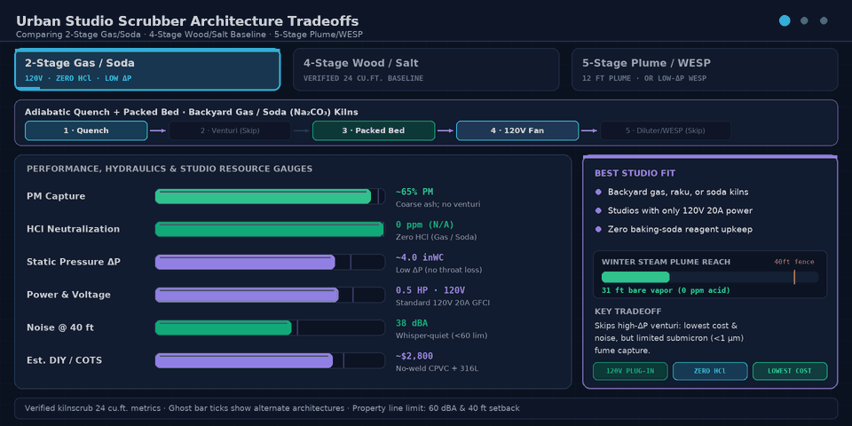

# `kilnscrub`

**Pure-Go Kiln Exhaust Scrubber Designer, CAD/BOM Exporter & Active Closed-Loop Controller**

`kilnscrub` is a zero-runtime-dependency Go (`go 1.24+`) engineering toolkit, interactive 3D/2D web studio, and hardware controller for potters and ceramic workshops firing **wood, gas, soda, salt, bituminous coal, peat/turf, and agricultural biomass** kilns. Whether you are building a quiet suburban backyard soda/salt scrubber on a `120V`/`240V` circuit, a turnkey shop-fabricated stainless/FRP system, or a **`0 W` zero-electricity brick-and-stoneware scrubber** in Mumbai, Nairobi, Khurja, Kathmandu, Lagos, Tonalá, Cusco (`3,400 m`), Cairo/Fez, or the Scottish Highlands, `kilnscrub` sizes every stage from first-principles thermochemistry and generates complete build packets.

### What `kilnscrub` Can Do

- **Full First-Principles Scrubber Sizing (10 Fuels, 6 Flue Species):** Models `wood`, `wood_salt`, `gas`, `gas_salt`, `coal`, `coal_salt`, `peat`, `peat_salt`, `biomass_ag`, and `biomass_ag_salt` (palm kernel shells, olive pomace, rice husks) using NIST 7-coefficient Shomate `Cp`/`H` (`N2`, `CO2`, `H2O`, `O2`, `HCl`, `SO2`), IAPWS-95 saturation vapor pressure, Calvert particulate `d50` capture, Eckert/Ergun packed-bed hydraulics, combined `HCl + SO2` alkali neutralization, and Verhoff–Banchero `H2SO4` sulfuric-acid dew points.
- **4 Complete Build Paths — From `$500` Off-Grid Brick to Institutional Pro Deluxe:**
  - **No-Weld DIY (`cots_no_weld`):** Bolted stainless spools, Schedule 80 CPVC / Uniseal parallel pipe bundles, potter-extruded ceramic rings, and shop-compressor air-atomization (`-$2,500` to `-$3,500+` vs. baseline).
  - **Welded Sheet Metal (`welded_dxf`):** Unfolded R12 `.dxf` fabrication cut patterns + binary `.stl` 3D meshes.
  - **Pro Deluxe (`custom_fab_deluxe`):** Back-purged TIG 316L / Alloy C-276, ANSI Class 150 flanges, filament-wound FRP column, `-22 dBA` acoustic enclosure, plus energy/water savers (**Ceramic/SiC Condensing Plume Reclaimer `150°F`**, **Variable-Throat Venturi + VFD Turndown**, and **Stage 1 Water-Jacket Pre-Cooler**).
  - **Local Ceramic / Off-Grid Masonry (`local_ceramic_masonry`, `0 W`):** All-ceramic `>1,800°F` meltdown-immune firebrick/SWG towers across **10 global urban pottery hubs** (including `3,400 m` / `66.8 kPa` Andean altitude buoyancy compensation), **Stage 0 Passive Secondary-Air Masonry Tar Afterburner (`>750°C`, `0 W`)**, **4 zero-electricity draft modes** (`natural_chimney`, quiet `6 psig` catering steamer + `4.2 m` standpipe, `20 psig` LP coil, `60 psig` certified non-IBR baby boiler), **4 waste-heat boiler & steam-pump options** (Forbes Marshall PPCP, cold-water syphon, or **High-Capture Zero-Pump Ground Sump Pools + `1.4 m` Co-Current Trough + 2-Stage Ceramic Sieve at `~96.8%` HCl / `~78%` NaCl / `0 W`**), and **5 regional alkalis** (`soda_ash`, `slaked_lime`, zero-scaling `trona_kanwa`, `$0` `wood_ash_lye`, `baking_soda`).
- **Accessible Guided Web Studio (`kilnscrub ui`, default `127.0.0.1:8888`):** Single-binary embedded Next.js 15 + React 19 + offline Three.js (`0.170.0`) app with **Guided Setup vs. All Controls** sidebar modes, a first-time **"How It Works"** 4-stage visual tour, realistic 3D cutaway & animated particle flow, detailed **2D Cutaway & P&ID Blueprint** view with SVG download, **4-chapter Build & Firing Guide** workbook (Site Readiness, COTS BOM, Step-by-Step Build Guide, interactive Firing-Day Checklist), and **Shop Plans & Cut Sheets** with 5 toggleable systems layers.
- **One-Click CAD, BOM & Tailored Build Packets (`.zip`):** Export `.stl`, `.dxf`, CSV/Markdown BOMs, or an 8–12 file Build Packet `.zip` tailored to your exact build path and control tier.
- **Active Closed-Loop PID & Fail-Safe Safety Controller (`kilnscrub daemon`):** Pure-Go PID draft and quench controller with `200°F` / `<0.25 GPM` / sensor-fault fail-open bypass interlocks, real-time SSE telemetry dashboard, built-in simulation HAL with fault injection, and industrial **Modbus RTU** hardware support.

---

## Table of Contents

- [4-Stage Scrubber Architecture](#4-stage-scrubber-architecture)
- [Engineering & Compliance Documentation](#engineering--compliance-documentation)
- [Requirements & Build](#requirements--build)
- [Studio Potter Kit (COTS, Urban Readiness & Build Packets)](#studio-potter-kit-cots-urban-readiness--build-packets)
- [CLI Reference](#cli-reference)
  - [`kilnscrub presets`](#kilnscrub-presets)
  - [`kilnscrub guide`](#kilnscrub-guide)
  - [`kilnscrub packet`](#kilnscrub-packet)
  - [`kilnscrub design`](#kilnscrub-design)
  - [`kilnscrub export`](#kilnscrub-export)
  - [`kilnscrub daemon`](#kilnscrub-daemon)
  - [`kilnscrub ui`](#kilnscrub-ui)
  - [`kilnscrub version`](#kilnscrub-version)
- [Web Dashboard & HTTP API](#web-dashboard--http-api)
- [Fabrication & Safety Guide](#fabrication--safety-guide)
- [Testing, CI & Automated Releases](#testing-ci--automated-releases)
- [Deployment (systemd)](#deployment-systemd)
- [Repository Layout](#repository-layout)
- [References](#references)
- [License](#license)

---

## 4-Stage Scrubber Architecture

Studio wood/salt firings combine extreme flue temperatures (up to `2400°F` / `1588.7 K`), submicron wood fly ash and condensed `NaCl` salt fume (`0.1–2.0 µm`), and corrosive hydrogen chloride (`HCl`) gas. `kilnscrub` models and controls a four-stage wet scrubber train protected by an aligned `200°F` (`93.3°C`) / `< 0.25 GPM` independent hardwired + software spring-return fail-safe hot-gas bypass damper (`bypass_coil_deenergize_to_trip: true` by default):


```text
                        [Fail-Safe Spring-Return Bypass Damper]
                         (Trips OPEN: >=200°F, <0.25 GPM, fault)
                           +-------------------------------+
                           |                               |
                           | (bypass on trip/power loss)   v
[Kiln Flue] ----+-----> [Stage 1] ---> [Stage 2] ---> [Stage 3] ---> [Stage 4] ---> [Stack]
 2400°F peak    |      Adiabatic       Wet Venturi    Packed-Bed     ID Blower
 Wood/Salt      |      Spray Quench    Scrubber       HCl Absorber   + VFD PID
 -0.05 inWC     |      (316L SS)       (316L SS)      + Demister     (FRP/316L)
                +----------------------------------   (CPVC / PP)
                         Interlock monitors T_out,    NaHCO3 Sump
                         spray water GPM & draft      (pH 7.5-8.5)
```

| Stage | Equipment | Material of Construction | Engineering Model & Purpose |
|---|---|---|---|
| **Stage 1** | Adiabatic Spray Quench Tower | 316L Stainless Steel | NIST 7-coeff Shomate `Cp`/`H`, IAPWS-95 `Psat`, 1D Brent adiabatic saturation balance; cools `2400°F` flue gas safely below CPVC limits (`<= 200°F`) |
| **Stage 2** | High-Velocity Wet Venturi | 316L Stainless Steel | Calvert (1970, 1972) cut diameter `d50` with Davies/Allen-Raabe Cunningham slip; captures submicron wood ash (`2400 kg/m³`) and condensed `NaCl` fume (`2160 kg/m³`) |
| **Stage 3** | Counter-Current Packed-Bed Absorber & Chevron Demister | CPVC / Polypropylene (`1"` PP Pall Rings) | Souders-Brown / Eckert flooding (`<= 75%` of flood), Ergun bed `ΔP`, NTU-HTU `HCl` absorption (`>= 98%`) with recirculating `NaHCO3` (`pH 7.5–8.5`), chevron mist eliminator |
| **Stage 4** | Induced-Draft (ID) Centrifugal Blower & VFD | FRP/PP Housing, 316L SS Wheel | Static pressure summation (`duct + quench + venturi + bed + demister + |draft|`), fan/system curves, shaft & motor HP sizing, PID draft regulation |

### Architecture Trade-Offs (1-Stage through 5-Stage & Alternatives)

Not every studio kiln needs a full 4-stage `21.2 inWC` train: **89% of total static pressure comes from Stage 2 (the high-velocity venturi)**. Clean gas and soda (`Na₂CO₃`, `0 ppm HCl`) kilns can drop the venturi for a quiet `120V` 2-stage train (`~3–4.5 inWC`), non-salt wood/foundry kilns can drop the packed bed for a 3-stage train, and cold-winter urban studios can add a 5th-stage downstream `120V` squirrel-cage plume diluter. See [`docs/ARCHITECTURE_TRADE_STUDY.md`](docs/ARCHITECTURE_TRADE_STUDY.md) for the complete decision tree, sizing boundaries, and 12 public-domain U.S. patents.



---

## Engineering & Compliance Documentation

| Document | Scope |
| :--- | :--- |
| [`docs/ENGINEERING_VALIDATION.md`](docs/ENGINEERING_VALIDATION.md) | Independent first-principles chemical engineering & physics audit (NIST Shomate, IAPWS-95, Calvert/Yung-Calvert, Sauter Ergun/Eckert GPDC, Onda mass transfer, and verified A1–A4 fixes) |
| [`docs/ARCHITECTURE_TRADE_STUDY.md`](docs/ARCHITECTURE_TRADE_STUDY.md) | 12-architecture comparison (1–5 stages, WESP, baghouse, cyclonic, ejector-venturi, impingement-plate), 12 expired public-domain U.S. patents, hard lower/upper sizing boundaries, and studio decision tree |
| [`docs/STAGE_DESIGN_OPTIONS.md`](docs/STAGE_DESIGN_OPTIONS.md) | Phase 7 builder trade study: intermittent peak salting (`salting_hours`), dry-fan downflow static eductor (`eductor_dry_fan`), parallel `4"` CPVC packed-bed manifolds, COTS sanitary mini-venturis, closed-loop sump recirculation & dump schedule, U-turn skid, and electromechanical controls |
| [`docs/BUDGET_ENGINEERING_STUDY.md`](docs/BUDGET_ENGINEERING_STUDY.md) | Phase 8 cost-engineering study: shell-less `2"`–`4"` Uniseal parallel pipe bundles (zero external large pipe shell), affordable high-head blower drives (`regen_side_channel`, `dual_bypass_blowers`, `compressor_air_atomize`), potter-extruded stoneware ceramic Raschig rings, and exact shop air compressor eductor vs. twin-fluid atomization thermodynamics |
| [`docs/CUSTOM_FAB_DELUXE_GUIDE.md`](docs/CUSTOM_FAB_DELUXE_GUIDE.md) | Phase 9 shop fabrication & installation manual: TIG back-purged 316L SS / Alloy C-276 hot stages, ANSI/ASME B16.5 Class 150 lap-joint flanges, Derakane vinyl-ester FRP absorber with bolted manway & demister cassette, UL 508A NEMA 4X wiring (NEC 110.26 / 430.102 / 430.122(A)), flooded-suction mag-drive plumbing & barometric seals (IPC 608 / 702.5), structural forklift skid & K-bracing, and `2"` Rockwool TEFC labyrinth sound baffling |
| [`docs/LOCAL_ZERO_ELECTRICITY_ENGINEERING.md`](docs/LOCAL_ZERO_ELECTRICITY_ENGINEERING.md) | Phase 10 Nairobi / Mumbai local-materials masonry & 100% zero-electricity passive scrubber engineering study: wide stoneware-packed brick tower (`0.05–0.08 inWC`), `8–12 m` thermal-reheat chimney draft (`0.20–0.29 inWC`), overhead Kentank/Sintex gravity tank & treadle/hand-pump labor budget, local alkali stoichiometry (`Na₂CO₃`, `Ca(OH)₂`, `$0` wood-ash `K₂CO₃`, `NaHCO₃`), honest `~96%` HCl / `~30%` submicron NaCl audit, and DIY welded drum-boiler explosion rejection |
| [`docs/STEAM_EJECTOR_ZERO_ELECTRICITY.md`](docs/STEAM_EJECTOR_ZERO_ELECTRICITY.md) | Phase 10B & 10C zero-electricity pressurized steam-jet ejector & hygroscopic NaCl condensation scrubbing manual: unchoked **Subsonic Quiet `6 psig` (`0.414 barg`, `324–349 m/s`, `Mach 0.69–0.74 < 1.0`, `~52 dBA @ 3 ft` via Lighthill `v⁸` reduction, `55%` NaCl, commercial catering steamer + `4.2 m` open hydrostatic water-column standpipe + drilled brass cap orifice)** alongside IAPWS-IF97 *de Laval* supersonic expansion (`20 psig` `~514–545 m/s` / `62%` NaCl vs. `60 psig` `~709–739 m/s` / `80%` NaCl at `0 W` electric), Keenan-Neumann-Lustwerk 1D momentum balance, and strict certified Non-IBR (`<= 25 L`)/KEBS/ASME steamer/boiler & PRV safety boundary |
| [`docs/PHASE13_STEAM_AND_EFFICIENCY.md`](docs/PHASE13_STEAM_AND_EFFICIENCY.md) | Phase 13 & 14 engineering & patent-FTO study: urban steam water pumps (Forbes Marshall/Spirax Sarco PPCP, cold-water steam-jet syphon), **both** Stage 1 waste-heat recovery options (`0 psig` vented feedwater preheater + ASME/IBR `≤25 L` UG-28 pressurized water jacket) and `20 psig` LP kiln exhaust monotube coil, **High-Capture Zero-Pump Flooded Sump-Pool + `1.4 m` Co-Current Drenched Trough + 2-Stage Ceramic Sieve Tray (`~96.8%` HCl / `~78%` NaCl at `0 W`, `0` pumps, `0` tower)**, and **Ceramic-Coated / Sintered-SiC Deluxe Condensing Plume Abater (`150°F` + outdoor dry-cooler)** |
| [`docs/PHASE16_GLOBAL_URBAN_POTTERY_FUELS.md`](docs/PHASE16_GLOBAL_URBAN_POTTERY_FUELS.md) | Phase 16 global urban pottery survey & solid-fuel engineering: 7 new urban/peri-urban pottery hubs (**Khurja NCR / Dhaka**, **Kathmandu / Bhaktapur**, **Lagos / Accra**, **Tonalá / Puebla**, **Cusco / Altiplano `3,400 m` / `66.8 kPa`**, **Fustat Cairo / Fez**, **Scottish Highlands / Ireland Peat**), coal/peat/ag-biomass `SO₂` + `H₂SO₄` Verhoff–Banchero dew-point physics, combined `HCl + SO₂` diprotic alkali stoichiometry including **Trona / *Kanwa* / *Tequesquite***, and **Stage 0 Passive Secondary-Air Masonry Tar Afterburner (`>750°C`, `0 W`)** |
| [`docs/CONTROL_ALTERNATIVES_AND_RPI_BOM.md`](docs/CONTROL_ALTERNATIVES_AND_RPI_BOM.md) | 5 control architectures compared (Raspberry Pi, ESP32/Opta, 1/16-DIN PID + FM Limit, CLICK Micro-PLC, pure electromechanical), complete 23-item Raspberry Pi + NFPA 86 hardwired safety relay BOM, and de-energize-to-trip wiring schematics |
| [`docs/CODE_COMPLIANCE_AUDIT.md`](docs/CODE_COMPLIANCE_AUDIT.md) | U.S. national code compliance audit (NEC / NFPA 70, IMC, NFPA 91 / 211 / 86, IPC 608 / 702.5 / 803.1, 40 CFR 403.5, OSHA 29 CFR 1910.1000 / 1910.95) and verified `C1`–`C14` resolutions |
| [`docs/TEST_COVERAGE.md`](docs/TEST_COVERAGE.md) | Automated Statement, Executable Line, and AST C1 Branch coverage report across all 8 Go packages generated by [`scripts/branch_coverage.go`](scripts/branch_coverage.go) |

---

## Requirements & Build

- **Go toolchain:** Go `1.24+` (module targets `go 1.24.13`).
- **Single-Binary Encapsulated UI (`CGO_ENABLED=0`, Zero Runtime Dependencies):** `kilnscrub` always compiles into a **single self-contained static Go executable** across Linux, macOS, and Windows (including the pure-Go Modbus RTU serial HAL and the complete **Phase 11 Next.js static UI** encapsulated via `//go:embed all:static`, with **Three.js 0.170.0 + OrbitControls bundled offline — zero CDN and zero Node.js required at runtime!**).
- **Pre-synced Static Bundle (Pure-Go Build Works Without Node.js):** Because the compiled Next.js static export is synced into `internal/web/static/`, anyone can build the full binary (`make build` or `CGO_ENABLED=0 go build ./cmd/kilnscrub`) using **only Go** with zero Node.js installed.
- **Node.js `20+` (only when modifying `web/` UI source):** To edit TypeScript/React components under `web/`, run `make web-install && make web-build` (or `make build-full`) to run `tsc --noEmit`, compile Next.js (`output: 'export'`), sync hashed static chunks into `internal/web/static/`, and re-embed them into the Go binary.
- **C compiler (test-time race detector only):** `gcc` / `build-essential` (or MinGW-w64 `gcc` on Windows) is only required when running the Go race detector (`CGO_ENABLED=1 go test -race`). Building, running, and pure-Go tests require zero C compiler and zero `make`.

### Build Performance & Optimization Notes

- **Standard pure-Go single-binary build (~3s):** `CGO_ENABLED=0 go build -trimpath -ldflags="-s -w" -o bin/kilnscrub ./cmd/kilnscrub` embeds `internal/web/static/` directly into one compact binary.
- **Full rebuild including Phase 11 Next.js static export (~15s):** `make build-full` (or `npm --prefix web run typecheck && npm --prefix web run export:go && make build`).
- **Profile-Guided Optimization (PGO) (optional):** Capture a CPU profile (`go test -cpuprofile=default.pgo ./pkg/scrubber ./pkg/cad ./pkg/studio`) and rebuild with `go build -pgo=auto` to trade extra build time for faster solver/CAD throughput.
- **Verification before release:** Run `make check` (`gofmt`, `go vet`, and `-race` tests across all 8 packages) and `make coverage-branch` (`>= 85%` executable line / `>= 72%` AST branch coverage).

### Offline Scientific Oracle Fixtures

Thermophysical and chemical engineering correlations in `pkg/thermo` and `pkg/scrubber` were validated offline against peer-reviewed Python libraries (`chemicals 1.5.2`, `fluids 1.3.1`, `scipy`) using [`scripts/generate_oracle.py`](scripts/generate_oracle.py) to produce the committed ground-truth fixture file [`testdata/oracle_fixtures.json`](testdata/oracle_fixtures.json):

- NIST 7-coefficient Shomate `Cp(T)` and `H(T) - H(298.15)` for `N2`, `CO2`, `H2O`, `O2`, `HCl` (`350–1588.15 K`)
- Lucas gas viscosity (`chemicals.viscosity.Lucas_gas`)
- IAPWS-95 water saturation vapor pressure (`300–373.15 K`)
- Ergun packed-bed pressure drop (`1"` Pall rings, voidage `0.90`, `L = 1.2 m`)
- Calvert venturi cut diameter `d50` with Cunningham slip (`NaCl` density `2160 kg/m³`)

Go unit tests read only `testdata/oracle_fixtures.json` and assert `<= 1e-6` relative tolerance — no Python environment is needed to build or test `kilnscrub`.

### Building

#### Linux / macOS (Bash)

```bash
# Static pure-Go binary for the current host
CGO_ENABLED=0 go build -trimpath -ldflags="-s -w" -o bin/kilnscrub ./cmd/kilnscrub

# Launch the Studio Potter Web UI (http://localhost:8888)
./bin/kilnscrub ui

# Or using the Makefile
make build

# Cross-compile static binaries for linux/amd64, linux/arm64, darwin/amd64, darwin/arm64, windows/amd64
make release-all

# Build reproducible packaged release archives (.tar.gz / .zip) + SHA256SUMS.txt
make release-archives
```

#### Windows (PowerShell)

No `make`, `gcc`, or Bash required — copy and paste directly into Windows PowerShell:

```powershell
# Static pure-Go binary for Windows
$env:CGO_ENABLED = "0"
go build -trimpath -ldflags="-s -w" -o bin\kilnscrub.exe .\cmd\kilnscrub

# Launch the Studio Potter Web UI (http://localhost:8888)
.\bin\kilnscrub.exe ui
```

Cross-compile from Windows PowerShell (for example, to deploy to a Raspberry Pi studio controller on `linux/arm64`) with zero `make` required:

```powershell
# Cross-compile static binary for Raspberry Pi (linux/arm64)
$env:CGO_ENABLED = "0"
$env:GOOS = "linux"
$env:GOARCH = "arm64"
go build -trimpath -ldflags="-s -w" -o dist\kilnscrub-linux-arm64 .\cmd\kilnscrub

# Reset GOOS/GOARCH so subsequent commands in this terminal target Windows again
Remove-Item Env:GOOS, Env:GOARCH
```

---

## Studio Potter Kit (COTS, Urban Readiness & Build Packets)

`kilnscrub` includes a potter-friendly Studio Kit (`pkg/studio`) layered on top of the validated 4-stage thermochemistry solver so urban ceramicists and makers can go from kiln profile to shopping list and build packet in one step:

- **5 Curated Studio Presets:** `electric_raku_6` (6 cu.ft. 120V no-weld raku/test hood), `gas_soda_14` (14 cu.ft. zero-HCl Cone 10 soda kiln), `wood_salt_24` (24 cu.ft. Cone 11 wood-salt reference), `coop_wood_48` (48 cu.ft. heavy-duty C-276/FRP community kiln), and `foundry_glass_16` (16 cu.ft. particulate-focused glass/foundry scrubber).
- **COTS Hardware Snapping (`snap_to_cots`):** Maps theoretical diameters to real off-the-shelf 316L SS / Alloy C-276 pipe spools, vacuum-rated Schedule 80 CPVC (`6"–16"`) or filament-wound FRP (`18"–30"`) packed columns (restricting HDPE drums strictly to atmospheric vented sumps), PP Pall rings, radial pressure blowers + AutomationDirect `GS21` VFDs in NEC 110.28 NEMA 4X enclosures, NEC 430.102 lockable sight disconnects, IPC 608 Air Gap / ASSE 1013 RPZ backflow preventers, and NFPA 86 hardwired `200°F` safety relay + Modbus interlock kits — automatically recalculating actual `% of Eckert flooding velocity` (`<= 75%`). Supports **No-Weld COTS** (`cots_no_weld`), **Welded Sheet Metal DXF** (`welded_dxf`), **Custom Fabrication Deluxe** (`custom_fab_deluxe`), and **Local Ceramic / Brick Masonry** (`local_ceramic_masonry`) build paths, and **Standard 316L SS (Light / Occasional)** (`standard_316l`) vs. **Heavy Duty (Alloy C-276 / Vinyl-Ester FRP)** (`heavy_c276_frp`) corrosion tiers.
- **Local Ceramic / Brick (Nairobi & Mumbai), Zero-Electricity Off-Grid & Steam-Jet Ejector Mode (`--build-path local_ceramic_masonry`, `--zero-electricity`, `--local-draft-mode`, Phases 10, 10B & 10C, see [`docs/LOCAL_ZERO_ELECTRICITY_ENGINEERING.md`](docs/LOCAL_ZERO_ELECTRICITY_ENGINEERING.md) and [`docs/STEAM_EJECTOR_ZERO_ELECTRICITY.md`](docs/STEAM_EJECTOR_ZERO_ELECTRICITY.md)):** First-principles frugal ceramic scrubber built from firebrick, IS 651 salt-glazed stoneware (SWG) pipe, potter-extruded unglazed stoneware Raschig rings, and local poly tanks — running either **100% off-grid (`0 W`)** or **local-grid/solar hybrid (`0.5 HP` `230V 50Hz` Davis & Shirtliff / Kirloskar pump + optional `12V` solar low-ΔP fan)** at `~$510–$915` (`KES` / `INR` local pricing):
  - **Wide Stoneware Bed & `>1,800°F` Ceramic Immunity:** Widening the masonry absorber shaft to `24"–26"` (`60×60` cm Mumbai / `65×65` cm high-altitude Nairobi) lowers superficial velocity to `v_s ≈ 0.34–0.40 m/s`, slashing irrigated Ergun bed drag to **`~0.05–0.08 inWC`** while fired stoneware/firebrick survives `>1,800°F` dry-run exhaust indefinitely (eliminating CPVC plastic meltdown risk).
  - **4 Zero-Electricity Velocity & Draft Tiers (`--local-draft-mode`, `0 W` Electric):**
    - **`natural_chimney` (`0 psig` Passive Thermal-Reheat Chimney):** Recovers `~10–15 kW` via a gas-tight split-firebrick flue recuperator (or chimney-base ember hearth) to reheat clean scrubbed exhaust to `300–420°F` inside an **`8–12 m` brick / IS 651 SWG chimney** (`0.20–0.29 inWC` buoyancy draft, including Nairobi `1,660 m` / `83.5 kPa` altitude adjustment). Delivers **`~96%` `HCl`**, **`~90%` coarse ash**, and **`~30%` submicron `NaCl`** capture at **`0 W`** electric.
    - **`steam_ejector_subsonic` (`6 psig` / `0.414 barg` Subsonic Quiet Steam-Jet Ejector — Whisper-Quiet `~52 dBA` Tier):** Expands `~18.5 kg/hr` unchoked subsonic steam from a factory-certified `12–15 psig` commercial hotel/catering stainless steamer/kettle (physically pressure-capped at `6.0 psig` by an unvalved **`4.2 m` open hydrostatic water-column relief standpipe** + backup `10–15 psig` brass PRV) through a simple hand-drilled **`7.6–8.0 mm` brass pipe-cap converging orifice** (no CNC *de Laval* machining needed!) at **`324–349 m/s` (`Mach 0.69–0.74 < 1.0`)**. Eliminates supersonic shock screech via Lighthill `v⁸` acoustic reduction for **`~52 dBA @ 3 ft`** quiet urban operation, shrinks the chimney to **`5.2–5.5 m`**, and drives hygroscopic condensation nucleation onto `NaCl` fume to deliver **`97.5%` `HCl`**, **`92.5%` coarse ash**, and **`55%` submicron `NaCl`** capture at **`0 W`** electric.
    - **`steam_ejector_lp` (`20 psig` / `1.38 barg` Low-Pressure Steam-Jet Ejector + Condensation Assist):** Expands `~22 kg/hr` steam from a code-rated small-bore seamless 316L monotube flash coil (`< 2 L` stored water inventory) through a `4.6–4.8 mm` machined *de Laval* nozzle at **`~514–545 m/s` (`Mach 1.09–1.16`)**, shrinking the chimney to **`4.5–5.0 m`** with no reheat hearth and driving hygroscopic condensation growth + Stefan-flow diffusiophoresis onto `NaCl` nuclei to lift capture to **`97.8%` `HCl`**, **`94%` coarse ash**, and **`62%` submicron `NaCl`** at **`0 W`** electric.
    - **`steam_ejector_hp` (`60 psig` / `4.14 barg` Certified Baby Boiler Hydro-Sonic Ejector):** Expands `~54 kg/hr` steam from a factory-certified **Non-IBR (`<= 25 L`) / KEBS / ASME commercial baby steam boiler** through a `5.0–5.1 mm` *de Laval* nozzle at **`~709–739 m/s` (`Mach 1.49–1.56`)**, shearing gravity-fed scrub water into `14–30 µm` micro-droplets + condensation nucleation to achieve **`98.5%` `HCl`**, **`96.5%` coarse ash**, and **`80%` submicron `NaCl`** capture at **`0 W`** electric (approaching an industrial electric venturi).
  - **Mandatory Certified-Steamer/Boiler & Standpipe/PRV Safety Boundary:** **Uncertified DIY welded steel drum boilers or converted LPG cylinders remain 100% REJECTED** due to lethal flashing-water BLEVE blast energy (`253 kJ` / `60 g TNT` equivalent at `30 psig`, `579 kJ` at `60 psig`). Subsonic `6 psig` mode requires a factory-certified `12–15 psig` commercial catering stainless steamer fitted with **both** an unvalved `4.2 m` open hydrostatic water-column relief standpipe (`S2`, physically capping pressure at `6.0 psig` with zero moving parts) and a backup `10–15 psig` brass PRV; LP/HP steam modes strictly require code-rated small-bore (`< 2 L`) seamless monotube flash coils or factory-certified commercial baby boilers (`<= 25 L` Non-IBR / KEBS / ASME) equipped with a stamped ASME/IBR/KEBS spring-loaded PRV (`<= MAWP`), `1.5× MAWP` cold hydrostatic proof test, pressure gauge on brass siphon, feedwater check valve, insulated steam header `S1`, and an open atmospheric `0 psig` feedwater tank.
  - **Overhead Kentank / Sintex Gravity Tank & Manual/Hybrid Pumping:** Elevated `210–500 L` overhead tank on a diagonally braced `3.5 m` (`11.5 ft`, `~5 PSI`) stand feeds a clog-proof gravity trickle pan (`4–6 L/min`), refilled via **`~6–12 min/hr`** on a MoneyMaker treadle or cast-iron semi-rotary hand wing pump (`0 W`) — or switched to a local `0.5 HP` `230V 50Hz` domestic monoblock pump with automatic `45–60 min` blackout gravity ride-through.
  - **Local Alkalis (`--local-alkali`):** Models exact stoichiometry and local pricing for **Lake Magadi / Mumbai Washing Soda (`soda_ash`, `Na₂CO₃`)**, **Slaked Lime / Chuna (`slaked_lime`, `Ca(OH)₂` with honest `CO₂`→`CaCO₃` scaling mitigation)**, **`$0` Potter's Own Wood-Ash Potash Lye (`wood_ash_lye`, `K₂CO₃`)**, and **Bulk Baking Soda (`baking_soda`, `NaHCO₃`)**.
- **Custom Fabrication Deluxe Mode (`--build-path custom_fab_deluxe`, Phase 9, see [`docs/CUSTOM_FAB_DELUXE_GUIDE.md`](docs/CUSTOM_FAB_DELUXE_GUIDE.md)):** Institutional/production-grade turnkey shop-fabricated specification (available via CLI `--build-path custom_fab_deluxe` or 1-click **Apply Custom Fab Deluxe** in the web UI):
  - **TIG / FRP / ANSI Flanged Hardware:** Back-purged TIG-welded heavy-gauge 316L SS or Alloy C-276 hot stages with machined **ANSI/ASME B16.5 Class 150** lap-joint flanges + PTFE envelope gaskets, `2×` flanged borosilicate sight glasses, `2×` bolted NFPA 91 quick-release cleanout doors, `1"` ceramic-fiber + SS hot-flue insulation jacket, filament-wound Derakane vinyl-ester FRP absorber column with bolted packing access manway & removable 3-pass chevron cassette, welded `2"×2"×3/16"` structural steel forklift skid, UL 508A NEMA 4X pre-wired control panel, and flooded-suction magnetic-drive chemical recirculation pump (`+$6,447` delta on `wood_salt_24` vs. baseline No-Weld COTS).
  - **Acoustic Baffling (`-22 dBA` Total Attenuation):** Adds a `2"` Rockwool TEFC Z-labyrinth blower baffle box on neoprene isolation mounts (`-9 dBA` extra attenuation on top of the tuned stack silencer, dropping `wood_salt_24` from `78.7 → 56.7 dBA @ 3 ft` and **`34.2 dBA @ 40 ft`** property line).
  - **Full Systems Installation Plan Viewer & 3D WebGL Skid/Pump/Baffling Overlay:** Populates `shop_plan.json` and the browser **Shop Plans & Cut Sheets** tab with **5 toggleable visual SVG layers** (**Electrical & Wiring**, **Pumps & Hosing**, **Bracing & Mounting**, **Clearances & Codes**, **Sound Baffling**) across both Elevation and Plan views, **4 engineering schedule tables** (Electrical Circuits, Pumps & Plumbing/Hosing, Structural Bracing & Anchors, Sound Baffling & dBA Budget), and a toggleable **3D WebGL Skid, Pump & Baffling** overlay in the 3D Studio viewport.
- **Selectable Stage Design & Cost-Saving Options (Phase 7):** Mix and match trade-study architectures with live BOM cost deltas, footprint savings, and physics recalculation (see [`docs/STAGE_DESIGN_OPTIONS.md`](docs/STAGE_DESIGN_OPTIONS.md)):
  - **Stage Alignment:** `inline_id_blower` (negative-pressure wet ID blower) vs. `eductor_dry_fan` (dry ambient radial fan driving a vertical downflow static venturi eductor + `90°` cyclonic sweep elbow into an enlarged Stage 3 packed bed — eliminates wet-blower corrosion and adds `~40°F` CPVC thermal margin; outdoor-only due to positive bed pressure).
  - **Packed-Bed Layout:** `single_column` vs. `parallel_manifold` (shell-less Uniseal flat-plate bundle of parallel `2"`, `3"`, or `4"` stock plumbing pipes with zero external large pipe shell or LTL freight; `4"` sweet spot keeping `D/d_p >= 7.5` and balanced multi-port top liquid distribution, with Sch 40 PVC unlocked only when dry-fan eductor mixing cools Stage 3 `<= 140°F`).
  - **Venturi Layout:** `single_throat` vs. `parallel_mini_venturis` (`2–4` off-the-shelf 316L sanitary concentric reducer throats with tri-clamp cleanout & staged turndown, plus wood-ash plugging risk check).
  - **Skid & Controls:** Compact U-turn folded skid (`~47%` shorter linear length), shared baffled sump (`70–85%` water savings vs. once-through), and `rpi_modbus` vs. `electromechanical_only` controls (preserving mandatory NFPA 86 hardwired `200°F` snap-disc & `0.25 GPM` flow interlocks).
- **Budget Studio Engineering Options (Phase 8, see [`docs/BUDGET_ENGINEERING_STUDY.md`](docs/BUDGET_ENGINEERING_STUDY.md)):** Cuts the reference 24 cu.ft. `wood_salt_24` COTS build by `$2,500–$3,500+` while preserving 100% of NEC/IMC/IPC/NFPA 86 safety protections:
  - **Affordable High-Push Blower Drives (`--blower-drive`):** Compare baseline `industrial_radial_vfd` against `regen_side_channel` (cast-aluminum regenerative ring blower, dry-side recommended), `dual_bypass_blowers` (2× parallel 3-stage Ametek Lamb tangential bypass blowers ~$420), `compressor_air_atomize` (`$75` twin-fluid `25 µm` air-atomizing nozzle + low-ΔP cast-aluminum radial blower), and `compressor_eductor_only` (honest feasibility check).
  - **Shop Compressor Air-Atomize vs. Main Eductor Math (`--compressor-scfm`):** Always evaluated side-by-side on every design — proves why a studio `5 HP / 15 SCFM` compressor **cannot** drive main scrubber airflow via an air-amplifier eductor on a 24 cu.ft. kiln (backpressure collapses entrainment, needing `~68–170 SCFM` / `15–45 HP`), whereas using **`4–6 SCFM @ 40 PSI`** for a `25 µm` twin-fluid venturi nozzle cuts venturi ΔP by `~9–10 inWC` (`21.2 -> ~11.8 inWC`) and saves **`$1,000+`** on the Stage 4 blower!
  - **Packing Media Choices (`--packing-media`):** Swap commercial `pp_pall_rings` for bulk `aquaculture_bioballs` (`$38/ft³`) or potter-extruded kiln-fired **`diy_ceramic_rings`** (`$18/ft³` stoneware Raschig rings — acid-proof & `2000°F`-proof, with honest irrigated Ergun ΔP and reinforced support-grate weight check).
  - **1-Click Budget Studio Combo:** Available right in the web dashboard (`Apply Budget Studio Combo`) to select the shell-less `4"` parallel Uniseal bundle, DIY ceramic rings, shop-compressor air-atomizing low-ΔP blower, compact U-turn skid, shared sump, and electromechanical NFPA 86 controls in one click.
- **Bulk Baking Soda & Closed-Loop Sump Recirculation:** Sizes bulk **`15 lb` bags / `50 lb` sacks** of `NaHCO₃` strictly to the active peak salting window (`salting_hours`, default `3.0 hrs` on `wood_salt_24` → `~9.8 lbs` / `1 × 15 lb` bag, with a `50 lb` sack covering `~5` firings), models multi-firing TDS accumulation (`150 g/L` / **`SG >= 1.105`** brine hydrometer dump trigger for `5–6` firings per dump), and enforces IPC 702.5 `<= 140°F` drain cooldown and 40 CFR 403.5 `pH 6.5–8.5` (`>= 5.0` floor).
- **Urban Neighbor & Backyard Readiness:** Evaluates 6 U.S. code-aligned site checks — NEC 430.122(A) 125% VFD single-phase electrical ampacity (`120V` vs `240V` + plume diluter amps), garden-hose water demand + mandatory IPC 608 backflow isolation, inverse-square property-line noise (`dBA` vs `60 dBA` daytime / `50–55 dBA` overnight + OSHA 29 CFR 1910.95 `85 dBA` near-field warning), bulk `NaHCO₃` & neutralized drain compliance, practical alloy care & buffered flush guidance for `Standard 316L SS (Light / Occasional)` vs. `Heavy Duty (Alloy C-276 / Vinyl-Ester FRP)`, and cold-weather steam plume visibility with IMC 510/501.3.1 & OSHA 29 CFR 1910.1000 HCl stack setbacks.
- **Squirrel-Cage High-Velocity Plume Calculator:** Models psychrometric mixing lines using IAPWS-95 `WaterPsat` to report bare vs. diluted horizontal winter plume reach (`bare_plume_length_ft` -> `diluted_plume_length_ft`) against your property-line setback, sizes a downstream `120V` squirrel-cage dilution blower + high-velocity exit cone (`~3,400 FPM`), and computes tangent-clear kiln-jacket waste-heat recovery (`kW`).
- **One-Click Tailored Build Packet (`.zip`):** Automatically adapts packet contents to the selected build path and control tier:
  - **Electric + RPi Modbus (12 files):** `BUILD_GUIDE.md`, `OPERATIONS_CHECKLIST.md`, `bom_cots.md`, `bom_cots.csv`, `bom_engineered.csv`, `scrubber.stl`, `scrubber.dxf`, `shop_plan.svg`, `shop_plan.json`, `project.json`, `daemon.json`, and `README_PACKET.txt`.
  - **Electric + Electromechanical Only (11 files):** Omits `daemon.json` (hardwired safety relay panel only).
  - **Local Ceramic / Off-Grid Masonry (8 files):** Omits inapplicable sheet-metal `.stl`/`.dxf`/`bom_engineered.csv` and electric `daemon.json`, bundling the tailored standalone architectural schematic `shop_plan.svg`, `shop_plan.json`, local `bom_cots.csv`/`.md`, masonry `BUILD_GUIDE.md`, `OPERATIONS_CHECKLIST.md`, `project.json`, and `README_PACKET.txt`.

---

## CLI Reference

```text
kilnscrub - Pure-Go Kiln Exhaust Scrubber Designer & Active Controller

Usage:
  kilnscrub <command> [flags]

Commands:
  design   Size a 4-stage kiln exhaust scrubber from firing parameters
  export   Export fabrication .stl mesh, unfolded .dxf patterns, and BOM
  presets  List curated studio kiln presets (ID, profile, audience, badge)
  guide    Evaluate COTS hardware, urban readiness, and Build/Firing Guides
  packet   Generate a tailored Studio Build Packet (.zip)
  daemon   Run the closed-loop PID draft & quench safety controller
  ui       Launch the interactive 4-tab web dashboard (default 127.0.0.1:8888)
  version  Print the kilnscrub version
```

> **Windows PowerShell tip:** Invoke `.\bin\kilnscrub.exe` instead of `kilnscrub` (or add `.\bin` to your `PATH`). All subcommands and flags below work identically in Windows PowerShell, Linux, and macOS.

### `kilnscrub presets`

Lists all 5 curated studio presets (`ID`, `Name`, `Badge`, `Audience`, `Tagline`) or emits machine-readable JSON (`--json`).

```bash
kilnscrub presets
kilnscrub presets --json
```

### `kilnscrub guide`

Evaluates a preset (`--preset`, default `wood_salt_24`) or saved `project.json` (`--project`), prints the COTS + Stage Options + Closed-Loop Recirculation + Shop Plan + Urban Readiness summary (including bulk `15 lb` / `50 lb` baking soda over `salting_hours` and bare vs. squirrel-cage diluted plume reach), and either prints the tailored Markdown Build Guide to stdout or writes `BUILD_GUIDE.md` and `OPERATIONS_CHECKLIST.md` to `--out <dir>`.

**Optional Phase 7–10 Build Path, Stage, Budget & Local/Off-Grid Flags (shared by `guide` and `packet`):**

| Flag | Values / Default | Description |
|---|---|---|
| `--build-path` | `cots_no_weld` \| `welded_dxf` \| `custom_fab_deluxe` \| `local_ceramic_masonry` | Fabrication build path (No-Weld COTS, Welded Sheet Metal DXF, Custom Fabrication Deluxe TIG/FRP/Acoustic Skid, or Nairobi/Mumbai Local Ceramic & Brick Masonry) |
| `--zero-electricity` | `false` \| `true` | Zero electricity on site (passive thermal-reheat brick chimney draft + manual overhead gravity tank; implies `local_ceramic_masonry`) |
| `--local-region` | `nairobi` \| `mumbai` \| `khurja_dhaka` \| `kathmandu` \| `lagos_accra` \| `tonala_puebla` \| `cusco_andes` \| `cairo_fez` \| `highland_peat` \| `general_local` | Global urban pottery hub, altitude/barometric pressure (`66.8–101.3 kPa`), ambient temperature, local hardware brands, and currency (`KES`, `INR`, `NPR`, `NGN`, `MXN`, `PEN`, `EGP`, `GBP`, `USD`) |
| `--local-alkali` | `soda_ash` \| `slaked_lime` \| `trona_kanwa` \| `wood_ash_lye` \| `baking_soda` | Local neutralizing alkali for combined `HCl + SO₂` (`Na₂CO₃` Magadi/washing soda, `Ca(OH)₂` chuna/cal/gir, natural `Na₂CO₃·NaHCO₃·2H₂O` Trona/*Kanwa*/*Tequesquite*, `$0` wood-ash `K₂CO₃` lye, or `NaHCO₃`) |
| `--local-draft-mode` | `natural_chimney` \| `steam_ejector_subsonic` \| `steam_ejector_lp` \| `steam_ejector_hp` *(default `natural_chimney`)* | Passive velocity/draft driver for `local_ceramic_masonry` (`0 psig` chimney `~30%` NaCl vs. `6 psig` subsonic quiet `~52 dBA` / `55%` NaCl vs. `20 psig` LP coil `62%` NaCl vs. `60 psig` certified baby boiler `80%` NaCl at `0 W` electric) |
| `--local-boiler-source` | `dedicated_hearth` \| `stage1_feedwater_preheater` \| `stage1_water_jacket` \| `kiln_exhaust_coil` | Phase 13/14 steam boiler heat source (dedicated firebox, `0 psig` vented Stage 1 feedwater preheater safe on `6/20/60 psig`, ASME/IBR `≤25 L` UG-28 Stage 1 pressurized water jacket, or `20 psig` LP SiC-muffled `<2 L` flue coil; see [`docs/PHASE13_STEAM_AND_EFFICIENCY.md`](docs/PHASE13_STEAM_AND_EFFICIENCY.md)) |
| `--local-pump-mode` | `manual_treadle` \| `steam_ppcp` \| `steam_jet_syphon` \| `sump_pool_no_pump` | Phase 13/14 off-grid water drive (manual treadle/hand pump, `>=20 psig` Forbes Marshall/Spirax PPCP hot-sump auto-recirc, cold-makeup steam-jet syphon, or `60 psig` **High-Capture Zero-Pump Ground Sump Pools + `1.4 m` Co-Current Trough + 2-Stage Ceramic Sieve** at `~96.8%` HCl / `~78%` NaCl / `0 W`) |
| `--local-afterburner` | `false` \| `true` | Phase 16 Stage 0 passive secondary-air firebrick checkerwork smoke-burner / tar afterburner (`>750°C`, `0 W`, `+0.015 inWC`) + Pool #1 tar-skimming weir (cracks `70–85%` of coal/peat/PKS tars before Stage 1; see [`docs/PHASE16_GLOBAL_URBAN_POTTERY_FUELS.md`](docs/PHASE16_GLOBAL_URBAN_POTTERY_FUELS.md)) |
| `--deluxe-condensing-reclaimer` | `false` \| `true` | Phase 13/14 Deluxe upgrade (`+$2,850`): ceramic-coated / sintered-SiC condensing plume abater (`150°F` + outdoor dry-cooler + CPVC acidic condensate return; `~55–68%` evap water reclaimed, `>70%` winter plume reduction) |
| `--deluxe-variable-throat-vfd` | `false` \| `true` | Phase 13 Deluxe upgrade (`+$1,450`): auto variable-throat venturi + VFD turndown (`~55–68%` blower kWh saved, `-10 dBA` off-peak) |
| `--deluxe-stage1-heat-recovery` | `false` \| `true` | Phase 13 Deluxe upgrade (`+$1,650`): Stage 1 water-jacketed quench pre-cooler & studio heat reclaimer (`~40%` less evap water + `~18–35 kW` heat) |
| `--salting-hours` | *(preset default, e.g. `3.0`)* | Active peak salting window in hours (`2–4 hrs` typical in salt mode) |
| `--alignment` | `inline_id_blower` \| `eductor_dry_fan` | Inline wet ID blower vs. dry-fan vertical downflow static eductor |
| `--bed-layout` | `single_column` \| `parallel_manifold` | Single large packed column vs. shell-less Uniseal parallel pipe manifold |
| `--parallel-pipe-in` | `2` \| `3` \| `4` *(default `4`)* | Nominal pipe size (inches) for the shell-less parallel manifold bundle (`4"` sweet spot) |
| `--packing-media` | `pp_pall_rings` \| `aquaculture_bioballs` \| `diy_ceramic_rings` | Stage 3 packing media (commercial PP Pall rings, bulk bio-balls, or DIY kiln-fired stoneware rings) |
| `--venturi-layout` | `single_throat` \| `parallel_mini_venturis` | Single venturi throat vs. `2–4` parallel COTS sanitary mini-venturis |
| `--blower-drive` | `industrial_radial_vfd` \| `regen_side_channel` \| `dual_bypass_blowers` \| `compressor_air_atomize` \| `compressor_eductor_only` | Stage 4 prime-mover / blower drive option and shop-compressor eductor feasibility check |
| `--compressor-scfm` | *(default `15`)* | Existing studio shop air compressor capacity (`SCFM @ 90 PSI`) for eductor vs. air-atomize math |
| `--compact` | `false` \| `true` | Fold skid into a compact U-turn footprint (`~47%` shorter linear length) |
| `--controls` | `rpi_modbus` \| `electromechanical_only` | Raspberry Pi Modbus telemetry vs. pure hardwired electromechanical NFPA 86 safety |

```bash
kilnscrub guide --preset gas_soda_14
kilnscrub guide --preset wood_salt_24 --out ./studio-guides
kilnscrub guide --preset wood_salt_24 --build-path custom_fab_deluxe
kilnscrub guide --preset wood_salt_24 --build-path local_ceramic_masonry --zero-electricity --local-region nairobi --local-alkali soda_ash
kilnscrub guide --preset wood_salt_24 --build-path local_ceramic_masonry --zero-electricity --local-region nairobi --local-alkali soda_ash --local-draft-mode steam_ejector_subsonic
kilnscrub guide --preset wood_salt_24 --build-path local_ceramic_masonry --zero-electricity --local-region nairobi --local-alkali soda_ash --local-draft-mode steam_ejector_lp
kilnscrub guide --preset wood_salt_24 --build-path local_ceramic_masonry --zero-electricity --local-region mumbai --local-alkali slaked_lime --local-draft-mode steam_ejector_hp
kilnscrub guide --preset wood_salt_24 --salting-hours 3.0 --alignment eductor_dry_fan --bed-layout parallel_manifold --compact --controls electromechanical_only
kilnscrub guide --preset wood_salt_24 --blower-drive compressor_air_atomize --bed-layout parallel_manifold --parallel-pipe-in 4 --packing-media diy_ceramic_rings --compressor-scfm 15 --controls electromechanical_only
kilnscrub guide --project ./my-studio-project.json --out ./studio-guides
```

### `kilnscrub packet`

Generates a tailored Build Packet `.zip` archive (8–12 files depending on build path & control tier, always including `shop_plan.svg` and `shop_plan.json` with full electrical, plumbing, bracing, acoustic, Deluxe, and Local Ceramic / Off-Grid specs) from a preset (`--preset`) or saved `project.json` (`--project`), accepting all optional Phase 7–10 build-path, stage, budget, and local/off-grid flags above.

```bash
kilnscrub packet --preset wood_salt_24 --out ./kilnscrub-wood_salt_24-packet.zip
kilnscrub packet --preset wood_salt_24 --build-path custom_fab_deluxe --out ./deluxe-packet.zip
kilnscrub packet --preset wood_salt_24 --build-path local_ceramic_masonry --zero-electricity --local-region nairobi --local-alkali soda_ash --out ./nairobi-offgrid-packet.zip
kilnscrub packet --preset wood_salt_24 --build-path local_ceramic_masonry --zero-electricity --local-region nairobi --local-alkali soda_ash --local-draft-mode steam_ejector_subsonic --out ./nairobi-steam-subsonic-packet.zip
kilnscrub packet --preset wood_salt_24 --build-path local_ceramic_masonry --zero-electricity --local-region nairobi --local-alkali soda_ash --local-draft-mode steam_ejector_lp --out ./nairobi-steam-lp-packet.zip
kilnscrub packet --preset wood_salt_24 --build-path local_ceramic_masonry --zero-electricity --local-region mumbai --local-alkali slaked_lime --local-draft-mode steam_ejector_hp --out ./mumbai-steam-hp-packet.zip
kilnscrub packet --preset wood_salt_24 --blower-drive compressor_air_atomize --bed-layout parallel_manifold --parallel-pipe-in 4 --packing-media diy_ceramic_rings --compressor-scfm 15 --controls electromechanical_only --out ./budget-packet.zip
kilnscrub packet --project ./my-studio-project.json --out ./my-build-packet.zip
```

### `kilnscrub design`

Sizes all four scrubber stages from kiln firing parameters (optionally seeded by `--preset <id>` or `--project <path.json>`) and prints either a formatted engineering summary or the full `ScrubberDesign` JSON document.

**Flags:**

| Flag | Default | Description |
|---|---|---|
| `--preset` | *(none)* | Optional studio preset ID to seed sizing parameters |
| `--project` | *(none)* | Optional path to a saved `StudioProject` `project.json` file |
| `--kiln-volume` | `24` | Kiln interior volume (`cu.ft.`) |
| `--peak-temp` | `2400` | Peak kiln exit gas temperature (`°F`) |
| `--salt-rate` | `2.0` | `NaCl` salt introduction rate (`lbs/hr`) |
| `--fuel` | `wood_salt` | Fuel stoichiometry: `wood_salt`, `wood`, `gas_salt`, `gas` |
| `--throat-vel` | `70` | Venturi throat gas velocity (`m/s`, typical `50–90 m/s`) |
| `--lg` | `0.0012` | Venturi liquid-to-gas volumetric ratio (`m³/m³`) |
| `--hcl-removal` | `0.99` | Target fractional `HCl` removal efficiency in `(0, 1)` |
| `--draft` | `-0.05` | Target kiln draft setpoint (`inWC`, negative = suction) |
| `--json` | `false` | Output complete `ScrubberDesign` as indented JSON |

**Example (24 cu.ft. Reference Wood/Salt Kiln):**

```bash
kilnscrub design --kiln-volume 24 --peak-temp 2400 --salt-rate 2.0
```

**Sample Output:**

```text
Kiln Scrub 4-Stage Engineering Summary
======================================
Kiln Input : 24.0 cu.ft. | Peak 2400 F | Salt 2.00 lbs/hr | Fuel wood_salt | Draft -0.050 inWC
Inlet Gas  : 579.2 ACFM (0.0610 kg/s) @ 2400 F | Quenched: 255.9 ACFM @ 183.9 F

Stage 1 - Adiabatic Quench Tower (316L Stainless Steel)
  Tsat / Outlet / Dew Point : 183.9 F (357.5 K) / 183.9 F / 183.9 F
  Spray Water               : 0.58 GPM evap | 1.16 GPM total (2.0x overspray, 2 nozzles)
  Geometry & dP             : D=0.350 m (13.8 in) x H=2.400 m (7.87 ft) | dP=0.41 inWC (102 Pa)

Stage 2 - Wet Venturi Scrubber (316L Stainless Steel)
  Throat & Spray            : D_th=0.047 m (1.85 in) | v_th=70.0 m/s | L/G=0.0012 (2.30 GPM)
  Calvert d50               : NaCl fume 0.214 um | Wood ash 0.199 um
  Overall Capture & dP      : NaCl 84.2% | Wood ash 96.5% | dP=18.88 inWC (4703 Pa)

Stage 3 - Packed-Bed HCl Absorber & Demister (CPVC / Polypropylene)
  Column & Packing          : D=0.300 m (11.8 in) x H=2.950 m (9.68 ft) | Z_pack=1.050 m (1" PP Pall Rings)
  Hydraulics & HCl Removal  : 55.5% of flood | HCl 99.04% (1048 -> 10.0 ppm) | NaHCO3 1.49 kg/hr | Recirc 5.36 GPM
  Pressure Drop             : Bed 1.44 inWC + Demister 0.26 inWC = 1.70 inWC (425 Pa)

Stage 4 - Induced-Draft Blower (FRP / Polypropylene Housing, 316L SS Wheel)
  Duty Point                : 269.7 ACFM @ 21.21 inWC (5284 Pa) | Kiln draft setpoint -0.050 inWC
  dP Breakdown (inWC)       : Duct 0.17 | Quench 0.41 | Venturi 18.88 | Bed 1.44 | Demister 0.26 | Draft 0.05
  Power & Wheel             : 1.45 shaft HP -> 2.00 HP motor (eta 62%) | Wheel 0.640 m (25.2 in) @ 3510 RPM

Skid Envelope               : L=3.62 m x W=1.36 m x H=3.25 m (11.9 x 4.5 x 10.7 ft) | Duct D=0.178 m (7.0 in) | Area=4.92 m2
Warnings                    : none
```

Emit machine-readable JSON for downstream tooling:

```bash
kilnscrub design --kiln-volume 24 --peak-temp 2400 --salt-rate 2.0 --json > design.json
```

---

### `kilnscrub export`

Generates fabrication deliverables from the sized scrubber design:

- `scrubber.stl` — Binary STL 3D assembly mesh in millimeters with outward unit normals.
- `scrubber.dxf` — AutoCAD R12 DXF with unfolded sheet-metal cylinder wraps and exact frustum/cone developments for the venturi converging/diverging transitions.
- `bom.csv` — Spreadsheet-ready Bill of Materials with quantities, materials, total line-item weights (`kg`), and budgetary USD estimates.
- `bom.md` — Formatted Markdown Bill of Materials with fabrication and safety notes.

**Flags:**

Accepts all sizing flags from `kilnscrub design` (`--preset`, `--project`, `--kiln-volume`, `--peak-temp`, `--salt-rate`, `--fuel`, `--throat-vel`, `--lg`, `--hcl-removal`, `--draft`) plus:

| Flag | Default | Description |
|---|---|---|
| `--out` | `.` | Output directory for `scrubber.stl`, `scrubber.dxf`, `bom.csv`, and `bom.md` |

**Example:**

```bash
kilnscrub export --kiln-volume 24 --peak-temp 2400 --salt-rate 2.0 --out ./out
```

**Sample Output:**

```text
wrote out/scrubber.stl (332484 bytes)
wrote out/scrubber.dxf (14847 bytes)
wrote out/bom.csv (3553 bytes)
wrote out/bom.md (5066 bytes)
BOM summary: 18 items | 306.2 kg total | $9142.60 est. USD
```

---

### `kilnscrub daemon`

Runs the active closed-loop PID controller managing:
- **Kiln draft loop:** Low-pass filtered (`0.5 Hz` / `318.3 ms`) differential pressure feedback driving the blower VFD (`0–100%`) via anti-windup PID.
- **Quench cooling loop:** Quench outlet RTD feedback driving the modulating spray water valve (`0–100%`) via anti-windup PID.
- **Fail-safe bypass interlock:** Continuously evaluates sensor validity, quench outlet temperature, spray water flow, and draft magnitude before applying actuator commands.

**Flags:**

| Flag | Default | Description |
|---|---|---|
| `--config` | *(none)* | Path to JSON daemon configuration file (e.g., `configs/kilnscrub.example.json`) |
| `--hal` | `sim` | Hardware abstraction layer backend: `sim` (built-in kiln/scrubber plant simulator) or `modbus` (pure-Go Modbus RTU over RS-485 serial) |
| `--draft` | `-0.05` | Target kiln draft setpoint (`inWC`, negative = suction) |
| `--quench-temp-f` | `188.0` | Target quench outlet temperature setpoint (`°F`, above `183.9°F` adiabatic saturation floor) |
| `--interval` | `100ms` | Closed-loop control tick interval |
| `--log-interval` | `0` | Optional stdout telemetry log throttle interval (`0` = log every tick; always logs state/interlock transitions immediately) |
| `--duration` | `0` | Optional bounded run duration (`0` = run until `SIGINT`/`SIGTERM`) |

**Examples:**

```bash
# Quick simulation smoke run (350 ms)
kilnscrub daemon --hal sim --duration 350ms

# Production controller driven by JSON config and Modbus RTU serial HAL
kilnscrub daemon --config configs/kilnscrub.example.json --hal modbus
```

**Sample Output (Simulation Mode):**

```text
kilnscrub daemon starting (for 350ms, hal=sim): target_draft=-0.050 inWC (-12.45 Pa) quench_sp=188.0 F interval=100ms
tick=1 state=NORMAL draft=-0.0500 inWC (-12.45 Pa) quench_out=188.0 F water=1.00 GPM vfd=40.5% valve=44.0% bypass=false
tick=2 state=NORMAL draft=-0.0500 inWC (-12.45 Pa) quench_out=187.9 F water=1.03 GPM vfd=40.5% valve=43.9% bypass=false
tick=3 state=NORMAL draft=-0.0499 inWC (-12.44 Pa) quench_out=187.9 F water=1.05 GPM vfd=40.6% valve=43.7% bypass=false
tick=4 state=NORMAL draft=-0.0499 inWC (-12.42 Pa) quench_out=187.7 F water=1.06 GPM vfd=40.7% valve=43.5% bypass=false
kilnscrub daemon stopped cleanly after 4 ticks (final state=NORMAL, interlock=false)
```

#### Fail-Safe Interlock Limits


| Condition | Default Threshold | Trip Code | Action |
|---|---|---|---|
| **Independent Hardwired CPVC High-Limit** *(NFPA 86)* | `>= 200.0°F` (`93.3°C`) manual-reset snap-disc | *(Hardwired `K_SAFE`)* | **Primary hardwired trip:** de-energizes 24VDC safety relay, springs bypass damper OPEN & cuts VFD STO/Run-Enable independently of software |
| **High Quench Outlet Temp** *(Aligned Software Cutoff)* | `>= 200.0°F` (`366.48 K`) | `HIGH_QUENCH_OUTLET_TEMP` | **Hard latch:** opens hot-gas bypass damper & latches alarm |
| **Quench Water Loss** | `< 0.25 GPM` (`1.577e-5 m³/s`) | `QUENCH_WATER_LOSS` | **Hard latch:** opens hot-gas bypass damper & latches alarm |
| **Sensor Fault / Stale Telemetry** | HAL read/write error, `NaN`/`Inf`, open-TC/under-range (`< 32°F`), Modbus CRC/timeout/exception, or timestamp age `> 5s` | `SENSOR_FAULT` | **Hard latch:** opens hot-gas bypass damper & latches alarm |
| **Excessive Draft Magnitude** | `|draft| > 1.0 inWC` (`248.84 Pa`) | `EXCESSIVE_DRAFT` | **Hard latch:** opens hot-gas bypass damper & latches alarm |
| **Sump pH Excursion** | `< 6.5` or `> 9.5` | *(Warning only)* | **Warning/alarm only:** alerts operator for `NaHCO3` dosing; does **not** open hot-gas bypass damper |

Hard interlock trips latch `BypassDamperOpen = true` and `AlarmLatched = true` (`bypass_coil_deenergize_to_trip: true` is enabled by default for fail-safe active-low PLC relay coils, and `daemon` issues a best-effort fail-safe write on clean shutdown). Clearing a latch requires **both** that all hard faults have cleared in the latest sensor evaluation **and** an explicit operator reset (`ResetInterlock()` / `POST /api/control/reset`). See [`docs/CONTROL_ALTERNATIVES_AND_RPI_BOM.md`](docs/CONTROL_ALTERNATIVES_AND_RPI_BOM.md) for full hardwired NFPA 86 safety relay wiring diagrams.

---

### `kilnscrub ui`

Launches the embedded single-binary HTTP dashboard on `http://127.0.0.1:8888` (loopback-only by default for local safety; pass `--addr 0.0.0.0:8888` when intentionally exposing on a trusted studio LAN, with same-origin CSRF guards and clickjacking headers enabled). By default, an embedded `control.Daemon` starts in the background (using `SimHAL` unless `--config` / `--hal modbus` selects Modbus RTU) so the **Live Control & Telemetry** tab streams live SSE telemetry immediately.

**Flags:**

| Flag | Default | Description |
|---|---|---|
| `--addr` | `127.0.0.1:8888` | HTTP listen address (`127.0.0.1:8888` loopback default; pass `0.0.0.0:8888` for LAN) |
| `--config` | *(none)* | Path to JSON daemon configuration file for embedded live control |
| `--hal` | `sim` | Embedded control HAL backend: `sim` or `modbus` |
| `--no-control` | `false` | Disable embedded live control daemon and telemetry backend |

**Examples (Linux / macOS Bash):**

```bash
# Dashboard with live simulated control & SSE telemetry out of the box
kilnscrub ui --addr 127.0.0.1:8888

# Dashboard backed by config file / Modbus RTU hardware
kilnscrub ui --addr 127.0.0.1:8888 --config configs/kilnscrub.example.json

# Design-only mode without live control backend
kilnscrub ui --addr 127.0.0.1:8888 --no-control
```

**Examples (Windows PowerShell):**

```powershell
# Dashboard with live simulated control & SSE telemetry out of the box (http://localhost:8888)
.\bin\kilnscrub.exe ui

# Bind to localhost only, or disable the embedded live control backend
.\bin\kilnscrub.exe ui --addr 127.0.0.1:8888
.\bin\kilnscrub.exe ui --addr 127.0.0.1:8888 --no-control
```

---

### `kilnscrub version`

Prints the build version embedded via `-ldflags "-X main.version=..."` (`kilnscrub version` or `kilnscrub --version`).

---

## Web Dashboard & HTTP API

The encapsulated Next.js 15 TypeScript web application (`web/` → statically exported to `internal/web/static/` and embedded directly into the single Go binary via `//go:embed all:static`, with **Three.js 0.170.0 + OrbitControls bundled offline**) provides four workspace tabs out of the box when running `kilnscrub ui`:

1. **Design & 3D Studio (Guided Beginner-Friendly + Full Engineering Modes)**
   - **Guided Setup vs. All Controls Sidebar (Phase 17):** Newcomers follow a calm 3-step flow (**1. Start From a Kiln Preset** → **2. Your Kiln & Fuel** → **3. Build Style & Power**), while collapsible accordions (**Hardware & Layout**, **Backyard & Utilities**, **Boiler & Pump**, **Global Coal/Peat Examples**, and **Advanced Engineering Parameters**) keep every parameter one click away — or toggle **All Controls** to open every setting at once.
   - **Hero-First 3D & 2D Interactive Studio:** Opens with a dismissible **"? How It Works"** 4-stage visual explainer, **4 clean summary KPI tiles** (Cost & Power, Smoke & Salt Capture, Acid Neutralization `HCl`/`SO₂`, Cooling & Safety), and the interactive **3D Model / 2D Blueprint** viewport directly above the fold. Includes realistic Three.js (`0.170.0`) cutaway geometry, animated gas/mist/steam flow particles, **Detailed 2D Cutaway & P&ID SVG** (with plumbing/controls layers & SVG export), stage-focus camera chips with a live plain-English explainer caption, and a tidy **Display ▾** popover.
   - **Organized Deep-Dive Tabs Below Viewport:** Switch cleanly between **Site Checks & Mode Summary** (6 traffic-light backyard readiness cards + active Deluxe/Off-Grid highlights), **Performance Charts** (pressure drop breakdown, Calvert capture curve, fan vs. system curve), and **Safety & Engineering Notices**.
   - **Clean Topbar & `Export ▾` Menu:** Houses `Save/Load project.json`, `STL`, `DXF`, and `BOM CSV` exports neatly beside the `in/ft ↔ mm/m` unit switch and primary **Build Packet (`.zip`)** button.
2. **Build & Firing Guide (4-Chapter Workbook)**
   - Organized into four focused tabs — **1. Site Readiness** (6 site checks + architecture trade-offs + sump recirculation schedule), **2. COTS Parts & Shopping List** (complete BOM table with weights & pricing), **3. Step-by-Step Build Guide**, and **4. Firing-Day How-To Checklist** (interactive browser-saved checkboxes) — plus Print and **Download Complete Build Packet (`.zip`)**.
3. **Shop Plans & Cut Sheets (Full Systems Installation Plan Viewer)**
   - Complete in-browser engineering blueprint viewer with zero external CAD software required: switch between the **Detailed 2D P&ID Cutaway** and clickable **Numbered Blocks** schematic, toggle **5 Visual System Layers** (**Electrical & Wiring**, **Pumps & Hosing**, **Bracing & Mounting**, **Clearances & Codes**, **Sound Baffling**), inspect **4 Installation Schedule Tables** + **Parts Legend** + unfolded **Flat-Pattern Cut Sheets**, toggle `in`/`mm`, **Download SVG**, and **Print Shop Plan**.
4. **Live Control & Telemetry**
   - Real-time **Server-Sent Events (SSE)** stream (`SSE LIVE` / `CONNECTING` / `OFFLINE`) with active HAL mode badge (`SIM` / `MODBUS`), high-visibility safety interlock banner (`NORMAL`, `WARNING`, or `INTERLOCK TRIPPED — BYPASS DAMPER OPEN`) with **Reset Interlock**, live KPI cards, rolling SVG strip charts, live setpoint controls, and simulation fault-injection buttons when running against `sim` HAL.

### HTTP API Summary

| Method & Endpoint | Description |
|---|---|
| `GET /` | Embedded single-file 4-tab web dashboard |
| `GET /favicon.ico` | Embedded SVG favicon |
| `GET /api/health` | Health check (`{"status":"ok"}`) |
| `GET /api/defaults` | Default 24 cu.ft. wood/salt `DesignInput` JSON |
| `POST /api/size` | Compute `ScrubberDesign` JSON (partial JSON payloads inherit defaults from `DefaultSaltKilnInput()`) |
| `POST /api/export?format=...` | Export CAD/BOM attachment (`format` in `stl`, `dxf`, `bom_csv`, `bom_md`, `bom_json`) |
| `GET /api/studio/presets` | List all 5 curated `StudioPreset` profiles (`{"presets":[...]}`) |
| `POST /api/studio/evaluate` | Evaluate a `StudioProject` JSON payload into a full `StudioEvaluation` (design + COTS + urban readiness + architecture options + recirculation + shop plan + Markdown guides) |
| `POST /api/studio/packet` | Generate and download the tailored Studio Build Packet `.zip` (`application/zip`, 8–12 files depending on build path & control tier) |
| `GET /api/control/status` | Live controller snapshot, active `ControlConfig`, `hal_mode`, and `supports_fault_injection` (`{"enabled":false}` when no control backend is attached) |
| `GET /api/control/stream` | Server-Sent Events (`text/event-stream`) live `ControlStatus` telemetry feed (`503` if control backend disabled) |
| `POST /api/control/setpoint` | Update live `target_draft_in_wc` and/or `quench_setpoint_f` (`400` on out-of-range input) |
| `POST /api/control/reset` | Reset a latched fail-safe interlock (`409 Conflict` if any hard fault remains active) |
| `POST /api/control/fault` | Trigger or clear simulation faults (`heat_spike`, `water_loss`, `clear_water_loss`, `sensor_fault`, `clear_sensor_fault`, `sump_ph`, `clear_all`) |

---

## Fabrication & Safety Guide

> **Engineering Validation:** Before fabricating or purchasing hardware, review [`docs/ENGINEERING_VALIDATION.md`](docs/ENGINEERING_VALIDATION.md) for the independent first-principles physics audit, comparison against EPA Air Pollution Control Cost Manual / Perry's Chemical Engineers' Handbook design guidelines, and conservative engineering margins.

### Material Selection & Service Cautions

- **316L Stainless Steel (Stages 1 & 2 — Inlet Duct, Quench Tower, Wet Venturi):**
  - Selected for high-temperature thermal shock resistance and wet particulate impingement durability in studio-scale intermittent firings.
  - **Chloride corrosion warning:** Hot, wet `HCl`/`NaCl` environments can cause **chloride pitting and chloride stress-corrosion cracking (CSCC)** in 316L SS, especially at welds and wet/dry transition zones. Maintain continuous spray wetting during salt firing, flush thoroughly with fresh water after each firing, inspect welds regularly, and consider upgrading hot wet-acid zones to **Alloy C-276 (Hastelloy)** or refractory-lined quench vessels for frequent commercial salt production.
- **CPVC & Polypropylene (Stage 3 — Packed-Bed Column, Pall Rings, Chevron Demister, Sump):**
  - Provides excellent corrosion resistance against dilute `HCl` and neutralized `NaCl`/`NaHCO3` brine at reasonable studio cost.
  - **Strict thermal ceiling (`<= 200°F`):** Schedule 80 CPVC (ASTM F441) is rated to `200°F` (`93.3°C`) max continuous and polypropylene softens lower. Stage 3 **must always** be protected by an independent, hardware-wired **24 VDC spring-return fail-open hot-gas bypass damper** driven by a physical high-temperature switch (`<= 200°F`), water-flow switch (`>= 0.25 GPM`), and power-loss fail-safe relay (aligned with the `200°F` software cutoff) — never rely exclusively on software PID or Modbus polling for thermal protection.
- **Seals, Fasteners & Chemical Sump:**
  - Use acid- and temperature-rated **expanded PTFE or Viton** full-face flange gaskets and **316 stainless steel** fasteners.
  - Maintain sump neutralization (`NaHCO3` dosing to `pH 7.5–8.5`), provide a blowdown/drain strategy for dissolved `NaCl` buildup, and dispose of neutralized scrubber effluent in compliance with local municipal wastewater regulations.
- **Blower & Electrical Safety:**
  - Use a NEMA 4X VFD and corrosion-resistant FRP/PP blower housing with a 316L SS wheel downstream of the chevron demister. Ensure proper grounding, emergency stop (E-Stop), and interlock wiring per NEC/local electrical codes.

### Disclaimer

`kilnscrub` is open-source engineering software provided for educational, prototyping, and preliminary design purposes under the MIT License. **Studio kiln exhaust systems involve extreme temperatures, toxic/corrosive combustion gases (`CO`, `HCl`), rotating machinery, and municipal air/water emissions.** Fabrication, installation, electrical/interlock wiring, structural support, wastewater disposal, and air-quality exhaust permitting must comply with all applicable local building, fire, mechanical, and environmental codes and should be reviewed by a licensed **Professional Engineer (PE)** or qualified industrial ventilation contractor before commissioning.

---

## Testing, CI & Automated Releases

Run the full formatting, static analysis, test suite, and CLI/packet smoke checks with zero Python dependencies:

### Linux / macOS (Bash)

```bash
# Full local verification gate (gofmt check, go vet, race tests across all 8 packages)
make check

# CLI end-to-end smoke checks (design, export, daemon) and Build Packet zip check
make smoke
make packet-smoke
```

### Windows (PowerShell)

Run the full pure-Go test suite, static analysis, and CLI smoke checks with **no `gcc` and no `make` required**:

```powershell
# Pure-Go tests across all 8 packages (no gcc or make required)
$env:CGO_ENABLED = "0"; go test -count=1 ./...

# Static analysis and formatting check
go vet ./...
gofmt -l .

# Quick CLI smoke check (presets & tailored Studio Build Packet .zip)
.\bin\kilnscrub.exe presets
.\bin\kilnscrub.exe packet --preset wood_salt_24 --out .\kilnscrub-wood_salt_24-packet.zip
```

**Race detector & AST branch coverage on Windows** (optional — requires MinGW-w64 `gcc` in `PATH` for `CGO_ENABLED=1`):

```powershell
# Race detector + atomic coverage profile across all 8 packages (requires MinGW/gcc)
$env:CGO_ENABLED = "1"; go test -race -count=1 -covermode=atomic -coverprofile=coverage.out ./...

# Statement, Executable Line, and AST Branch coverage report (add -min-line 85 -min-branch 72 to enforce CI gates)
go run .\scripts\branch_coverage.go -profile coverage.out
```

### GitHub Actions CI & Release Pipeline

- **CI ([`.github/workflows/ci.yml`](.github/workflows/ci.yml)):** Runs `gofmt -l .`, `go vet ./...`, `go mod tidy` cleanliness check, zero-Python-in-Go guard, JSON validation, `go test -race -covermode=atomic -coverprofile=coverage.out ./...`, Line (`>= 85%`) & AST Branch (`>= 72%`) coverage enforcement via `scripts/branch_coverage.go`, CLI smoke checks (`design`, `export`, `daemon`, `presets`, `packet`), and 5-target static cross-compilation (`linux/amd64`, `linux/arm64`, `darwin/amd64`, `darwin/arm64`, `windows/amd64`) with `SHA256SUMS.txt`.
- **Automated Releases ([`.github/workflows/release.yml`](.github/workflows/release.yml) & [`packaging/release.sh`](packaging/release.sh)):** Triggered on semantic version tags (`v*.*.*`) or manual `workflow_dispatch`; runs the race test gate, builds reproducible `.tar.gz`/`.zip` release archives with embedded `main.version`, verifies `SHA256SUMS.txt`, and publishes a GitHub Release automatically.

### Makefile Targets

| Target | Description |
|---|---|
| `make web-install` | Install Phase 11 Next.js / React / Three.js dependencies in `web/` |
| `make web-build` | Run TypeScript typecheck + Next.js static export (`output: 'export'`) and sync into `internal/web/static/` |
| `make build` | Compile single static pure-Go binary (`CGO_ENABLED=0`) to `bin/kilnscrub` using embedded `internal/web/static/` |
| `make build-full` | Rebuild Next.js static export (`make web-build`) and compile the single Go binary (`make build`) |
| `make test` | Run `CGO_ENABLED=1 go test -race -count=1 ./...` |
| `make vet` | Run `go vet ./...` |
| `make fmt` / `make fmt-check` | Format all Go source files with `gofmt -w .` / verify `gofmt` cleanliness |
| `make check` | Run `fmt-check`, `vet`, and `test` |
| `make coverage` | Run race tests with coverage profile and print total coverage |
| `make coverage-branch` | Run atomic race tests and enforce Statement, Executable Line (`>= 85%`), and AST Branch (`>= 72%`) coverage |
| `make smoke` | Build binary and run `design`, `export` (`.stl`, `.dxf`, `bom.csv`, `bom.md`), and `daemon` smoke checks |
| `make packet-smoke` | Build binary and verify `presets` + `packet --preset wood_salt_24` `.zip` integrity |
| `make release-all` | Cross-compile all 5 static binaries and `SHA256SUMS.txt` to `dist/` |
| `make release-archives` | Build reproducible `.tar.gz`/`.zip` release archives + `SHA256SUMS.txt` via `packaging/release.sh` |
| `make clean` | Remove `bin/`, `dist/`, and `coverage.out` build outputs |

---

## Deployment (`systemd`)

For dedicated studio controllers (e.g., Raspberry Pi / Debian connected to an RS-485 USB Modbus RTU adapter), a hardened `systemd` unit is provided at [`packaging/systemd/kilnscrub-daemon.service`](packaging/systemd/kilnscrub-daemon.service).

Quick install summary (see unit file comments for full steps):

```bash
sudo useradd --system --no-create-home --shell /usr/sbin/nologin --groups dialout kilnscrub
sudo install -m 0755 bin/kilnscrub /usr/local/bin/kilnscrub
sudo install -d -m 0750 -o root -g kilnscrub /etc/kilnscrub
sudo install -m 0640 -o root -g kilnscrub configs/kilnscrub.example.json /etc/kilnscrub/daemon.json
sudo install -d -m 0750 -o kilnscrub -g kilnscrub /var/lib/kilnscrub
sudo install -m 0644 packaging/systemd/kilnscrub-daemon.service /etc/systemd/system/kilnscrub-daemon.service
sudo systemctl daemon-reload
sudo systemctl enable --now kilnscrub-daemon.service
sudo journalctl -u kilnscrub-daemon.service -f
```

---

## Repository Layout

```text
kilnscrub/
├── cmd/kilnscrub/              # CLI entrypoints (design, export, presets, guide, packet, daemon, ui, version)
├── pkg/
│   ├── model/                  # Shared SI unit types, DesignInput, ControlConfig, HAL interfaces
│   ├── thermo/                 # NIST Shomate Cp/H, Lucas viscosity, IAPWS-95 Psat, Brent quench solver
│   ├── scrubber/               # Venturi (Calvert), Packed Bed (Eckert/Ergun/NTU-HTU), ID Blower
│   ├── cad/                    # Binary .stl mesh, unfolded R12 .dxf patterns, CSV/Markdown BOM
│   └── studio/                 # Studio presets, COTS catalog & snapping, urban & plume readiness, guides, Build Packet .zip
├── internal/
│   ├── control/                # PID draft/quench loops, LPF filter, fail-safe interlock, Sim & Modbus RTU HALs
│   └── web/                    # Embedded HTTP server, JSON/SSE/Studio APIs, //go:embed all:static Next.js export bundle
├── web/                        # Phase 11 Next.js 15 + React 19 + TypeScript + Offline Three.js UI source (static export)
├── configs/                    # Example JSON daemon & Modbus RTU configuration
├── docs/                       # Engineering validation, trade study, RPi BOM, US code audit, coverage report & assets/*.gif
├── packaging/
│   ├── release.sh              # Reproducible cross-platform .tar.gz/.zip release archive builder
│   └── systemd/                # Hardened systemd service unit for studio controllers
├── scripts/
│   ├── branch_coverage.go      # Pure-Go Statement, Executable Line & AST C1 Branch coverage analyzer
│   ├── generate_gifs.py        # Offline deterministic generator for docs/assets/*.gif diagrams
│   └── generate_oracle.py      # One-time offline Python oracle fixture generator
├── testdata/oracle_fixtures.json # Committed ground-truth scientific test fixtures
├── .github/workflows/          # GitHub Actions CI (ci.yml), automated Release (release.yml), Dependabot
└── Makefile                    # Ergonomic build, check, coverage-branch, smoke, packet-smoke, and release targets
```

---

## References

### Scientific & Chemical Engineering Literature

1. **U.S. EPA (2002).** *EPA Air Pollution Control Cost Manual*, 6th Ed., `EPA/452/B-02-001` — Section 5.2, Ch. 1 (*Wet Scrubbers for Acid Gas*) & Section 6, Ch. 2 (*Wet Scrubbers for Particulate Matter*).
2. **U.S. EPA Air Pollution Control Technology Fact Sheets:** Spray-Chamber / Spray-Tower (`EPA-452/F-03-016`), Impingement-Plate / Tray-Tower (`EPA-452/F-03-012`), Packed-Bed (`EPA-452/F-03-015`), Venturi Scrubber (`EPA-452/F-03-017`), Catalytic Incinerator (`EPA-452/F-03-018`), Pulse-Jet Fabric Filter (`EPA-452/F-03-025`), and Wet Electrostatic Precipitator — Wire-Pipe (`EPA-452/F-03-029`) & Wire-Plate (`EPA-452/F-03-030`).
3. **Calvert, S. (1970).** "Venturi and Other Atomizing Scrubbers Efficiency and Pressure Drop," *AIChE Journal*, 16(3), 392–396.
4. **Calvert, S., Goldshmid, J., Leith, D., & Mehta, D. (1972).** *Scrubber Handbook*, `EPA-R2-72-118a` (NTIS PB-213016); **Calvert, S., Lundgren, D., & Mehta, D. S. (1972)**, "Venturi Scrubber Performance," *J. Air Pollution Control Assoc.*, 22(7), 529–532.
5. **Boll, R. H. (1973).** "Particle Collection and Pressure Drop in Venturi Scrubbers," *Ind. Eng. Chem. Fundam.*, 12(1), 40–50.
6. **Yung, S.-C., Barbarika, H. F., & Calvert, S. (1977).** "Pressure Loss in Venturi Scrubbers," *J. Air Pollution Control Assoc.*, 27(4), 348–351 (`EPA-600/2-77-172`).
7. **Hesketh, H. E. (1974).** "Fine Particle Collection Efficiency Related to Pressure Drop, Scrubbant and Particle Properties, and Contact Mechanism," *J. Air Pollution Control Assoc.*, 24(10), 939–942.
8. **Nukiyama, S., & Tanasawa, Y. (1939).** "Experiments on the Atomization of Liquids in an Air Stream," *Trans. JSME*, 5(18), 62–67.
9. **Eckert, J. S. (1970).** "Selecting the Proper Distillation Column Packing," *Chemical Engineering Progress*, 66(3), 39–44.
10. **Strigle, R. F. (1994).** *Packed Tower Design and Applications*, 2nd Ed., Gulf Publishing; **Treybal, R. E. (1980).** *Mass-Transfer Operations*, 3rd Ed., McGraw-Hill.
11. **Onda, K., Takeuchi, H., & Okumoto, Y. (1968).** "Mass Transfer Coefficients Between Gas and Liquid Phases in Packed Columns," *J. Chem. Eng. Japan*, 1(1), 56–62.
12. **Ergun, S. (1952).** "Fluid Flow Through Packed Columns," *Chemical Engineering Progress*, 48(2), 89–94.
13. **Wagner, W., & Pruss, A. (1993, 2002).** *The IAPWS Formulation 1995 for the Thermodynamic Properties of Ordinary Water Substance*, *J. Phys. Chem. Ref. Data*, 31(2), 387–535.
14. **Poling, B. E., Prausnitz, J. M., & O'Connell, J. P. (2001).** *The Properties of Gases and Liquids*, 5th Ed., McGraw-Hill (Lucas gas viscosity; Wilke 1950 mixture viscosity rule).
15. **NIST Chemistry WebBook** (NIST Standard Reference Database 69), Gas-Phase Shomate Thermochemistry Tables (`N2`, `CO2`, `H2O`, `O2`, `HCl`).
16. **Haaland, S. E. (1983).** "Simple and Explicit Formulas for the Friction Factor in Turbulent Pipe Flow," *J. Fluids Engineering*, 105(1), 89–90.
17. **Green, D. W., & Southard, M. Z. (2019).** *Perry's Chemical Engineers' Handbook*, 9th Ed., McGraw-Hill (Sections 14, 17, 25: Gas Absorption, Gas-Solid Separation, Alloy C-276 vs. 316L SS Corrosion).
18. **Jorgensen, R. (1999).** *Fan Engineering*, 9th Ed., Howden Buffalo; **Bleier, F. P. (1998).** *Fan Handbook*, McGraw-Hill.

### Expired Public-Domain U.S. Patents (Open Hardware Prior Art)

1. **US 895,729** — F. G. Cottrell (1908), *Art of Separating Suspended Particles from Gaseous Bodies* (Electrostatic Precipitation / WESP).
2. **US 1,992,762** — F. F. Pease (1935), *Method of Washing Gases* (Pease-Anthony Cyclonic Spray Scrubber).
3. **US 2,604,185** — H. F. Johnstone & A. W. Anthony, Jr. (1952), *Method and Apparatus for Treating Gases* (Pease-Anthony Venturi Scrubber).
4. **US 2,639,909** — M. Leva (1953), *Tower Packing / Saddle for Treating Towers* (Intalox Saddle).
5. **US 3,266,787** *(Re. 27,216)* — J. S. Eckert (1966), *Pall Ring* (Open-Walled Slotted Tower Packing).
6. **US 3,568,404** — A. B. Walker (1971), *Low Pressure Electrostatic Precipitator*.
7. **US 3,759,497** — J. H. Black (1973), *Impingement Baffle Plate Assemblies* (Peabody Tray Scrubber).
8. **US 4,023,942** — J. D. Brady & L. K. Legatski (1977), *Variable Throat Venturi Scrubber*.
9. **US 4,186,159** — M. Huber (1980), *Structured Tower Packing* (Corrugated Cross-Channel Packing).
10. **US 4,305,909** — H. P. Willett & E. Bakke (1981), *Integrated Flue Gas Processing System* (Tubular WESP + Scrubbing).
11. **US 4,828,768** — E. Talmor (1989), *Jet Scrubber and Method of Operation* (Ejector-Venturi Scrubber).
12. **US 5,464,459** — G. K. VanBuskirk, C.-L. Hsieh, K. J. McNulty & O. V. Hansen (1995), *Chevron Type Mist Eliminator and System*.

### U.S. National Building, Electrical, Mechanical, Plumbing, Fire & Workplace Safety Codes

1. **NFPA 70 (National Electrical Code, 2020/2023):** Article 110.28 (NEMA 4X Enclosures), Article 210.8(A)/(B)/(F) (GFCI Protection & Outdoor Outlets), Article 400.12 (Flexible Cords Uses Not Permitted), Article 430 — Table 430.248 (Single-Phase Motor FLC), Section 430.22 (125% Motor Conductors), Section 430.102(A)/(B) (Lockable Sight Disconnect `<= 50 ft`), Section 430.122(A) (125% VFD Rated Input Ampacity).
2. **International Mechanical Code (IMC, 2021/2024):** Section 401.4 (Outdoor Air Intake Separation), Section 501.3 & 501.3.1 (Exhaust Termination Setbacks: `30 ft` / `10 ft` property line, `10 ft` operable openings, `6 ft` / `3 ft` walls & roofs, `10 ft` above grade), Section 510 (Hazardous Exhaust Systems & `> 600°F` Chimney Construction), Chapter 8 (Chimneys and Vents).
3. **NFPA 91:** *Standard for Exhaust Systems for Air Conveying of Vapors, Gases, Mists, and Particulate Solids* (corrosion-resistant ducts, cleanout/access doors, low-point condensate drains, ASTM E84 / UL 723 FSI `<= 25` / SDI `<= 50` plastic ductwork).
4. **NFPA 211:** *Standard for Chimneys, Fireplaces, Vents, and Solid Fuel-Burning Appliances* (high-heat `> 1000°F` connectors, `36"` clearance to combustibles, no combustible wall penetrations, refractory bypass chimney).
5. **NFPA 86:** *Standard for Ovens and Furnaces* (independent hardwired excess temperature limit controller with manual reset and open-sensor fail-safe, de-energize-to-trip safety relays, and exhaust-proving ventilation interlocks).
6. **International Plumbing Code (IPC, 2021/2024):** Section 608 / Table 608.1 / 608.15.1 / 608.15.4.2 (High-Hazard Potable Water Protection — Engineered `>= 1"` Air Gap / ASME A112.1.2 or Certified ASSE 1013 RPZ Backflow Preventer), Section 702.5 (`<= 140°F` PVC/ABS Sanitary Drain Temperature Limit), Section 803.1 (Corrosive Waste Neutralizing Device).
7. **U.S. EPA 40 CFR 403.5(b):** *National Pretreatment Standards — Prohibited Discharges* (`pH < 5.0` prohibition, solid/viscous obstruction limits, heat limits `<= 104°F` at POTW influent).
8. **U.S. OSHA 29 CFR 1910.1000 Table Z-1 & 29 CFR 1910.95:** Hydrogen Chloride Ceiling PEL (`5 ppm` / `7 mg/m³`; NIOSH IDLH `50 ppm`) and Occupational Noise Exposure (`85 dBA` 8-hr TWA Action Level; `90 dBA` PEL).
9. **ASTM F441 & ASTM E84 / UL 723:** Schedule 80 CPVC Pipe Temperature/Pressure Rating (`200°F` max continuous) and Surface Burning Characteristics for Plastic Ductwork.

---

## License

MIT License — see [`LICENSE`](LICENSE).
