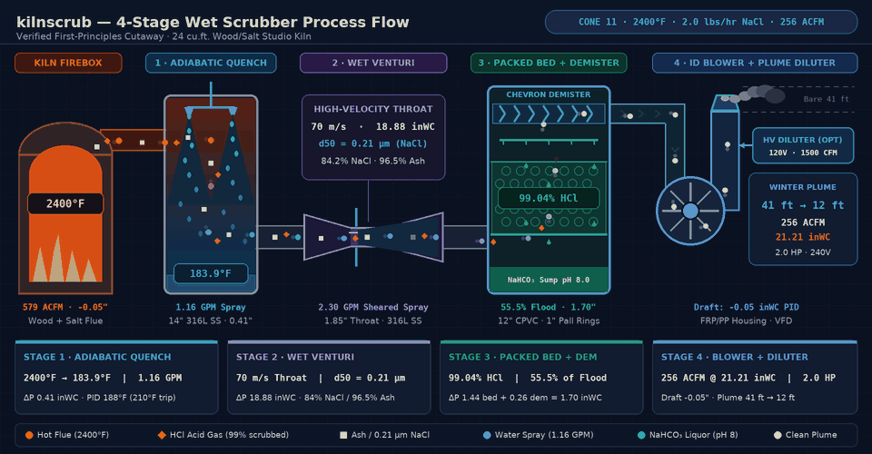
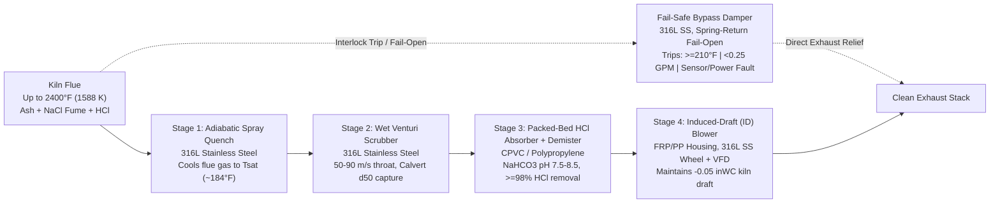
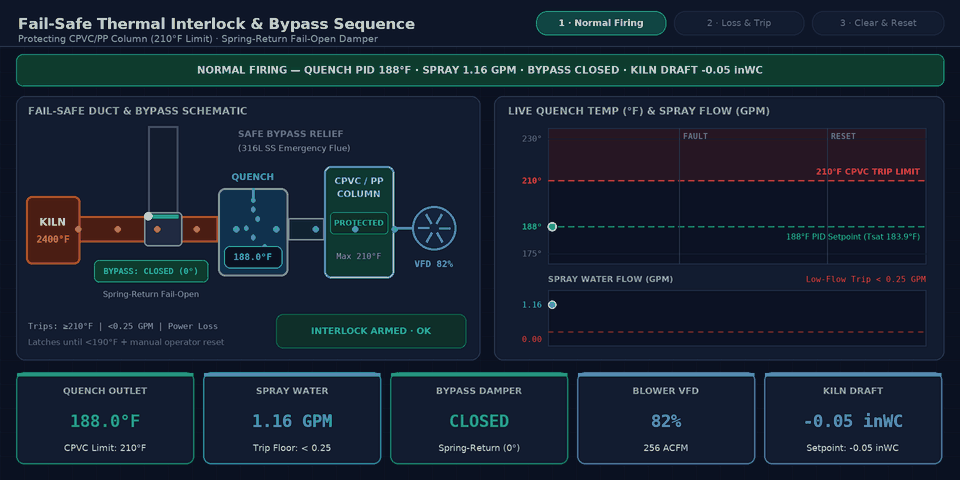

# `kilnscrub`

**Pure-Go Kiln Exhaust Scrubber Designer, CAD/BOM Exporter & Active Closed-Loop Controller**

`kilnscrub` is a zero-runtime-dependency Go (`go 1.24+`) engineering toolkit and hardware controller for urban studio potters firing wood, gas, and salt kilns. It sizes a 4-stage wet scrubbing train from first-principles thermochemistry, exports fabrication-ready 3D meshes (`.stl`), unfolded sheet-metal cut templates (`.dxf`), and Bills of Materials (CSV/Markdown), serves an interactive embedded 3D & live-telemetry web dashboard, and runs a closed-loop PID + fail-safe bypass controller daemon over simulated or industrial Modbus RTU hardware.

---

## Table of Contents

- [4-Stage Scrubber Architecture](#4-stage-scrubber-architecture)
- [Engineering & Compliance Documentation](#engineering--compliance-documentation)
- [Requirements & Build](#requirements--build)
- [Studio Potter Kit (COTS, Urban Readiness & Build Packets)](#studio-potter-kit-cots-urban-readiness--build-packets)
- [CLI Reference](#cli-reference)
  - [`kilnscrub presets`](#kilnscrub-presets)
  - [`kilnscrub guide`](#kilnscrub-guide)
  - [`kilnscrub packet`](#kilnscrub-packet)
  - [`kilnscrub design`](#kilnscrub-design)
  - [`kilnscrub export`](#kilnscrub-export)
  - [`kilnscrub daemon`](#kilnscrub-daemon)
  - [`kilnscrub ui`](#kilnscrub-ui)
  - [`kilnscrub version`](#kilnscrub-version)
- [Web Dashboard & HTTP API](#web-dashboard--http-api)
- [Fabrication & Safety Guide](#fabrication--safety-guide)
- [Testing, CI & Automated Releases](#testing-ci--automated-releases)
- [Deployment (systemd)](#deployment-systemd)
- [Repository Layout](#repository-layout)
- [References](#references)
- [License](#license)

---

## 4-Stage Scrubber Architecture

Studio wood/salt firings combine extreme flue temperatures (up to `2400°F` / `1588.7 K`), submicron wood fly ash and condensed `NaCl` salt fume (`0.1–2.0 µm`), and corrosive hydrogen chloride (`HCl`) gas. `kilnscrub` models and controls a four-stage wet scrubber train protected by an independent hardwired `200°F` / `< 0.25 GPM` spring-return fail-safe hot-gas bypass damper (ahead of the `210°F` software backup):





```text
                        [Fail-Safe Spring-Return Bypass Damper]
                         (Trips OPEN: >=210°F, <0.25 GPM, fault)
                           +-------------------------------+
                           |                               |
                           | (bypass on trip/power loss)   v
[Kiln Flue] ----+-----> [Stage 1] ---> [Stage 2] ---> [Stage 3] ---> [Stage 4] ---> [Stack]
 2400°F peak    |      Adiabatic       Wet Venturi    Packed-Bed     ID Blower
 Wood/Salt      |      Spray Quench    Scrubber       HCl Absorber   + VFD PID
 -0.05 inWC     |      (316L SS)       (316L SS)      + Demister     (FRP/316L)
                +----------------------------------   (CPVC / PP)
                         Interlock monitors T_out,    NaHCO3 Sump
                         spray water GPM & draft      (pH 7.5-8.5)
```

| Stage | Equipment | Material of Construction | Engineering Model & Purpose |
|---|---|---|---|
| **Stage 1** | Adiabatic Spray Quench Tower | 316L Stainless Steel | NIST 7-coeff Shomate `Cp`/`H`, IAPWS-95 `Psat`, 1D Brent adiabatic saturation balance; cools `2400°F` flue gas below CPVC limits (`<= 210°F`) |
| **Stage 2** | High-Velocity Wet Venturi | 316L Stainless Steel | Calvert (1970, 1972) cut diameter `d50` with Davies/Allen-Raabe Cunningham slip; captures submicron wood ash (`2400 kg/m³`) and condensed `NaCl` fume (`2160 kg/m³`) |
| **Stage 3** | Counter-Current Packed-Bed Absorber & Chevron Demister | CPVC / Polypropylene (`1"` PP Pall Rings) | Souders-Brown / Eckert flooding (`<= 75%` of flood), Ergun bed `ΔP`, NTU-HTU `HCl` absorption (`>= 98%`) with recirculating `NaHCO3` (`pH 7.5–8.5`), chevron mist eliminator |
| **Stage 4** | Induced-Draft (ID) Centrifugal Blower & VFD | FRP/PP Housing, 316L SS Wheel | Static pressure summation (`duct + quench + venturi + bed + demister + |draft|`), fan/system curves, shaft & motor HP sizing, PID draft regulation |

### Architecture Trade-Offs (1-Stage through 5-Stage & Alternatives)

Not every studio kiln needs a full 4-stage `21.2 inWC` train: **89% of total static pressure comes from Stage 2 (the high-velocity venturi)**. Clean gas and soda (`Na₂CO₃`, `0 ppm HCl`) kilns can drop the venturi for a quiet `120V` 2-stage train (`~3–4.5 inWC`), non-salt wood/foundry kilns can drop the packed bed for a 3-stage train, and cold-winter urban studios can add a 5th-stage downstream `120V` squirrel-cage plume diluter. See [`docs/ARCHITECTURE_TRADE_STUDY.md`](docs/ARCHITECTURE_TRADE_STUDY.md) for the complete decision tree, sizing boundaries, and 12 public-domain U.S. patents.


---

## Engineering & Compliance Documentation

| Document | Scope |
| :--- | :--- |
| [`docs/ENGINEERING_VALIDATION.md`](docs/ENGINEERING_VALIDATION.md) | Independent first-principles chemical engineering & physics audit (NIST Shomate, IAPWS-95, Calvert/Yung-Calvert, Sauter Ergun/Eckert GPDC, Onda mass transfer, and verified A1–A4 fixes) |
| [`docs/ARCHITECTURE_TRADE_STUDY.md`](docs/ARCHITECTURE_TRADE_STUDY.md) | 12-architecture comparison (1–5 stages, WESP, baghouse, cyclonic, ejector-venturi, impingement-plate), 12 expired public-domain U.S. patents, hard lower/upper sizing boundaries, and studio decision tree |
| [`docs/CONTROL_ALTERNATIVES_AND_RPI_BOM.md`](docs/CONTROL_ALTERNATIVES_AND_RPI_BOM.md) | 5 control architectures compared (Raspberry Pi, ESP32/Opta, 1/16-DIN PID + FM Limit, CLICK Micro-PLC, pure electromechanical), complete 23-item Raspberry Pi + NFPA 86 hardwired safety relay BOM, and de-energize-to-trip wiring schematics |
| [`docs/CODE_COMPLIANCE_AUDIT.md`](docs/CODE_COMPLIANCE_AUDIT.md) | U.S. national code compliance audit (NEC / NFPA 70, IMC, NFPA 91 / 211 / 86, IPC 608 / 702.5 / 803.1, 40 CFR 403.5, OSHA 29 CFR 1910.1000 / 1910.95) and verified `C1`–`C14` resolutions |
| [`docs/TEST_COVERAGE.md`](docs/TEST_COVERAGE.md) | Automated Statement, Executable Line, and AST C1 Branch coverage report across all 8 Go packages generated by [`scripts/branch_coverage.go`](scripts/branch_coverage.go) |

---

## Requirements & Build

- **Go toolchain:** Go `1.24+` (module targets `go 1.24.13`).
- **Pure-Go static binary:** `CGO_ENABLED=0` is fully supported across Linux, macOS, and Windows (including the pure-Go Modbus RTU serial HAL).
- **Zero Python runtime dependencies:** Neither the `kilnscrub` binary nor `go test` invokes Python.
- **C compiler (test-time only):** `gcc` / `build-essential` (or MinGW-w64 `gcc` on Windows) is only required when running the Go race detector (`CGO_ENABLED=1 go test -race`). Building, running, and pure-Go tests require zero C compiler and zero `make`.

### Offline Scientific Oracle Fixtures

Thermophysical and chemical engineering correlations in `pkg/thermo` and `pkg/scrubber` were validated offline against peer-reviewed Python libraries (`chemicals 1.5.2`, `fluids 1.3.1`, `scipy`) using [`scripts/generate_oracle.py`](scripts/generate_oracle.py) to produce the committed ground-truth fixture file [`testdata/oracle_fixtures.json`](testdata/oracle_fixtures.json):

- NIST 7-coefficient Shomate `Cp(T)` and `H(T) - H(298.15)` for `N2`, `CO2`, `H2O`, `O2`, `HCl` (`350–1588.15 K`)
- Lucas gas viscosity (`chemicals.viscosity.Lucas_gas`)
- IAPWS-95 water saturation vapor pressure (`300–373.15 K`)
- Ergun packed-bed pressure drop (`1"` Pall rings, voidage `0.90`, `L = 1.2 m`)
- Calvert venturi cut diameter `d50` with Cunningham slip (`NaCl` density `2160 kg/m³`)

Go unit tests read only `testdata/oracle_fixtures.json` and assert `<= 1e-6` relative tolerance — no Python environment is needed to build or test `kilnscrub`.

### Building

#### Linux / macOS (Bash)

```bash
# Static pure-Go binary for the current host
CGO_ENABLED=0 go build -trimpath -ldflags="-s -w" -o bin/kilnscrub ./cmd/kilnscrub

# Launch the Studio Potter Web UI (http://localhost:8080)
./bin/kilnscrub ui

# Or using the Makefile
make build

# Cross-compile static binaries for linux/amd64, linux/arm64, darwin/amd64, darwin/arm64, windows/amd64
make release-all

# Build reproducible packaged release archives (.tar.gz / .zip) + SHA256SUMS.txt
make release-archives
```

#### Windows (PowerShell)

No `make`, `gcc`, or Bash required — copy and paste directly into Windows PowerShell:

```powershell
# Static pure-Go binary for Windows
$env:CGO_ENABLED = "0"
go build -trimpath -ldflags="-s -w" -o bin\kilnscrub.exe .\cmd\kilnscrub

# Launch the Studio Potter Web UI (http://localhost:8080)
.\bin\kilnscrub.exe ui
```

Cross-compile from Windows PowerShell (for example, to deploy to a Raspberry Pi studio controller on `linux/arm64`) with zero `make` required:

```powershell
# Cross-compile static binary for Raspberry Pi (linux/arm64)
$env:CGO_ENABLED = "0"
$env:GOOS = "linux"
$env:GOARCH = "arm64"
go build -trimpath -ldflags="-s -w" -o dist\kilnscrub-linux-arm64 .\cmd\kilnscrub

# Reset GOOS/GOARCH so subsequent commands in this terminal target Windows again
Remove-Item Env:GOOS, Env:GOARCH
```

---

## Studio Potter Kit (COTS, Urban Readiness & Build Packets)

`kilnscrub` includes a potter-friendly Studio Kit (`pkg/studio`) layered on top of the validated 4-stage thermochemistry solver so urban ceramicists and makers can go from kiln profile to shopping list and build packet in one step:

- **5 Curated Studio Presets:** `electric_raku_6` (6 cu.ft. 120V no-weld raku/test hood), `gas_soda_14` (14 cu.ft. zero-HCl Cone 10 soda kiln), `wood_salt_24` (24 cu.ft. Cone 11 wood-salt reference), `coop_wood_48` (48 cu.ft. heavy-duty C-276/FRP community kiln), and `foundry_glass_16` (16 cu.ft. particulate-focused glass/foundry scrubber).
- **COTS Hardware Snapping (`snap_to_cots`):** Maps theoretical diameters to real off-the-shelf 316L SS / Alloy C-276 pipe spools, vacuum-rated Schedule 80 CPVC (`6"–16"`) or filament-wound FRP (`18"–30"`) packed columns (restricting HDPE drums strictly to atmospheric vented sumps), PP Pall rings, radial pressure blowers + AutomationDirect `GS21` VFDs in NEC 110.28 NEMA 4X enclosures, NEC 430.102 lockable sight disconnects, IPC 608 Air Gap / ASSE 1013 RPZ backflow preventers, and NFPA 86 hardwired `200°F` safety relay + Modbus interlock kits — automatically recalculating actual `% of Eckert flooding velocity` (`<= 75%`). Supports both **No-Weld COTS** (`cots_no_weld`) and **Welded Sheet Metal DXF** (`welded_dxf`) build paths.
- **Urban Neighbor & Backyard Readiness:** Evaluates 6 U.S. code-aligned site checks — NEC 430.122(A) 125% VFD single-phase electrical ampacity (`120V` vs `240V` + plume diluter amps), garden-hose water demand + mandatory IPC 608 backflow isolation, inverse-square property-line noise (`dBA` vs `60 dBA` daytime / `50–55 dBA` overnight + OSHA 29 CFR 1910.95 `85 dBA` near-field warning), baking soda (`NaHCO3`) boxes + IPC 702.5 `<= 140°F` drain cooldown & 40 CFR 403.5 `pH >= 5.0` compliance, 316L hot-wet-HCl corrosion vs. zero-HCl Soda (`Na2CO3`), and cold-weather steam plume visibility with IMC 510/501.3.1 & OSHA 29 CFR 1910.1000 HCl stack setbacks.
- **Squirrel-Cage High-Velocity Plume Calculator:** Models psychrometric mixing lines using IAPWS-95 `WaterPsat` to report bare vs. diluted horizontal winter plume reach (`bare_plume_length_ft` -> `diluted_plume_length_ft`) against your property-line setback, sizes a downstream `120V` squirrel-cage dilution blower + high-velocity exit cone (`~3,400 FPM`), and computes tangent-clear kiln-jacket waste-heat recovery (`kW`).
- **One-Click 10-File Build Packet (`.zip`):** Bundles `BUILD_GUIDE.md`, `OPERATIONS_CHECKLIST.md`, `bom_cots.md`, `bom_cots.csv`, `bom_engineered.csv`, `scrubber.stl`, `scrubber.dxf`, `project.json`, `daemon.json`, and `README_PACKET.txt`.

---

## CLI Reference

```text
kilnscrub - Pure-Go Kiln Exhaust Scrubber Designer & Active Controller

Usage:
  kilnscrub <command> [flags]

Commands:
  design   Size a 4-stage kiln exhaust scrubber from firing parameters
  export   Export fabrication .stl mesh, unfolded .dxf patterns, and BOM
  presets  List curated studio kiln presets (ID, profile, audience, badge)
  guide    Evaluate COTS hardware, urban readiness, and Build/Firing Guides
  packet   Generate a complete 10-file Studio Build Packet (.zip)
  daemon   Run the closed-loop PID draft & quench safety controller
  ui       Launch the interactive 3-tab web dashboard (default :8080)
  version  Print the kilnscrub version
```

> **Windows PowerShell tip:** Invoke `.\bin\kilnscrub.exe` instead of `kilnscrub` (or add `.\bin` to your `PATH`). All subcommands and flags below work identically in Windows PowerShell, Linux, and macOS.

### `kilnscrub presets`

Lists all 5 curated studio presets (`ID`, `Name`, `Badge`, `Audience`, `Tagline`) or emits machine-readable JSON (`--json`).

```bash
kilnscrub presets
kilnscrub presets --json
```

### `kilnscrub guide`

Evaluates a preset (`--preset`, default `wood_salt_24`) or saved `project.json` (`--project`), prints the COTS + Urban Readiness summary (including bare vs. squirrel-cage diluted plume reach), and either prints the tailored Markdown Build Guide to stdout or writes `BUILD_GUIDE.md` and `OPERATIONS_CHECKLIST.md` to `--out <dir>`.

```bash
kilnscrub guide --preset gas_soda_14
kilnscrub guide --preset wood_salt_24 --out ./studio-guides
kilnscrub guide --project ./my-studio-project.json --out ./studio-guides
```

### `kilnscrub packet`

Generates the complete 10-file Build Packet `.zip` archive from a preset (`--preset`) or saved `project.json` (`--project`).

```bash
kilnscrub packet --preset wood_salt_24 --out ./kilnscrub-wood_salt_24-packet.zip
kilnscrub packet --project ./my-studio-project.json --out ./my-build-packet.zip
```

### `kilnscrub design`

Sizes all four scrubber stages from kiln firing parameters (optionally seeded by `--preset <id>` or `--project <path.json>`) and prints either a formatted engineering summary or the full `ScrubberDesign` JSON document.

**Flags:**

| Flag | Default | Description |
|---|---|---|
| `--preset` | *(none)* | Optional studio preset ID to seed sizing parameters |
| `--project` | *(none)* | Optional path to a saved `StudioProject` `project.json` file |
| `--kiln-volume` | `24` | Kiln interior volume (`cu.ft.`) |
| `--peak-temp` | `2400` | Peak kiln exit gas temperature (`°F`) |
| `--salt-rate` | `2.0` | `NaCl` salt introduction rate (`lbs/hr`) |
| `--fuel` | `wood_salt` | Fuel stoichiometry: `wood_salt`, `wood`, `gas_salt`, `gas` |
| `--throat-vel` | `70` | Venturi throat gas velocity (`m/s`, typical `50–90 m/s`) |
| `--lg` | `0.0012` | Venturi liquid-to-gas volumetric ratio (`m³/m³`) |
| `--hcl-removal` | `0.99` | Target fractional `HCl` removal efficiency in `(0, 1)` |
| `--draft` | `-0.05` | Target kiln draft setpoint (`inWC`, negative = suction) |
| `--json` | `false` | Output complete `ScrubberDesign` as indented JSON |

**Example (24 cu.ft. Reference Wood/Salt Kiln):**

```bash
kilnscrub design --kiln-volume 24 --peak-temp 2400 --salt-rate 2.0
```

**Sample Output:**

```text
Kiln Scrub 4-Stage Engineering Summary
======================================
Kiln Input : 24.0 cu.ft. | Peak 2400 F | Salt 2.00 lbs/hr | Fuel wood_salt | Draft -0.050 inWC
Inlet Gas  : 579.2 ACFM (0.0610 kg/s) @ 2400 F | Quenched: 255.9 ACFM @ 183.9 F

Stage 1 - Adiabatic Quench Tower (316L Stainless Steel)
  Tsat / Outlet / Dew Point : 183.9 F (357.5 K) / 183.9 F / 183.9 F
  Spray Water               : 0.58 GPM evap | 1.16 GPM total (2.0x overspray, 2 nozzles)
  Geometry & dP             : D=0.350 m (13.8 in) x H=2.400 m (7.87 ft) | dP=0.41 inWC (102 Pa)

Stage 2 - Wet Venturi Scrubber (316L Stainless Steel)
  Throat & Spray            : D_th=0.047 m (1.85 in) | v_th=70.0 m/s | L/G=0.0012 (2.30 GPM)
  Calvert d50               : NaCl fume 0.214 um | Wood ash 0.199 um
  Overall Capture & dP      : NaCl 84.2% | Wood ash 96.5% | dP=18.88 inWC (4703 Pa)

Stage 3 - Packed-Bed HCl Absorber & Demister (CPVC / Polypropylene)
  Column & Packing          : D=0.300 m (11.8 in) x H=2.950 m (9.68 ft) | Z_pack=1.050 m (1" PP Pall Rings)
  Hydraulics & HCl Removal  : 55.5% of flood | HCl 99.04% (1048 -> 10.0 ppm) | NaHCO3 1.49 kg/hr | Recirc 5.36 GPM
  Pressure Drop             : Bed 1.44 inWC + Demister 0.26 inWC = 1.70 inWC (425 Pa)

Stage 4 - Induced-Draft Blower (FRP / Polypropylene Housing, 316L SS Wheel)
  Duty Point                : 255.6 ACFM @ 21.21 inWC (5284 Pa) | Kiln draft setpoint -0.050 inWC
  dP Breakdown (inWC)       : Duct 0.17 | Quench 0.41 | Venturi 18.88 | Bed 1.44 | Demister 0.26 | Draft 0.05
  Power & Wheel             : 1.38 shaft HP -> 2.00 HP motor (eta 62%) | Wheel 0.840 m (33.1 in) @ 3511 RPM

Skid Envelope               : L=3.94 m x W=1.66 m x H=3.25 m (12.9 x 5.4 x 10.7 ft) | Duct D=0.178 m (7.0 in) | Area=6.54 m2
Warnings                    : none
```

Emit machine-readable JSON for downstream tooling:

```bash
kilnscrub design --kiln-volume 24 --peak-temp 2400 --salt-rate 2.0 --json > design.json
```

---

### `kilnscrub export`

Generates fabrication deliverables from the sized scrubber design:

- `scrubber.stl` — Binary STL 3D assembly mesh in millimeters with outward unit normals.
- `scrubber.dxf` — AutoCAD R12 DXF with unfolded sheet-metal cylinder wraps and exact frustum/cone developments for the venturi converging/diverging transitions.
- `bom.csv` — Spreadsheet-ready Bill of Materials with quantities, materials, total line-item weights (`kg`), and budgetary USD estimates.
- `bom.md` — Formatted Markdown Bill of Materials with fabrication and safety notes.

**Flags:**

Accepts all sizing flags from `kilnscrub design` (`--preset`, `--project`, `--kiln-volume`, `--peak-temp`, `--salt-rate`, `--fuel`, `--throat-vel`, `--lg`, `--hcl-removal`, `--draft`) plus:

| Flag | Default | Description |
|---|---|---|
| `--out` | `.` | Output directory for `scrubber.stl`, `scrubber.dxf`, `bom.csv`, and `bom.md` |

**Example:**

```bash
kilnscrub export --kiln-volume 24 --peak-temp 2400 --salt-rate 2.0 --out ./out
```

**Sample Output:**

```text
wrote out/scrubber.stl (332384 bytes)
wrote out/scrubber.dxf (13398 bytes)
wrote out/bom.csv (3435 bytes)
wrote out/bom.md (4464 bytes)
BOM summary: 18 items | 325.8 kg total | $9457.10 est. USD
```

---

### `kilnscrub daemon`

Runs the active closed-loop PID controller managing:
- **Kiln draft loop:** Low-pass filtered (`0.5 Hz` / `318.3 ms`) differential pressure feedback driving the blower VFD (`0–100%`) via anti-windup PID.
- **Quench cooling loop:** Quench outlet RTD feedback driving the modulating spray water valve (`0–100%`) via anti-windup PID.
- **Fail-safe bypass interlock:** Continuously evaluates sensor validity, quench outlet temperature, spray water flow, and draft magnitude before applying actuator commands.

**Flags:**

| Flag | Default | Description |
|---|---|---|
| `--config` | *(none)* | Path to JSON daemon configuration file (e.g., `configs/kilnscrub.example.json`) |
| `--hal` | `sim` | Hardware abstraction layer backend: `sim` (built-in kiln/scrubber plant simulator) or `modbus` (pure-Go Modbus RTU over RS-485 serial) |
| `--draft` | `-0.05` | Target kiln draft setpoint (`inWC`, negative = suction) |
| `--quench-temp-f` | `188.0` | Target quench outlet temperature setpoint (`°F`, above `183.9°F` adiabatic saturation floor) |
| `--interval` | `100ms` | Closed-loop control tick interval |
| `--duration` | `0` | Optional bounded run duration (`0` = run until `SIGINT`/`SIGTERM`) |

**Examples:**

```bash
# Quick simulation smoke run (350 ms)
kilnscrub daemon --hal sim --duration 350ms

# Production controller driven by JSON config and Modbus RTU serial HAL
kilnscrub daemon --config configs/kilnscrub.example.json --hal modbus
```

**Sample Output (Simulation Mode):**

```text
kilnscrub daemon starting (for 350ms, hal=sim): target_draft=-0.050 inWC (-12.45 Pa) quench_sp=188.0 F interval=100ms
tick=1 state=NORMAL draft=-0.0500 inWC (-12.45 Pa) quench_out=188.0 F water=1.00 GPM vfd=40.5% valve=44.0% bypass=false
tick=2 state=NORMAL draft=-0.0500 inWC (-12.45 Pa) quench_out=187.9 F water=1.03 GPM vfd=40.5% valve=43.9% bypass=false
tick=3 state=NORMAL draft=-0.0499 inWC (-12.44 Pa) quench_out=187.9 F water=1.05 GPM vfd=40.6% valve=43.7% bypass=false
tick=4 state=NORMAL draft=-0.0499 inWC (-12.42 Pa) quench_out=187.7 F water=1.06 GPM vfd=40.7% valve=43.5% bypass=false
kilnscrub daemon stopped cleanly after 4 ticks (final state=NORMAL, interlock=false)
```

#### Fail-Safe Interlock Limits



| Condition | Default Threshold | Trip Code | Action |
|---|---|---|---|
| **Independent Hardwired CPVC High-Limit** *(NFPA 86)* | `>= 200.0°F` (`93.3°C`) manual-reset snap-disc | *(Hardwired `K_SAFE`)* | **Primary hardwired trip:** de-energizes 24VDC safety relay, springs bypass damper OPEN & cuts VFD STO/Run-Enable independently of software |
| **High Quench Outlet Temp** *(Software Backup)* | `>= 210.0°F` (`372.04 K`) | `HIGH_QUENCH_OUTLET_TEMP` | **Hard latch:** opens hot-gas bypass damper & latches alarm |
| **Quench Water Loss** | `< 0.25 GPM` (`1.577e-5 m³/s`) | `QUENCH_WATER_LOSS` | **Hard latch:** opens hot-gas bypass damper & latches alarm |
| **Sensor Fault / Stale Telemetry** | HAL read error, `NaN`/`Inf`, Modbus CRC/timeout/exception, or timestamp age `> 5s` | `SENSOR_FAULT` | **Hard latch:** opens hot-gas bypass damper & latches alarm |
| **Excessive Draft Magnitude** | `|draft| > 1.0 inWC` (`248.84 Pa`) | `EXCESSIVE_DRAFT` | **Hard latch:** opens hot-gas bypass damper & latches alarm |
| **Sump pH Excursion** | `< 6.5` or `> 9.5` | *(Warning only)* | **Warning/alarm only:** alerts operator for `NaHCO3` dosing; does **not** open hot-gas bypass damper |

Hard interlock trips latch `BypassDamperOpen = true` and `AlarmLatched = true` (set `bypass_coil_deenergize_to_trip: true` in `modbus` config for fail-safe active-low PLC relay coils). Clearing a latch requires **both** that all hard faults have cleared in the latest sensor evaluation **and** an explicit operator reset (`ResetInterlock()` / `POST /api/control/reset`). See [`docs/CONTROL_ALTERNATIVES_AND_RPI_BOM.md`](docs/CONTROL_ALTERNATIVES_AND_RPI_BOM.md) for full hardwired NFPA 86 safety relay wiring diagrams.

---

### `kilnscrub ui`

Launches the embedded single-binary HTTP dashboard on `http://localhost:8080` (with zero external build step or asset server). By default, an embedded `control.Daemon` starts in the background (using `SimHAL` unless `--config` / `--hal modbus` selects Modbus RTU) so the **Live Control & Telemetry** tab streams live SSE telemetry immediately.

**Flags:**

| Flag | Default | Description |
|---|---|---|
| `--addr` | `:8080` | HTTP listen address (e.g., `127.0.0.1:8080` or `:8080`) |
| `--config` | *(none)* | Path to JSON daemon configuration file for embedded live control |
| `--hal` | `sim` | Embedded control HAL backend: `sim` or `modbus` |
| `--no-control` | `false` | Disable embedded live control daemon and telemetry backend |

**Examples (Linux / macOS Bash):**

```bash
# Dashboard with live simulated control & SSE telemetry out of the box
kilnscrub ui --addr 127.0.0.1:8080

# Dashboard backed by config file / Modbus RTU hardware
kilnscrub ui --addr 127.0.0.1:8080 --config configs/kilnscrub.example.json

# Design-only mode without live control backend
kilnscrub ui --addr 127.0.0.1:8080 --no-control
```

**Examples (Windows PowerShell):**

```powershell
# Dashboard with live simulated control & SSE telemetry out of the box (http://localhost:8080)
.\bin\kilnscrub.exe ui

# Bind to localhost only, or disable the embedded live control backend
.\bin\kilnscrub.exe ui --addr 127.0.0.1:8080
.\bin\kilnscrub.exe ui --addr 127.0.0.1:8080 --no-control
```

---

### `kilnscrub version`

Prints the build version embedded via `-ldflags "-X main.version=..."` (`kilnscrub version` or `kilnscrub --version`).

---

## Web Dashboard & HTTP API

The embedded web application (`internal/web/static/index.html`) provides three workspace tabs out of the box when running `kilnscrub ui`:

1. **Design & 3D Studio**
   - One-click **5 Curated Studio Presets** (`electric_raku_6`, `gas_soda_14`, `wood_salt_24`, `coop_wood_48`, `foundry_glass_16`), pyrometric Cone selector (`Cone 06`–`Cone 11`), Vapor Glaze toggle (`None` / `Soda` / `Salt`), Build Path (`No-Weld COTS` vs `Welded DXF`), Corrosion Tier (`Hobby 316L` vs `Heavy C-276 / FRP`), acoustic silencer & `120V` squirrel-cage plume diluter toggles, and `Save/Load project.json`.
   - **Urban Neighbor Readiness Bar** displaying live traffic-light chips for Electrical, Water, Neighbor Noise, Baking Soda, Winter Plume reach (`bare -> HV squirrel-cage vs fence line`), and Corrosion/Soda comparison.
   - Collapsible **Advanced Engineering Parameters** drawer for venturi throat velocity, `L/G` ratio, `HCl` removal target, packing voidage/diameter, and draft setpoint.
   - Parametric **Three.js** (`0.170.0`) 3D cutaway visualization with animated flow particles, orbit controls, engineering charts, and direct CAD/BOM downloads.
2. **Build & Firing Guide**
   - COTS snapped hardware summary cards, actual `% of flooding velocity` check (`<= 75%`), full COTS shopping-list BOM table, and detailed 6-card Urban Site & Neighbor Readiness breakdown (including squirrel-cage plume verdict and bare vs. diluted plume reach).
   - Interactive **Step-by-Step Build Guide** and **Firing-Day How-To Checklist** reader with persistent checkboxes and one-click **Download Complete Build Packet (`.zip`)** button.
3. **Live Control & Telemetry**
   - Real-time **Server-Sent Events (SSE)** stream (`SSE LIVE` / `CONNECTING` / `OFFLINE`) with active HAL mode badge (`SIM` / `MODBUS`).
   - High-visibility safety interlock banner (`NORMAL`, `WARNING (pH)`, or `INTERLOCK TRIPPED — BYPASS DAMPER OPEN` with exact `trip_reason`) and **Reset Interlock** action.
   - Live KPI cards, rolling real-time SVG strip charts, live setpoint controls, and simulation fault-injection buttons when running against `sim` HAL.

### HTTP API Summary

| Method & Endpoint | Description |
|---|---|
| `GET /` | Embedded single-file 3-tab web dashboard |
| `GET /favicon.ico` | Embedded SVG favicon |
| `GET /api/health` | Health check (`{"status":"ok"}`) |
| `GET /api/defaults` | Default 24 cu.ft. wood/salt `DesignInput` JSON |
| `POST /api/size` | Compute `ScrubberDesign` JSON (partial JSON payloads inherit defaults from `DefaultSaltKilnInput()`) |
| `POST /api/export?format=...` | Export CAD/BOM attachment (`format` in `stl`, `dxf`, `bom_csv`, `bom_md`, `bom_json`) |
| `GET /api/studio/presets` | List all 5 curated `StudioPreset` profiles (`{"presets":[...]}`) |
| `POST /api/studio/evaluate` | Evaluate a `StudioProject` JSON payload into a full `StudioEvaluation` (design + COTS + urban readiness + Markdown guides) |
| `POST /api/studio/packet` | Generate and download the 10-file Studio Build Packet `.zip` (`application/zip`) |
| `GET /api/control/status` | Live controller snapshot, active `ControlConfig`, `hal_mode`, and `supports_fault_injection` (`{"enabled":false}` when no control backend is attached) |
| `GET /api/control/stream` | Server-Sent Events (`text/event-stream`) live `ControlStatus` telemetry feed (`503` if control backend disabled) |
| `POST /api/control/setpoint` | Update live `target_draft_in_wc` and/or `quench_setpoint_f` (`400` on out-of-range input) |
| `POST /api/control/reset` | Reset a latched fail-safe interlock (`409 Conflict` if any hard fault remains active) |
| `POST /api/control/fault` | Trigger or clear simulation faults (`heat_spike`, `water_loss`, `clear_water_loss`, `sensor_fault`, `clear_sensor_fault`, `sump_ph`, `clear_all`) |

---

## Fabrication & Safety Guide

> **Engineering Validation:** Before fabricating or purchasing hardware, review [`docs/ENGINEERING_VALIDATION.md`](docs/ENGINEERING_VALIDATION.md) for the independent first-principles physics audit, comparison against EPA Air Pollution Control Cost Manual / Perry's Chemical Engineers' Handbook design guidelines, and conservative engineering margins.

### Material Selection & Service Cautions

- **316L Stainless Steel (Stages 1 & 2 — Inlet Duct, Quench Tower, Wet Venturi):**
  - Selected for high-temperature thermal shock resistance and wet particulate impingement durability in studio-scale intermittent firings.
  - **Chloride corrosion warning:** Hot, wet `HCl`/`NaCl` environments can cause **chloride pitting and chloride stress-corrosion cracking (CSCC)** in 316L SS, especially at welds and wet/dry transition zones. Maintain continuous spray wetting during salt firing, flush thoroughly with fresh water after each firing, inspect welds regularly, and consider upgrading hot wet-acid zones to **Alloy C-276 (Hastelloy)** or refractory-lined quench vessels for frequent commercial salt production.
- **CPVC & Polypropylene (Stage 3 — Packed-Bed Column, Pall Rings, Chevron Demister, Sump):**
  - Provides excellent corrosion resistance against dilute `HCl` and neutralized `NaCl`/`NaHCO3` brine at reasonable studio cost.
  - **Strict thermal ceiling (`<= 210°F`):** CPVC loses structural rigidity near `212°F` (`100°C`) and polypropylene softens even lower. Stage 3 **must always** be protected by an independent, hardware-wired **24 VDC spring-return fail-open hot-gas bypass damper** driven by a physical high-temperature switch (`<= 210°F`), water-flow switch (`>= 0.25 GPM`), and power-loss fail-safe relay — never rely exclusively on software PID or Modbus polling for thermal protection.
- **Seals, Fasteners & Chemical Sump:**
  - Use acid- and temperature-rated **expanded PTFE or Viton** full-face flange gaskets and **316 stainless steel** fasteners.
  - Maintain sump neutralization (`NaHCO3` dosing to `pH 7.5–8.5`), provide a blowdown/drain strategy for dissolved `NaCl` buildup, and dispose of neutralized scrubber effluent in compliance with local municipal wastewater regulations.
- **Blower & Electrical Safety:**
  - Use a NEMA 4X VFD and corrosion-resistant FRP/PP blower housing with a 316L SS wheel downstream of the chevron demister. Ensure proper grounding, emergency stop (E-Stop), and interlock wiring per NEC/local electrical codes.

### Disclaimer

`kilnscrub` is open-source engineering software provided for educational, prototyping, and preliminary design purposes under the MIT License. **Studio kiln exhaust systems involve extreme temperatures, toxic/corrosive combustion gases (`CO`, `HCl`), rotating machinery, and municipal air/water emissions.** Fabrication, installation, electrical/interlock wiring, structural support, wastewater disposal, and air-quality exhaust permitting must comply with all applicable local building, fire, mechanical, and environmental codes and should be reviewed by a licensed **Professional Engineer (PE)** or qualified industrial ventilation contractor before commissioning.

---

## Testing, CI & Automated Releases

Run the full formatting, static analysis, test suite, and CLI/packet smoke checks with zero Python dependencies:

### Linux / macOS (Bash)

```bash
# Full local verification gate (gofmt check, go vet, race tests across all 8 packages)
make check

# CLI end-to-end smoke checks (design, export, daemon) and Build Packet zip check
make smoke
make packet-smoke
```

### Windows (PowerShell)

Run the full pure-Go test suite, static analysis, and CLI smoke checks with **no `gcc` and no `make` required**:

```powershell
# Pure-Go tests across all 8 packages (no gcc or make required)
$env:CGO_ENABLED = "0"; go test -count=1 ./...

# Static analysis and formatting check
go vet ./...
gofmt -l .

# Quick CLI smoke check (presets & 10-file Studio Build Packet .zip)
.\bin\kilnscrub.exe presets
.\bin\kilnscrub.exe packet --preset wood_salt_24 --out .\kilnscrub-wood_salt_24-packet.zip
```

**Race detector & AST branch coverage on Windows** (optional — requires MinGW-w64 `gcc` in `PATH` for `CGO_ENABLED=1`):

```powershell
# Race detector + atomic coverage profile across all 8 packages (requires MinGW/gcc)
$env:CGO_ENABLED = "1"; go test -race -count=1 -covermode=atomic -coverprofile=coverage.out ./...

# Statement, Executable Line, and AST Branch coverage report (add -min-line 85 -min-branch 72 to enforce CI gates)
go run .\scripts\branch_coverage.go -profile coverage.out
```

### GitHub Actions CI & Release Pipeline

- **CI ([`.github/workflows/ci.yml`](.github/workflows/ci.yml)):** Runs `gofmt -l .`, `go vet ./...`, `go mod tidy` cleanliness check, zero-Python-in-Go guard, JSON validation, `go test -race -covermode=atomic -coverprofile=coverage.out ./...`, Line (`>= 85%`) & AST Branch (`>= 72%`) coverage enforcement via `scripts/branch_coverage.go`, CLI smoke checks (`design`, `export`, `daemon`, `presets`, `packet`), and 5-target static cross-compilation (`linux/amd64`, `linux/arm64`, `darwin/amd64`, `darwin/arm64`, `windows/amd64`) with `SHA256SUMS.txt`.
- **Automated Releases ([`.github/workflows/release.yml`](.github/workflows/release.yml) & [`packaging/release.sh`](packaging/release.sh)):** Triggered on semantic version tags (`v*.*.*`) or manual `workflow_dispatch`; runs the race test gate, builds reproducible `.tar.gz`/`.zip` release archives with embedded `main.version`, verifies `SHA256SUMS.txt`, and publishes a GitHub Release automatically.

### Makefile Targets

| Target | Description |
|---|---|
| `make build` | Compile static pure-Go binary (`CGO_ENABLED=0`) to `bin/kilnscrub` with `-X main.version=...` |
| `make test` | Run `CGO_ENABLED=1 go test -race -count=1 ./...` |
| `make vet` | Run `go vet ./...` |
| `make fmt` / `make fmt-check` | Format all Go source files with `gofmt -w .` / verify `gofmt` cleanliness |
| `make check` | Run `fmt-check`, `vet`, and `test` |
| `make coverage` | Run race tests with coverage profile and print total coverage |
| `make coverage-branch` | Run atomic race tests and enforce Statement, Executable Line (`>= 85%`), and AST Branch (`>= 72%`) coverage |
| `make smoke` | Build binary and run `design`, `export` (`.stl`, `.dxf`, `bom.csv`, `bom.md`), and `daemon` smoke checks |
| `make packet-smoke` | Build binary and verify `presets` + `packet --preset wood_salt_24` `.zip` integrity |
| `make release-all` | Cross-compile all 5 static binaries and `SHA256SUMS.txt` to `dist/` |
| `make release-archives` | Build reproducible `.tar.gz`/`.zip` release archives + `SHA256SUMS.txt` via `packaging/release.sh` |
| `make clean` | Remove `bin/`, `dist/`, and `coverage.out` build outputs |

---

## Deployment (`systemd`)

For dedicated studio controllers (e.g., Raspberry Pi / Debian connected to an RS-485 USB Modbus RTU adapter), a hardened `systemd` unit is provided at [`packaging/systemd/kilnscrub-daemon.service`](packaging/systemd/kilnscrub-daemon.service).

Quick install summary (see unit file comments for full steps):

```bash
sudo useradd --system --no-create-home --shell /usr/sbin/nologin --groups dialout kilnscrub
sudo install -m 0755 bin/kilnscrub /usr/local/bin/kilnscrub
sudo install -d -m 0750 -o root -g kilnscrub /etc/kilnscrub
sudo install -m 0640 -o root -g kilnscrub configs/kilnscrub.example.json /etc/kilnscrub/daemon.json
sudo install -d -m 0750 -o kilnscrub -g kilnscrub /var/lib/kilnscrub
sudo install -m 0644 packaging/systemd/kilnscrub-daemon.service /etc/systemd/system/kilnscrub-daemon.service
sudo systemctl daemon-reload
sudo systemctl enable --now kilnscrub-daemon.service
sudo journalctl -u kilnscrub-daemon.service -f
```

---

## Repository Layout

```text
kilnscrub/
├── cmd/kilnscrub/              # CLI entrypoints (design, export, presets, guide, packet, daemon, ui, version)
├── pkg/
│   ├── model/                  # Shared SI unit types, DesignInput, ControlConfig, HAL interfaces
│   ├── thermo/                 # NIST Shomate Cp/H, Lucas viscosity, IAPWS-95 Psat, Brent quench solver
│   ├── scrubber/               # Venturi (Calvert), Packed Bed (Eckert/Ergun/NTU-HTU), ID Blower
│   ├── cad/                    # Binary .stl mesh, unfolded R12 .dxf patterns, CSV/Markdown BOM
│   └── studio/                 # Studio presets, COTS catalog & snapping, urban & plume readiness, guides, Build Packet .zip
├── internal/
│   ├── control/                # PID draft/quench loops, LPF filter, fail-safe interlock, Sim & Modbus RTU HALs
│   └── web/                    # Embedded HTTP server, JSON/SSE/Studio APIs, 3-tab Three.js + Guide + Telemetry UI
├── configs/                    # Example JSON daemon & Modbus RTU configuration
├── docs/                       # Engineering validation, trade study, RPi BOM, US code audit, coverage report & assets/*.gif
├── packaging/
│   ├── release.sh              # Reproducible cross-platform .tar.gz/.zip release archive builder
│   └── systemd/                # Hardened systemd service unit for studio controllers
├── scripts/
│   ├── branch_coverage.go      # Pure-Go Statement, Executable Line & AST C1 Branch coverage analyzer
│   ├── generate_gifs.py        # Offline deterministic generator for docs/assets/*.gif diagrams
│   └── generate_oracle.py      # One-time offline Python oracle fixture generator
├── testdata/oracle_fixtures.json # Committed ground-truth scientific test fixtures
├── .github/workflows/          # GitHub Actions CI (ci.yml), automated Release (release.yml), Dependabot
└── Makefile                    # Ergonomic build, check, coverage-branch, smoke, packet-smoke, and release targets
```

---

## References

### Scientific & Chemical Engineering Literature

1. **U.S. EPA (2002).** *EPA Air Pollution Control Cost Manual*, 6th Ed., `EPA/452/B-02-001` — Section 5.2, Ch. 1 (*Wet Scrubbers for Acid Gas*) & Section 6, Ch. 2 (*Wet Scrubbers for Particulate Matter*).
2. **U.S. EPA Air Pollution Control Technology Fact Sheets:** Spray-Chamber / Spray-Tower (`EPA-452/F-03-016`), Impingement-Plate / Tray-Tower (`EPA-452/F-03-012`), Packed-Bed (`EPA-452/F-03-015`), Venturi Scrubber (`EPA-452/F-03-017`), Catalytic Incinerator (`EPA-452/F-03-018`), Pulse-Jet Fabric Filter (`EPA-452/F-03-025`), and Wet Electrostatic Precipitator — Wire-Pipe (`EPA-452/F-03-029`) & Wire-Plate (`EPA-452/F-03-030`).
3. **Calvert, S. (1970).** "Venturi and Other Atomizing Scrubbers Efficiency and Pressure Drop," *AIChE Journal*, 16(3), 392–396.
4. **Calvert, S., Goldshmid, J., Leith, D., & Mehta, D. (1972).** *Scrubber Handbook*, `EPA-R2-72-118a` (NTIS PB-213016); **Calvert, S., Lundgren, D., & Mehta, D. S. (1972)**, "Venturi Scrubber Performance," *J. Air Pollution Control Assoc.*, 22(7), 529–532.
5. **Boll, R. H. (1973).** "Particle Collection and Pressure Drop in Venturi Scrubbers," *Ind. Eng. Chem. Fundam.*, 12(1), 40–50.
6. **Yung, S.-C., Barbarika, H. F., & Calvert, S. (1977).** "Pressure Loss in Venturi Scrubbers," *J. Air Pollution Control Assoc.*, 27(4), 348–351 (`EPA-600/2-77-172`).
7. **Hesketh, H. E. (1974).** "Fine Particle Collection Efficiency Related to Pressure Drop, Scrubbant and Particle Properties, and Contact Mechanism," *J. Air Pollution Control Assoc.*, 24(10), 939–942.
8. **Nukiyama, S., & Tanasawa, Y. (1939).** "Experiments on the Atomization of Liquids in an Air Stream," *Trans. JSME*, 5(18), 62–67.
9. **Eckert, J. S. (1970).** "Selecting the Proper Distillation Column Packing," *Chemical Engineering Progress*, 66(3), 39–44.
10. **Strigle, R. F. (1994).** *Packed Tower Design and Applications*, 2nd Ed., Gulf Publishing; **Treybal, R. E. (1980).** *Mass-Transfer Operations*, 3rd Ed., McGraw-Hill.
11. **Onda, K., Takeuchi, H., & Okumoto, Y. (1968).** "Mass Transfer Coefficients Between Gas and Liquid Phases in Packed Columns," *J. Chem. Eng. Japan*, 1(1), 56–62.
12. **Ergun, S. (1952).** "Fluid Flow Through Packed Columns," *Chemical Engineering Progress*, 48(2), 89–94.
13. **Wagner, W., & Pruss, A. (1993, 2002).** *The IAPWS Formulation 1995 for the Thermodynamic Properties of Ordinary Water Substance*, *J. Phys. Chem. Ref. Data*, 31(2), 387–535.
14. **Poling, B. E., Prausnitz, J. M., & O'Connell, J. P. (2001).** *The Properties of Gases and Liquids*, 5th Ed., McGraw-Hill (Lucas gas viscosity; Wilke 1950 mixture viscosity rule).
15. **NIST Chemistry WebBook** (NIST Standard Reference Database 69), Gas-Phase Shomate Thermochemistry Tables (`N2`, `CO2`, `H2O`, `O2`, `HCl`).
16. **Haaland, S. E. (1983).** "Simple and Explicit Formulas for the Friction Factor in Turbulent Pipe Flow," *J. Fluids Engineering*, 105(1), 89–90.
17. **Green, D. W., & Southard, M. Z. (2019).** *Perry's Chemical Engineers' Handbook*, 9th Ed., McGraw-Hill (Sections 14, 17, 25: Gas Absorption, Gas-Solid Separation, Alloy C-276 vs. 316L SS Corrosion).
18. **Jorgensen, R. (1999).** *Fan Engineering*, 9th Ed., Howden Buffalo; **Bleier, F. P. (1998).** *Fan Handbook*, McGraw-Hill.

### Expired Public-Domain U.S. Patents (Open Hardware Prior Art)

1. **US 895,729** — F. G. Cottrell (1908), *Art of Separating Suspended Particles from Gaseous Bodies* (Electrostatic Precipitation / WESP).
2. **US 1,992,762** — F. F. Pease (1935), *Method of Washing Gases* (Pease-Anthony Cyclonic Spray Scrubber).
3. **US 2,604,185** — H. F. Johnstone & A. W. Anthony, Jr. (1952), *Method and Apparatus for Treating Gases* (Pease-Anthony Venturi Scrubber).
4. **US 2,639,909** — M. Leva (1953), *Tower Packing / Saddle for Treating Towers* (Intalox Saddle).
5. **US 3,266,787** *(Re. 27,216)* — J. S. Eckert (1966), *Pall Ring* (Open-Walled Slotted Tower Packing).
6. **US 3,568,404** — A. B. Walker (1971), *Low Pressure Electrostatic Precipitator*.
7. **US 3,759,497** — J. H. Black (1973), *Impingement Baffle Plate Assemblies* (Peabody Tray Scrubber).
8. **US 4,023,942** — J. D. Brady & L. K. Legatski (1977), *Variable Throat Venturi Scrubber*.
9. **US 4,186,159** — M. Huber (1980), *Structured Tower Packing* (Corrugated Cross-Channel Packing).
10. **US 4,305,909** — H. P. Willett & E. Bakke (1981), *Integrated Flue Gas Processing System* (Tubular WESP + Scrubbing).
11. **US 4,828,768** — E. Talmor (1989), *Jet Scrubber and Method of Operation* (Ejector-Venturi Scrubber).
12. **US 5,464,459** — G. K. VanBuskirk, C.-L. Hsieh, K. J. McNulty & O. V. Hansen (1995), *Chevron Type Mist Eliminator and System*.

### U.S. National Building, Electrical, Mechanical, Plumbing, Fire & Workplace Safety Codes

1. **NFPA 70 (National Electrical Code, 2020/2023):** Article 110.28 (NEMA 4X Enclosures), Article 210.8(A)/(B)/(F) (GFCI Protection & Outdoor Outlets), Article 400.12 (Flexible Cords Uses Not Permitted), Article 430 — Table 430.248 (Single-Phase Motor FLC), Section 430.22 (125% Motor Conductors), Section 430.102(A)/(B) (Lockable Sight Disconnect `<= 50 ft`), Section 430.122(A) (125% VFD Rated Input Ampacity).
2. **International Mechanical Code (IMC, 2021/2024):** Section 401.4 (Outdoor Air Intake Separation), Section 501.3 & 501.3.1 (Exhaust Termination Setbacks: `30 ft` / `10 ft` property line, `10 ft` operable openings, `6 ft` / `3 ft` walls & roofs, `10 ft` above grade), Section 510 (Hazardous Exhaust Systems & `> 600°F` Chimney Construction), Chapter 8 (Chimneys and Vents).
3. **NFPA 91:** *Standard for Exhaust Systems for Air Conveying of Vapors, Gases, Mists, and Particulate Solids* (corrosion-resistant ducts, cleanout/access doors, low-point condensate drains, ASTM E84 / UL 723 FSI `<= 25` / SDI `<= 50` plastic ductwork).
4. **NFPA 211:** *Standard for Chimneys, Fireplaces, Vents, and Solid Fuel-Burning Appliances* (high-heat `> 1000°F` connectors, `36"` clearance to combustibles, no combustible wall penetrations, refractory bypass chimney).
5. **NFPA 86:** *Standard for Ovens and Furnaces* (independent hardwired excess temperature limit controller with manual reset and open-sensor fail-safe, de-energize-to-trip safety relays, and exhaust-proving ventilation interlocks).
6. **International Plumbing Code (IPC, 2021/2024):** Section 608 / Table 608.1 / 608.15.1 / 608.15.4.2 (High-Hazard Potable Water Protection — Engineered `>= 1"` Air Gap / ASME A112.1.2 or Certified ASSE 1013 RPZ Backflow Preventer), Section 702.5 (`<= 140°F` PVC/ABS Sanitary Drain Temperature Limit), Section 803.1 (Corrosive Waste Neutralizing Device).
7. **U.S. EPA 40 CFR 403.5(b):** *National Pretreatment Standards — Prohibited Discharges* (`pH < 5.0` prohibition, solid/viscous obstruction limits, heat limits `<= 104°F` at POTW influent).
8. **U.S. OSHA 29 CFR 1910.1000 Table Z-1 & 29 CFR 1910.95:** Hydrogen Chloride Ceiling PEL (`5 ppm` / `7 mg/m³`; NIOSH IDLH `50 ppm`) and Occupational Noise Exposure (`85 dBA` 8-hr TWA Action Level; `90 dBA` PEL).
9. **ASTM F441 & ASTM E84 / UL 723:** Schedule 80 CPVC Pipe Temperature/Pressure Rating (`200°F` max continuous) and Surface Burning Characteristics for Plastic Ductwork.

---

## License

MIT License — see [`LICENSE`](LICENSE).
