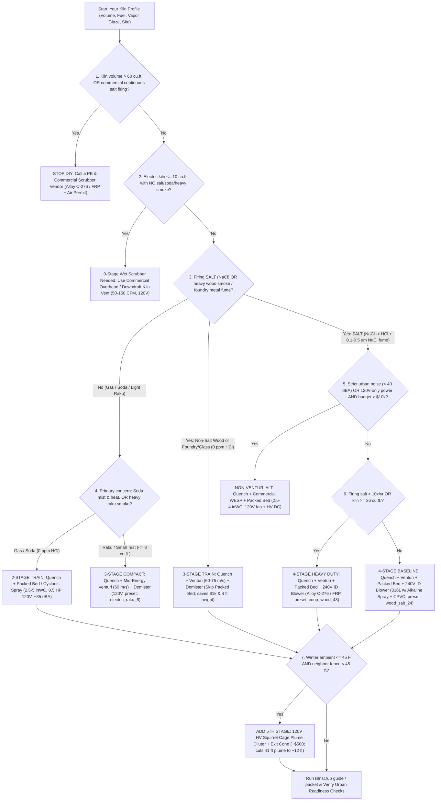

# Scrubber Architecture Trade Study, Public-Domain Patents & Studio Sizing Boundaries

**Purpose:** Challenge the default 4-stage wet scrubber architecture implemented in `kilnscrub` (Adiabatic Spray Quench → High-Velocity Venturi → Counter-Current Packed-Bed HCl Absorber → Induced-Draft Blower), benchmark it quantitatively against simpler (1–3 stage), expanded (5-stage), and alternative non-venturi gas-cleaning trains, catalog verified **expired (public-domain) U.S. patents** that studio builders can freely adopt, define the **hard lower and upper engineering boundaries** of an effective system, and provide a plain-English **decision tree** so any studio potter can pick the right stage count, technology, and `kilnscrub` configuration.

**Reference Baseline:** All quantitative comparisons in Section 1 are normalized to the validated `kilnscrub` reference studio kiln (`wood_salt_24` preset, post-audit A1–A4 physics in `pkg/scrubber/` and `docs/ENGINEERING_VALIDATION.md`): **24 cu.ft.** interior volume, **Cone 11 (`2400°F` / `1588.7 K`)**, `579.2 ACFM` hot inlet flue gas (`129.6 kW` firing load), quenched to **`255.9 ACFM` at `183.9°F`** (`55.7% H₂O`), with **`2.0 lbs/hr` NaCl** (`1,048 ppm` post-quench HCl) for salt-firing rows or **`0 lbs/hr` NaCl** (`0 ppm` HCl) for non-salt/soda rows, evaluated at a **40 ft** residential property line in **`35°F` winter air**.

---

## 1. Challenging the 4-Stage Architecture (Fewer vs. Same vs. More Stages)

The 4-stage `kilnscrub` baseline (`Quench → Venturi → Packed Bed + Demister → ID Blower`) is a **general-purpose worst-case train** designed to survive the hardest problem in studio ceramics: a wood-fired salt kiln generating simultaneously (1) `2400°F` flue gas, (2) submicron `0.1–0.5 µm` condensed NaCl fume and wood smoke, and (3) `1,000–4,100 ppm` corrosive HCl acid gas.

However, **most studio potters do not fire wood-salt**. Keeping an `18.9 inWC` high-velocity venturi in a kiln that produces zero submicron salt fume forces a **2.0 HP / 240V high-head radial blower** where a whisper-quiet **0.5 HP / 120V blower** would work just as well—or better. Conversely, in dense winter neighborhoods or heavy reduction wood firings, even the 4-stage train may benefit from a 5th stage (plume abatement) or an upstream thermal oxidizer.

### 1.1 The Core Urban-Potter Insight: Where Static Pressure Actually Comes From

In the validated `wood_salt_24` 4-stage baseline (`kilnscrub design --preset wood_salt_24`), total static pressure is **`21.21 inWC` (`5,284 Pa`)**, distributed as:

| Stage / Loss Component | ΔP (`inWC`) | Share of Total ΔP | What It Removes |
| :--- | :---: | :---: | :--- |
| Hot Inlet Flue Duct (`7"`, `3.0 m`) | `0.17` | `0.8%` | Conveys hot gas |
| Stage 1: Adiabatic Spray Quench | `0.41` | `1.9%` | Cools `2400°F → 183.9°F`; coarse ash (`>5 µm`); `~30–50%` incidental HCl |
| **Stage 2: High-Velocity Venturi (`70 m/s`)** | **`18.88`** | **`89.0%`** | **Submicron NaCl fume (`d_50 = 0.214 µm`) & fine wood ash (`d_50 = 0.199 µm`)** |
| Stage 3: Packed Bed (`1.05 m`, 1" PP Pall Rings) | `1.44` | `6.8%` | `99.0%` HCl gas neutralization (`1,048 → 10.0 ppm`) |
| Stage 3: 3-Pass Chevron Demister | `0.26` | `1.2%` | Entrained water droplets (`>15–25 µm`) |
| Target Kiln Suction Draft (`-0.05 inWC`) | `0.05` | `0.2%` | Holds gentle negative kiln draw |
| **Total 4-Stage Baseline** | **`21.21`** | **`100%`** | **Shaft: `1.38 HP` → `2.0 HP` 240V NEMA motor** |

> **Key Takeaway:** **89% of the blower pressure drop—and therefore 89% of the blower electricity, noise, and 240V electrical upgrade cost—comes from Stage 2 (the Venturi throat) alone.**
>
> - **Gas & Soda Kilns (`0 ppm HCl`, coarse/soluble `Na₂CO₃` mist, negligible submicron soot):** Can safely **drop the high-ΔP Venturi** and run a **2-Stage train** (`Quench → Packed Bed + Chevron Demister`, or a **Cyclonic Spray Tower**). Total static pressure plunges from **`21.2 inWC` down to `~2.5–4.5 inWC`** (including discharge stack & silencer). Blower power drops from `1.38 shaft HP` (`2.0 HP` 240V motor) to **`~0.24 shaft HP` (`0.5 HP` standard 120V garage outlet)**, and property-line noise falls by **`~8 dBA`** (nearly half the perceived loudness)!
> - **Wood & Salt Kilns (`0.1–0.5 µm` condensed NaCl aerosol + fine wood smoke + `1,000+ ppm` HCl):** Cannot skip submicron particulate capture. Condensed salt fume has a mass median aerodynamic diameter (MMAD) near `0.55 µm` with substantial mass down to `0.15 µm`, which slips straight through spray towers and packed beds (`d_50 ≈ 2–10 µm`). Capturing it requires **either**:
>   1. **High-Energy Venturi (`~19 inWC` throat / `21.2 inWC` total)** — mechanically simple, no high-voltage electronics, DIY-friendly, 240V blower; **or**
>   2. **Wet Electrostatic Precipitator (WESP) (`~0.25–0.5 inWC` WESP / `2.5–4.0 inWC` total)** — ultra-low ΔP and superior submicron capture (`d_50 < 0.1 µm`), quiet 120V blower, **but** demands a `20–50 kV DC` corona power supply, purge-air HV insulators, and high-voltage safety engineering.

---

### 1.2 Quantitative Comparison Matrix (Normalized to 24 cu.ft. Studio Kiln, `256 ACFM` Quenched)

All values below reflect peer-reviewed EPA Air Pollution Control Technology Fact Sheets (`EPA-452/F-03-*`), the *EPA Air Pollution Control Cost Manual* (`EPA/452/B-02-001`), and `kilnscrub`'s validated thermodynamic/hydraulic/acoustic models (`pkg/scrubber/`, `pkg/studio/urban.go`, `pkg/studio/cots.go`). Noise values assume an acoustic discharge silencer (`-13 dBA`) at a `40 ft` property line; steam plume reach is for `35°F` winter air at `60% RH`.

| Architecture / Train | Stages | Submicron PM Cut `d_50` (`µm`) | HCl Removal (%) | Total Static ΔP (`inWC`) | Blower / Prime-Mover HP & Circuit | Noise @ 40 ft (Silenced `dBA`) | Water Use (Makeup / Recirc `GPM`) | Winter Steam Plume (`35°F`) | DIY Build Cost (USD) | Maintenance Burden | Best Kiln Type |
| :--- | :---: | :---: | :---: | :---: | :---: | :---: | :---: | :---: | :---: | :---: | :--- |
| **1-Stage: Spray Tower / Adiabatic Quench** (`EPA-452/F-03-016`) | 1 | `5.0 – 10.0` *(misses PM₂.₅)* | `30 – 60%` *(unbuffered)* | `0.8 – 1.5` | `0.25 HP` blower (`120V`) | `~32 – 34` | `0.6 – 1.2` evap/spray | Heavy (`~41 ft`) | `$1,200 – $2,200` | **Low** (nozzle flush) | Coarse ash / gas kiln pre-cooling only *(inadequate for salt or dense smoke)* |
| **2-Stage A: Quench + Packed Bed + Demister** *(Skip Venturi)* (`EPA-452/F-03-015`) | 2 | `2.0 – 4.0` *(misses NaCl fume)* | **`98 – 99%+`** | **`2.5 – 4.5`** | **`0.5 HP` blower (`120V`)** | **`~35 – 37`** | `0.6` makeup / `5.4` recirc | Heavy (`~41 ft`) | `$3,200 – $4,400` | **Low–Med** (strainer, pH, packing rinse) | **Backyard Gas & Soda kilns**; low-particulate acid/fume kilns on **120V** |
| **2-Stage B: Cyclonic Spray Tower** *(Pease-Anthony)* | 2 | `1.5 – 3.0` | `70 – 85%` | `2.5 – 6.0` | `0.5 – 0.75 HP` (`120V`) | `~36 – 39` | `0.6` makeup / `4 – 8` recirc | Heavy (`~41 ft`) | `$2,500 – $4,000` | **Low** (no packing to foul) | **Gas/Soda** & light **wood-ash** kilns (zero packing plugging) |
| **2-Stage C: Ejector-Venturi Jet Scrubber + Separator** *(No Blower)* | 2 | `0.8 – 1.5` | `85 – 95%` *(99% w/ 2nd stage)* | `0` *(induces `-0.5 to -4 inWC` draft)* | **No blower**; `2.0 – 3.0 HP` motive pump (`240V`) | **`~34 – 38`** *(pump hum only)* | `0.6` makeup / `20 – 40` recirc | Heavy (`~41 ft`) | `$3,000 – $5,000` | **Low–Med** (high-wear motive nozzle) | Corrosive **gas-salt** or compact kilns where **zero rotating fan in acid gas** is prized |
| **3-Stage: Quench + Venturi + Cyclone/Chevron Demister** *(Skip Packed Bed)* | 3 | `0.20 – 0.25` | `30 – 60%` *(insufficient for salt)* | `15 – 20` *(14–19 throat)* | `1.5 – 2.0 HP` (`240V`) | `~42 – 43` | `0.6` makeup / `2.3` recirc | Heavy (`~41 ft`) | `$3,800 – $4,800` | **Low–Med** (venturi throat & strainer) | **Non-salt Wood kilns**, raku, & **home foundry / glass** (`0 ppm HCl`, heavy ash/smoke) |
| **4-Stage Baseline (`kilnscrub`): Quench + Venturi + Packed Bed + ID Blower** | **4** | **`0.20 – 0.21`** | **`99.0%`** | **`21.2`** *(18.9 venturi + 1.7 col)* | **`2.0 HP` radial (`240V 30A`)** | **`43.2`** | `0.66` makeup / `7.7` recirc | Heavy (`41 ft` bare) | **`$5,555`** *(COTS 316L)* / **`$9.5k+`** *(C-276/FRP)* | **Medium** (nozzles, strainer, pH, 316L check) | **Dedicated Studio Wood-Salt kilns** (`12 – 48 cu.ft.`), all-around worst-case |
| **5-Stage A: 4-Stage + Sub-Cooling Condenser** *(Plume Elimination)* | 5 | `0.20 – 0.21` | `99.0%+` | `22.5 – 24.0` | `2.0 – 3.0 HP` (`240V`) + cooling pump/fan | `~44 – 46` | **`15 – 25 GPM`** cold water *(or closed cooling tower)* | **Near-Zero (`< 5 ft`)** *(exits `100–120°F`)* | `$8,500 – $12,000` | **High** (fouling HX coils, condensate corrosion) | Dense urban sites with strict **zero-plume** rules & cooling tower / chilled water |
| **5-Stage B: 4-Stage + 120V HV Squirrel-Cage Plume Diluter** *(`kilnscrub` option)* | 5 | `0.20 – 0.21` | `99.0%` | `21.2` main + `~1.0` tee | `2.0 HP` (`240V`) + `0.5 HP` (`120V` `1,500 CFM`) | `~44 – 45` | `0.66` makeup / `7.7` recirc | **Short (`12 ft` vs `40 ft` fence)** *(0 ft w/ kiln-jacket shroud)* | **`$6,050`** *(+$500 over 4-stage)* | **Medium** (same as 4-stage + belt/wheel check) | **Urban/suburban cold-winter studios** with close property lines (`25 – 45 ft`) |
| **Alt 1: Quench + Wet Electrostatic Precipitator (WESP) + Packed Bed** (`EPA-452/F-03-029/030`) | 3–4 | **`< 0.05 – 0.10`** *(best submicron)* | **`99.0%+`** | **`2.5 – 4.0`** *(WESP `0.25–0.5`)* | **`0.5 HP` (`120V`)** + `20–50 kV DC` HV supply (`0.3 kW`) | **`~35 – 37`** | `0.66` makeup / `6 – 8` recirc | Heavy (`~41 ft`) | `$8,000 – $20,000+` *(rarely DIY)* | **High** (HV insulators, spark control, washing) | **Heavy Wood-Salt** in noise-restricted urban zones **when built commercially** |
| **Alt 2: Air Cooler + Dry Sorbent Injection (`NaHCO₃`) + Ceramic/PTFE Baghouse** (`EPA-452/F-03-025`) | 3 | **`0.10 – 0.30`** *(filter cake)* | `85 – 95%` *(needs `2–3×` reagent)* | `5.0 – 9.0` | `0.75 – 1.0 HP` (`120V/240V`) + pulse air | `~39 – 42` *(+ pulse-jet pops)* | **`0 GPM`** *(dry)* | **Zero (`0 ft`, dry `350–450°F`)** | `$8,000 – $18,000` | **High** (spark arrestor, bag blinding/fire risk, dust cake) | **Arid / water-scarce / strict zero-plume** gas-salt or electric-fume kilns *(risky on raw wood embers)* |
| **Alt 3: Upstream Thermal Afterburner (`1500°F`) + Downstream Scrubber** | +1 upstream | Destroys `95–99%` soot/tar/VOCs | `0%` alone *(needs scrubber)* | `+0.5 – 1.5` | `+25 – 50 kW` aux gas burner | `+2 – 4 dBA` burner roar | `+20–35%` quench evap | Larger (more flue mass) | `+$2,500 – $5,500` | **Low–Med** (refractory & pilot safety) | **Heavy reduction wood / raku / paper-clay** with thick black unburned carbon smoke |
| **Alt 4: Impingement-Plate / Sieve-Tray Scrubber** *(Peabody)* (`EPA-452/F-03-012`) | 2–3 | `1.0 – 2.0` | `95 – 99%` *(3–4 trays)* | `6.0 – 12.0` *(`~1.5`/tray)* | `0.75 – 1.0 HP` (`120V/240V`) | `~39 – 41` | `0.66` makeup / `4 – 6` recirc | Heavy (`~41 ft`) | `$3,800 – $6,000` | **Low–Med** (resists wood-ash plugging better than rings) | **Gas-Salt**, **Soda**, or **high-ash wood** kilns where random packing plugs |

> **Why Catalytic Oxidizers Are Excluded for Kilns (`EPA-452/F-03-018`):** Although catalytic oxidizers destroy VOCs and smoke at lower temperatures (`600–900°F`) than thermal afterburners, **halogens (HCl / NaCl), alkali vapor (`Na₂O` / `K₂O`), silica glaze vapor, and fly ash rapidly poison and blind precious-metal monolith catalysts**. Never install a catalytic oxidizer upstream of a salt, soda, or wood kiln; use a direct-fired **thermal afterburner** (secondary combustion chamber) if unburned black wood smoke is the primary problem.

### 1.3 Deeper Engineering Trade-Offs by Stage Count

1. **1-Stage (Quench / Spray Tower Only):** Thermodynamically indispensable for cooling `2400°F` flue gas below polymer limits, but hydrodynamically weak for fine particles (`d_50 ≈ 5–10 µm` because relative droplet-gas velocity is only `2–6 m/s`). Useful only as a pre-cooler or spark quencher.
2. **2-Stage (Quench + Packed Bed vs. Cyclonic Spray vs. Ejector-Venturi):**
   - *Quench + Packed Bed (`2.5–4.5 inWC`)* is the **sweet spot for urban Gas/Soda kilns** and low-smoke gas-salt kilns where HCl/alkali mist absorption matters more than submicron soot. Removing the Venturi saves `~$1,000–$1,400`, eliminates the `240V` panel upgrade for kilns up to `~24–30 cu.ft.`, and cuts fan acoustic power by `~8 dBA`.
   - *Cyclonic Spray Tower (`2.5–6.0 inWC`)* uses tangential entry (`15–25 m/s` inlet swirl) to fling spray droplets radially outward across the spinning gas, achieving `d_50 ≈ 1.5–3.0 µm` with zero packing media to clog from wood fly ash.
   - *Ejector-Venturi Jet Scrubber* uses a `30–100 psig` high-flow liquid nozzle to both scrub and pump the gas stream (`-0.5 to -4 inWC` induced draft), eliminating the corrosive ID blower entirely. The trade-off is hydraulic power: pumping `25–35 GPM` at `60 psig` requires `~2.0–3.0 HP` at the pump (similar electricity to a 4-stage blower) and produces coarser atomization (`d_50 ≈ 0.8–1.5 µm`) than a `70 m/s` gas-atomized Venturi.
3. **3-Stage (Quench + Venturi + Demister):** Ideal for **non-salt wood kilns (`wood`)** and **home foundry/glass furnaces (`foundry_glass_16`)**. Removing the packed bed saves `~$1,000–$1,500`, drops height by `~3–4 ft`, and eliminates ring fouling—while retaining `95–97%` wood fly-ash capture (`d_50 ≈ 0.20 µm`). Because wood ash is coarser (MMAD `~1.5 µm`) than condensed NaCl fume (`~0.55 µm`), throat velocity can also be dialed down from `70 m/s` to `55–60 m/s`, dropping Venturi ΔP from `18.9 inWC` to `~12–14 inWC`.
4. **4-Stage Baseline (`kilnscrub`):** Remains the **most robust, DIY-achievable architecture for wood-salt kilns**. Every stage uses well-understood passive geometry and off-the-shelf pumps/blowers, avoiding `30 kV` HV hazards (WESP) and ember fires (baghouse).
5. **5-Stage Plume Abatement (Condenser vs. HV Squirrel-Cage Diluter):**
   - Saturated `183.9°F` exhaust carries `~0.80 kg H₂O / kg dry gas`. Simply blowing `35°F` ambient air into it **cannot** keep the mixture below saturation at the mixing tee (`cold_dilution_works = false` in `pkg/studio/urban.go:346`), and electric reheat to tangent-clear invisibility requires **`58.1 kW`** on a 24 cu.ft. kiln (`~242 A @ 240V`—completely impractical!).
   - A **sub-cooling condenser** solves fog thermodynamically by condensing out `~85%` of the water vapor (`184°F → 110°F`), rejecting `~85 kW` of latent heat—which demands `15–25 GPM` of cold water (3×–5× a residential garden hose) or a dedicated cooling tower.
   - By contrast, `kilnscrub`'s **5th-stage 120V HV Squirrel-Cage Plume Diluter** (`include_plume_diluter=true`, `+$500`) sits **strictly downstream** of the Stage 4 radial blower (it cannot replace the `21.2 inWC` radial blower because forward-curved squirrel-cage fans stall above `1.5–2.5 inWC`). By injecting `1,500 CFM` of air through a high-velocity `9"` exit cone (`~3,400 FPM`), turbulent jet entrainment collapses visible winter steam reach from **`41 ft` bare down to `12 ft`** (well inside a `40 ft` fence). Pulling that dilution air across a sheet-metal shroud around the hot kiln exterior (`~250°F` free waste heat) achieves near-zero winter plume without electric heaters or cooling towers.

---

## 2. Public-Domain Patents & Open Designs

Because the foundational physics of wet gas scrubbing, electrostatic precipitation, tower packing, and inertial mist elimination matured between **1908 and 1995**, **all core architectural patents have expired and reside in the public domain**. Studio potters, university ceramics departments, and open-source hardware builders are legally free to fabricate, adapt, and combine the core mechanical designs disclosed in these expired U.S. patents.

> **Patent Scope Disclaimer:** Expiration frees the inventions claimed in each expired patent (and all earlier prior art). Modern commercial equipment may still hold active patents on specific proprietary refinements (e.g., specialized polymer alloy blends, custom multi-hook mist-eliminator clips, or digital spark-control firmware), as well as registered trademarks (e.g., *FLEXICHEVRON*, *Mellapak*, *Intalox*). Always build from the expired baseline geometries or off-the-shelf generic hardware.

### 2.1 Verified Expired (Public-Domain) U.S. Patents Directly Applicable to Kiln Scrubbing

| # | U.S. Patent | Title / Subject | Inventor(s) & Original Assignee | Filed / Granted | Expiration Status | What Studio Builders Can Freely Adopt Today |
| :-: | :--- | :--- | :--- | :---: | :---: | :--- |
| **1** | **US 895,729** | *Art of Separating Suspended Particles from Gaseous Bodies* | Frederick Gardner Cottrell (International Precipitation Co.) | Jul 9, 1907 / **Aug 11, 1908** | **Expired (1925)** — Public Domain | Foundational corona-discharge electrostatic precipitation (ESP/WESP): high-voltage DC discharge wire inside a grounded wetted collector pipe to capture `< 0.1 µm` fume at `< 0.5 inWC` ΔP. |
| **2** | **US 1,992,762** | *Method of Washing Gases* (Pease-Anthony Cyclonic Spray Scrubber) | F. F. Pease (Pease-Anthony Equipment Co.) | Apr 2, 1931 / **Feb 26, 1935** | **Expired (1952)** — Public Domain | Tangential gas entry into a vertical cylindrical vessel with a central axial spray manifold: centrifugal force drives droplets outward across the vortex, combining quench + coarse PM capture (`d_50 ≈ 1.5–3 µm`) + cyclonic mist separation with no packing. |
| **3** | **US 2,604,185** | *Method and Apparatus for Treating Gases* (Pease-Anthony Venturi Scrubber) | Henry F. Johnstone & Alfred W. Anthony, Jr. (Pease-Anthony Equipment Co.) | Nov 8, 1946 / **Jul 22, 1952** | **Expired (1969)** — Public Domain | The exact Stage 2 geometry in `kilnscrub`: converging cone → high-velocity throat (`50–90 m/s`) with radial/axial liquid injection sheared into micro-droplets → gentle diverging pressure-recovery diffuser (`~7°` included angle). |
| **4** | **US 2,639,909** | *Tower Packing* / *Saddle for Treating Towers* (Intalox Saddle) | Max Leva (The U.S. Stoneware Co.) | Granted **May 26, 1953** | **Expired (1970)** — Public Domain | Asymmetric toroidal saddle geometry that prevents adjacent pieces from nesting flat against each other, giving uniform voidage and lower liquid channeling than Raschig rings in Stage 3 columns. |
| **5** | **US 3,266,787** *(Re. 27,216)* | *Pall Ring* | John S. Eckert (U.S. Stoneware Co.; evolving Wilhelm Pfannmüller's 1944 BASF German Pall ring) | Mar 5, 1962 / **Aug 16, 1966** | **Expired (1983)** — Public Domain | Open-walled cylindrical ring with punched windows and inward-bent tongues (`ε ≈ 0.90`, `a_p ≈ 207 m²/m³`, `F_p ≈ 170 m⁻¹` for 1" PP)—the exact Stage 3 packing modeled in `pkg/scrubber/packedbed.go`, freely available as generic commodity media. |
| **6** | **US 3,568,404** | *Low Pressure Electrostatic Precipitator* | Alan B. Walker (Research-Cottrell, Inc.) | May 6, 1968 / **Mar 9, 1971** | **Expired (1988)** — Public Domain | Low-pressure-drop electrostatic gas cleaning layout suitable for integrating submicron particle charging downstream of a wet quencher without a high-head radial fan. |
| **7** | **US 3,759,497** | *Impingement Baffle Plate Assemblies* (Peabody Tray Scrubber) | John H. Black (Peabody Engineering Corp.) | Jun 14, 1971 / **Sep 18, 1973** | **Expired (1990)** — Public Domain | Modular, quick-release perforated orifice plates paired with overhead target baffles immersed in a flowing alkaline froth (`~1.5 inWC/plate`). Easily fabricated from perforated PP/FRP sheet for ash-heavy kilns where random packing clogs. |
| **8** | **US 4,023,942** | *Variable Throat Venturi Scrubber* | Jack D. Brady & Lester K. Legatski (FMC Corp.) | Jan 22, 1975 *(pri. May 30, 1972)* / **May 17, 1977** | **Expired (1994)** — Public Domain | Adjustable throat constriction (movable damper blade or tapered plug) that keeps throat velocity constant (`~70 m/s`) during low-fire ramp-up and wood-stoking surges, preventing `d_50` collapse at turndown. |
| **9** | **US 4,186,159** | *Structured Tower Packing* (Corrugated Cross-Channel Packing / *Mellapak* class) | Max Huber (Sulzer Brothers Ltd.) | Oct 26, 1977 / **Jan 29, 1980** | **Expired (1997)** — Public Domain | Stacked corrugated sheets angled in alternating directions (`45°` channels): cuts Stage 3 bed pressure drop by `3×–5×` vs. random Pall rings at equal HCl removal—ideal for ultra-low-head `120V` packed columns. |
| **10** | **US 4,305,909** | *Integrated Flue Gas Processing System* (Tubular WESP + Scrubbing) | Howard P. Willett & Even Bakke (Peabody Process Systems, Inc.) | Mar 13, 1980 *(pri. Oct 17, 1979)* / **Dec 15, 1981** | **Expired (1998)** — Public Domain | Integrated wet gas cooling/absorption coupled directly to a vertical tubular WESP (wetted pipe walls acting as grounded collection electrodes around axial HV wires), capturing acid mist and submicron fume in a compact vertical footprint. |
| **11** | **US 4,828,768** | *Jet Scrubber and Method of Operation* (Ejector-Venturi Scrubber) | Eli Talmor (Chevron Research Co.) | Jun 10, 1983 / **May 9, 1989** | **Expired** — Public Domain | Dual-action liquid-jet ejector-venturi using high-pressure spray droplets to entrain/pump kiln gas and scrub pollutants simultaneously—eliminating an acid-exposed mechanical fan wheel. |
| **12** | **US 5,464,459** | *Chevron Type Mist Eliminator and System* | Gregory K. VanBuskirk, Chang-Li Hsieh, Kenneth J. McNulty & Ole V. Hansen (Koch Engineering Co.) | Jun 6, 1994 / **Nov 7, 1995** | **Expired (2014)** — Public Domain | Multi-section angled zig-zag (chevron) vane profiles that force wet gas through sharp `90°–120°` turns so `>15–25 µm` droplets impact and drain cleanly at `0.2–0.4 inWC` without re-entrainment—matching Stage 3's 3-pass PP demister. |

### 2.2 Public-Domain Federal Engineering Literature & Open Analytical Models

Beyond expired patents, the mathematical design equations inside `kilnscrub` are drawn entirely from **public-domain U.S. government research and open peer-reviewed literature**:

- **Calvert Scrubber Physics & Dual-Throat Collision Concepts:** Dr. Seymour Calvert's EPA-sponsored *Scrubber Handbook* (EPA-R2-72-118a, 1972) and peer-reviewed papers (*AIChE J.* 1970; *JAPCA* 1972; Yung, Barbarika & Calvert, *JAPCA* 1977 / EPA-600/2-77-172) provide the exact open-domain impaction integral (`CalvertF`), cut diameter (`d_50`), and finite-throat droplet acceleration factor (`β`) implemented in `pkg/scrubber/venturi.go`. His later dual-throat **Collision Scrubber** concept—splitting gas into two opposing venturi throats that crash head-on to double relative droplet-particle collision velocity—is likewise widely documented in public EPA reports for extreme submicron fume capture, though a single Pease-Anthony venturi (`US 2,604,185`) is far simpler to fabricate at studio scale.
- **U.S. EPA Air Pollution Control Cost Manual (`EPA/452/B-02-001`) & Fact Sheets (`EPA-452/F-03-*`):** Public-domain U.S. federal design baselines for Spray Towers (`-016`), Impingement-Plate Scrubbers (`-012`), Packed-Bed Acid Gas Scrubbers (`-015`), Venturi Scrubbers (`-017`), Wet Electrostatic Precipitators (`-029` wire-pipe / `-030` wire-plate), and Pulse-Jet Fabric Filters (`-025`).
- **Open Thermophysical & Mass-Transfer Standards:** NIST Chemistry WebBook Shomate polynomials (SRD 69), IAPWS-95 water saturation formulation, Ergun (1952), Onda (1968), Eckert (1970) GPDC flooding correlation, and Haaland (1983) friction factor.

---

## 3. Upper and Lower Boundaries of an Effective System

A kiln scrubber is not linearly scalable down to a tabletop toaster kiln or up to a commercial brick tunnel kiln. Below the **hard lower boundaries**, capture physics collapse or simple passive ventilation beats wet scrubbing; above the **hard upper boundaries**, fluid flooding, thermoplastic softening, corrosion cracking, residential electrical ceilings, and environmental permitting take over.

### 3.1 Hard Lower Boundaries (Where Capture Collapses or Wet Scrubbing Makes No Sense)

| Subsystem / Parameter | Hard Lower Boundary | What Fails Below This Boundary | Quantitative Physics / Code Reference | Practical Studio Action |
| :--- | :---: | :--- | :--- | :--- |
| **Kiln Size (Electric, No Salt/Soda)** | **`< 4 cu.ft.`** *(or `< 10 cu.ft.` indoor electric bisque/glaze)* | Overhead canopy / downdraft kiln vent (`EnviroVent` style, `50–150 CFM`, `0.5 inWC`, `$300–$600`) completely removes trace clay/glaze off-gassing; wet scrubbing adds `$4,000+` cost, water waste, and steam plume for negligible benefit. | Low thermal load (`< 22 kW`), zero combustion soot, zero HCl. | Use a commercial **downdraft electric kiln vent** ducted outdoors instead of a wet scrubber. |
| **Quench Residence Time (`τ_quench`)** | **`< 0.5 s`** *(hard floor)*; **`< 1.2 s`** w/ standard hydraulic nozzles | Water droplets fail to evaporate before exiting Stage 1; hot gas streaks (`> 250°F`) enter Stage 3 and melt CPVC/PP packing or trip the `210°F` bypass continuously. | `d²`-law (`docs/ENGINEERING_VALIDATION.md §2.2`): at `τ = 1.27 s`, max fully evaporated droplet is `252 µm` (`154 µm` at exit); coarse `400 µm` hydraulic drops need `3.2 s`. | Use `≥ 1.25 s` with fine-atomizing (`80–100 psig` or twin-fluid, `SMD ≤ 200 µm`) nozzles, or `2.0–3.0 s` with low-pressure nozzles. |
| **Quench Spray Flow Interlock** | **`< 0.25 GPM`** *(or `< 1.1×` evap rate)* | Insufficient liquid to absorb sensible flue heat; tower dries out and outlet temperature spikes toward kiln exit temp within `2–5 s`. | `pkg/scrubber/scrubber.go:188`; `24 cu.ft.` peak evaporation is `0.58 GPM` (`2.0×` overspray = `1.16 GPM`). | Hardwire `< 0.25 GPM` flow switch to spring-return fail-open bypass damper + 5-gal gravity backup tank. |
| **Venturi Throat Velocity (`v_t`)** | **`< 40 m/s`** *(`130 ft/s`)* | Gas shear fails to atomize liquid into `< 150 µm` droplets (Nukiyama–Tanasawa `d_32 > 160 µm`) and Stokes number collapses—submicron NaCl capture plunges below `35–50%`. | `pkg/scrubber/venturi.go:163, 282`: at `v_t = 35 m/s`, `d_50` degrades to `> 0.50 µm` vs. `0.214 µm` at `70 m/s`. | Stay in `50–90 m/s` (`scrubber.go:182`). If you don't need submicron capture, **remove the venturi** rather than running it at `25 m/s`. |
| **Venturi Liquid-to-Gas Ratio (`L/G`)** | **`< 0.0005 m³/m³`** *(`3.7 gal/1000 acf`)* | Droplet number density in the throat is too sparse for particles to impact droplets; dry streaks form along throat walls. | `CalvertPenetration` exponent scales linearly with `L/G`; EPA recommends `5–15 gal/1000 acf` (`0.00067–0.0020`). | Target `L/G = 0.0010–0.0015` (`7.5–11.2 gal/1000 acf`); default `0.0012`. |
| **Packed-Bed Wetting Flux (`L_flux`)** | **`< 0.5–1.0 GPM/ft²`** *(hard dry-bed floor)*; **`< 5–7 GPM/ft²`** on hydrophobic PP | Dry patches form across the packing bed; HCl gas channels straight up dry rings with zero mass transfer (`a_w/a_t → 0`). | Hydrophobic PP Pall rings need `MWR = L_flux/a_t ≥ 2.2–3.3×10⁻⁵ m²/s` (`~6.7–10 GPM/ft²` for `a_t = 207 m²/m³`; `docs/ENGINEERING_VALIDATION.md §2.4`). `packedbed.go` runs `7.05 GPM/ft²` on `24 cu.ft.`. | Never turn down recirculation pump below `~5 GPM/ft²` on plastic Pall rings; on tiny columns (`< 10"`), keep recirculation high (`≥ 3 GPM`). |
| **Column-to-Packing Diameter Ratio (`D/d_p`)** | **`< 8.0`** | Severe liquid wall-channeling: scrubbing liquor runs down the smooth pipe wall instead of wetting the packing interior, slashing HCl removal. | Strigle / Perry rule `D/d_p ≥ 8–10`; `packedbed.go:15` enforces `D_min = 0.25 m (9.8")` (`D/d_p = 9.8` for 1" rings). | Use `5/8"` or `1/2"` Pall rings if column ID is `< 8"`; keep `1"` rings for `≥ 10"` columns. |
| **Blower Static Head & Draft Authority** | **`ΔP_fan < ΔP_sys + 0.05 inWC`** *(or wrong fan type)* | Positive firebox pressure ("puff-backs") pushes toxic CO, smoke, and HCl out kiln spyholes and damper slots into the studio; forward-curved squirrel-cage fans stall above `1.5–2.5 inWC`. | `pkg/scrubber/blower.go:107`; `pkg/studio/urban.go:408`. | Size ID blower with `≥ 20%` static-pressure margin (and `1.3–1.5×` surge flow margin for wood kilns); verify `-0.05 inWC` on a Magnehelic gauge. |
| **Alkaline Sump Buffering (Salt Mode)** | **`pH < 6.5`** *(or unbuffered tap water)* | HCl vapor pressure over acidic water rises sharply (breaking irreversible absorption), and `pH 1–2` hot chloride liquor destroys 316L SS at `> 100 mpy`. | `pkg/studio/urban.go:467, 535`; `docs/ENGINEERING_VALIDATION.md §4.2`. | Pre-charge sump with `NaHCO₃` to `pH 8.0–8.5` before lighting; check hourly and keep `pH 7.5–8.5`. |

---

### 3.2 Hard Upper Boundaries (Where Physics, Utilities, Materials, or DIY Safety Break)

| Subsystem / Parameter | Hard Upper Boundary | What Breaks Above This Boundary | Quantitative Physics / Code Reference | Required Engineering Escalation |
| :--- | :---: | :--- | :--- | :--- |
| **Packed-Bed Flooding (`% of Flood`)** | **`> 75%`** *(hard cap; `> 85–100%` floods)* | Upward gas drag arrests falling liquor; liquid holdup surges, `ΔP` spikes vertically, blower stalls, and corrosive brine slugs blow out the top stack! | Eckert GPDC (`pkg/scrubber/packedbed.go:14, 143` strictly enforces `≤ 75%`, targeting `65%`). | Upsize column diameter (next COTS pipe/drum size) or switch to lower-`F_p` packing (`1.5"`–`2"` rings or structured packing). |
| **CPVC / PP Continuous Temperature** | **`> 195–200°F`** *(continuous)* / **`210°F`** *(hard interlock trip)* | Schedule 80 CPVC softens and loses hoop strength above `200°F`; PP Pall rings deform and collapse under bed weight above `190–200°F`. Note: undiluted `2400°F` adiabatic saturation is already `183.9°F`—leaving only `16–26°F` margin! | ASTM F441 CPVC limit `200°F`; `docs/ENGINEERING_VALIDATION.md §2.2, §4.2`. | Keep `QuenchSetpoint ≈ 188°F`, hardwire fail-open bypass damper (`200–210°F` trip), or add upstream **dilution air** (`T_sat → 150–160°F`) / upgrade to **Derakane vinyl-ester FRP** (`210–220°F` wet acid rated). |
| **316L Stainless Steel in Hot Wet HCl** | **`> 140°F` (`60°C`) with unbuffered wet `Cl⁻` (`pH < 4`)** | Rapid passive-film breakdown (`> 100 mpy` corrosion), deep chloride pitting at weld heat-affected zones/flange crevices, and transgranular **chloride stress-corrosion cracking (Cl-SCC)**—especially dangerous in high-RPM rotating blower wheels! | `docs/ENGINEERING_VALIDATION.md §4.2`; Perry's 9th Ed. Ch. 25. | For frequent salt firing (`> 5–10 firings/yr`), upgrade Stage 1–2 to **Alloy C-276 / castable refractory + SiC throat** and Stage 3–4 to **vinyl-ester FRP** (`heavy_c276_frp` tier). Otherwise recirculate `pH 8.0–8.5` `NaHCO₃` to quench+venturi and inspect every 5–10 firings. |
| **Venturi / Total Static Pressure (`ΔP`)** | **`> 30 inWC`** *(`> 7.5 kPa`, e.g., `v_t > 90 m/s`)* | Blower power crosses `3–5+ HP` on a `24–48 cu.ft.` kiln, exceeding standard residential **`240V 30A` single-phase circuits** (`> 24 A` continuous), driving wheel tip speed past `25,000 FPM` (structural/bearing hazard), and pushing bare noise past `82–88 dBA` (failing `60 dBA` municipal property-line ordinances). | `ΔP_accel ∝ v_t²`; `pkg/studio/urban.go:175, 241`; `docs/ENGINEERING_VALIDATION.md §2.5`. | Cap studio Venturi `v_t ≤ 80–90 m/s` (`ΔP_tot ≤ 25–28 inWC`). If finer `d_50 < 0.15 µm` is mandated, switch to a commercial **WESP** instead of pushing Venturi ΔP past `30 inWC`. |
| **Residential Single-Phase Power Ceiling** | **`> 5.0 HP` motor** *(single-phase 240V VFD input `> 40–50 A`)* | Per **NEC 430.122(A)** (`125%` of VFD rated 1-phase input current), `2.0 HP` needs `240V 30A`, `3.0 HP` needs `240V 40A`, and `5.0 HP` hits `240V 50A–60A` single-phase. Above `5 HP`, 3-phase service or heavy VFD derating is required. | `pkg/studio/urban.go` (`assessElectrical`, NEC 430.122(A)); `docs/CODE_COMPLIANCE_AUDIT.md` (C1). | Above `~48–60 cu.ft.` wood-salt (or `> 5 HP` blower), plan for **3-phase commercial power** or drop Venturi if non-salt. |
| **Studio Kiln Volume & Permitting Ceiling** | **`> 60 – 80 cu.ft.`** *(or commercial continuous / `> 3.5–5 lbs/hr` NaCl)* | Flue flows exceed `1,500–2,000 ACFM` hot (`700–900 ACFM` quenched), quench spray exceeds residential `5–8 GPM` garden-hose limits, sump salt brine exceeds residential sewer guidelines, and annual HCl/PM emissions trigger **state/local air-quality construction permits** (e.g., Title V / minor-source HAP rules where HCl is a listed EPA Hazardous Air Pollutant). | `coop_wood_48` (`48 cu.ft.`) already demands `2.31 GPM` spray, `5.0 HP` blower, `137.5 lbs` `NaHCO₃` per 24-hr firing (`$14.6k` COTS). | **Stop DIY design.** Retain a licensed **Professional Engineer (PE)** and commercial air-pollution vendor (FRP/Alloy C-276 skid + stack testing + local air permit). |
| **Combustion Excess Air Ceiling** | **`> 84.8%` excess air** *(at `2400°F`, 15% moisture wood)* | Adiabatic flame temperature falls below `2400°F`; flue sensible enthalpy mathematically exceeds fuel LHV (physically impossible without air preheat). | `docs/ENGINEERING_VALIDATION.md §2.1`. | Keep kiln damper/air-fuel tuning within `10%–50%` excess air (`0.10–0.50`). |
| **Sump Dissolved Solids (TDS) Without Blowdown** | **`> 10–15% wt` dissolved `NaCl` + ash** *(~8–12 hrs in 21-gal sump at `2 lbs/hr` salt)* | Salt precipitates onto pump seals, plugs `0.06"` spray nozzle orifices, and crusts over Pall rings—triggering high-temp bypass trips mid-firing. | `docs/ENGINEERING_VALIDATION.md B6`: `~1.03 kg/hr` dissolved NaCl + ash accumulates `~1.3% wt/hr` in an `81 L` sump. | Run continuous/periodic **sump blowdown (`0.05–0.15 GPM`)** + 50-mesh Y-strainer + 5-min fresh-water post-firing rinse. |

---

## 4. How a Studio Potter Chooses Stages & Sizes a Scrubber (Practical Decision Tree)

Use this plain-English decision tree to go from your **kiln size, fuel, vapor glaze, and backyard constraints** straight to the exact stage count, scrubber architecture, and `kilnscrub` command.

### 4.1 Step-by-Step Selection Flowchart

### 4.2 Practical Rules of Thumb (Plain English)

1. **Rule 1 — Kiln Volume Sets Your Utility Class (NEC 430.122(A)):**
   - **`< 4 cu.ft.` electric (no salt):** Skip wet scrubbing; buy a `$400` commercial downdraft kiln vent.
   - **`6 – 14 cu.ft.` (raku, test, backyard gas/soda):** `0.25 – 0.5 HP` motors fit on a **dedicated `120V 20A` circuit** (`1.0 HP` requires `120V 30A` or `240V 20A` per NEC 430.122(A)), use `< 0.7 GPM` garden hose, and build for **`$3,200 – $4,600`** with no-weld COTS pipe (`cots_no_weld`).
   - **`16 – 30 cu.ft.` (dedicated studio wood-salt or foundry):** Requires a **`240V 30A` single-phase circuit** (`1.5 – 2.0 HP` motor + VFD, `10 AWG` per NEC 430.122(A)), `1.0 – 1.5 GPM` water supply (via IPC 608 air gap / RPZ), and builds for **`$4,900 – $5,600`** (standard 316L SS (light/occasional)) or **`$9,000 – $11,000`** (heavy C-276/FRP).
   - **`36 – 60 cu.ft.` (community / co-op wood-salt):** Requires **`240V 40A–60A` single-phase (or 3-phase)** (`3.0 – 5.0 HP` motor), `2.0 – 3.0 GPM` dedicated water line, **mandatory Heavy C-276/FRP corrosion tier**, and budgets **`$12,000 – $18,000`**.
   - **`> 60 – 80 cu.ft.`:** Beyond safe DIY territory—hire a PE and commercial vendor.
2. **Rule 2 — Vapor Glaze Dictates Stage 3, Reagent Bulk Sizing & Metallurgy:**
   - **Soda (`Na₂CO₃`):** Produces **`0 ppm` HCl** (`0 lbs` `NaHCO₃` reagent), avoids hot wet chloride corrosion on 316L SS, and lets clean gas-soda kilns drop Stage 2 Venturi (`21.2 → ~3.5 inWC`).
   - **Salt (`NaCl`):** Always requires **both** submicron fume capture (`Venturi` at `≥ 65–70 m/s` or `WESP`) **and** alkaline HCl absorption (`Packed Bed` or `3–4 Impingement Plates` at `pH 7.5–8.5`). Because studio salt kilns typically introduce salt only during a **2–4 hr peak Cone 10–11 window** (not continuously across a 16-hr firing), a `24 cu.ft.` kiln throwing `2.0 lbs/hr` NaCl for `3 hrs` uses **`~9.8 lbs` of `NaHCO₃`**—less than one **`15 lb` bulk bag** (or ~5 firings per **`50 lb` industrial sack**). Never spray unbuffered tap water into 316L SS during a salt firing; recirculate buffered `pH 8.0–8.5` liquor and flush with fresh water afterward. For stage-layout, parallel-pipe, dry-fan eductor, and closed-loop recirculation trade-offs, see [docs/STAGE_DESIGN_OPTIONS.md](STAGE_DESIGN_OPTIONS.md).
3. **Rule 3 — Fuel Dictates Particulate Energy & Surge Headroom:**
   - **Gas (`natural gas / propane`):** Steady flow (`1.15×` surge factor), minimal ash/soot. Clean gas-soda kilns run comfortably as **2-Stage (`Quench + Packed Bed`)**; gas-salt kilns still need Stage 2 Venturi (`65–70 m/s`) for condensed NaCl fume.
   - **Wood (`hardwood`):** Produces `1.5×–2.5×` stoking gas surges, glowing embers, and `1.5 µm` fly ash. Requires a Venturi (`60–70 m/s`) or Impingement-Plate scrubber, a `50-mesh` inline pump Y-strainer, and `0.08 GPM` ash blowdown. If heavy reduction creates persistent black tar smoke, add an **upstream thermal afterburner** (`1400–1600°F`), never a catalytic converter.
4. **Rule 4 — Urban Fence Distance & Winter Climate Dictate Stage 5 & Silencing:**
   - **Fence `< 50 ft`:** Always include an **acoustic discharge silencer (`-13 dBA`)** + Rockwool blower box (`include_silencer=true`) to stay comfortably under typical `55–60 dBA` residential property-line limits.
   - **Winter temp `≤ 45°F` & Fence `< 45 ft`:** Add `kilnscrub`'s **5th-stage 120V HV Squirrel-Cage Plume Diluter** (`include_plume_diluter=true`, `+$500`) to cut visible white water-vapor reach by `~70%` (e.g., `41 ft → 12 ft` on a `24 cu.ft.` kiln), and never waste money on electric duct reheat (`33–58 kW`).

### 4.3 Mapping Your Decision to `kilnscrub` Presets & CLI Flags

Use `kilnscrub presets` to view curated profiles, `kilnscrub design` to run physics sizing, `kilnscrub guide` for urban readiness & COTS selection, and `kilnscrub packet` to export a complete 10-file build bundle (`.stl`, `.dxf`, BOM, guides, `project.json`):

| Studio Scenario | Recommended Architecture | Closest `kilnscrub` Preset | Example CLI Command & Key Overrides |
| :--- | :--- | :--- | :--- |
| **Home Electric / Test / Raku (`6 cu.ft.`, 120V)** | 3-Stage Compact (`Quench + 60 m/s Venturi + Demister`) or downdraft vent if `< 4 cu.ft.` electric | `electric_raku_6` | `kilnscrub guide --preset electric_raku_6` *(42 ACFM, 0.25 HP 120V, `$4,175` full 4-stage COTS; omit Stage 3 bed for 3-stage)* |
| **Urban Backyard Gas / Soda (`14 cu.ft.`, 120V, `0 ppm HCl`)** | **2-Stage (`Quench + Packed Bed + Demister`, omit Venturi)** for `~3 inWC` ultra-quiet 120V, or full 4-stage `gas_soda_14` | `gas_soda_14` | `kilnscrub design --preset gas_soda_14` *(full 4-stage = `1.0 HP` 120V @ `18.0 inWC`, `$4,588`; omitting Stage 2 Venturi drops duty to `~1.7 inWC` bare / `~3 inWC` installed, `0.25–0.5 HP` 120V)* |
| **Non-Salt Wood Kiln (`24 cu.ft.`, 240V, `0 ppm HCl`)** | **3-Stage (`Quench + 60 m/s Venturi + Demister`, omit Packed Bed)** | `wood_salt_24` *(with `--fuel wood --salt-rate 0`)* | `kilnscrub design --kiln-volume 24 --fuel wood --salt-rate 0 --throat-vel 60` *(cuts Venturi ΔP from `18.9` to `~14 inWC` while holding `> 94%` wood-ash capture)* |
| **Home Foundry / Glass / Enamel (`16 cu.ft.`, 240V)** | **3-Stage (`Quench + 75 m/s Venturi + Demister`)** or full 4-stage for acid fluxes | `foundry_glass_16` | `kilnscrub packet --preset foundry_glass_16 --out foundry-kit.zip` *(151 ACFM @ 23.2 inWC, `1.5 HP` 240V, `d_50 = 0.20 µm`, `$4,899`)* |
| **Dedicated Wood-Salt Studio (`24 cu.ft.`, 240V, `< 10 firings/yr`)** | **4-Stage Baseline** (`+ 5th-stage HV Plume Diluter` if winter `≤ 45°F` & fence `< 45 ft`) | `wood_salt_24` | `kilnscrub packet --preset wood_salt_24 --out studio-kit.zip` *(enable `include_plume_diluter: true` in `project.json` or Web UI for 5th stage; `$5,555–$6,050`)* |
| **Community / College Co-op Wood-Salt (`48 cu.ft.`, heavy use)** | **4-Stage Heavy Duty (`Alloy C-276 / FRP`)** + 5th-stage plume diluter | `coop_wood_48` | `kilnscrub packet --preset coop_wood_48 --out coop-kit.zip` *(511 ACFM @ 22.7 inWC, `5.0 HP` 240V/3-ph, `heavy_c276_frp`, `$14,603`)* |

### 4.4 Red Flags: When to Stop and Call a Licensed PE or Commercial Vendor

Do **not** rely on a DIY studio build if **any** of the following apply:

1. **Scale Exceeds Studio Envelope:** Kiln volume **`> 60–80 cu.ft.`**, firing load **`> 350–400 kW` (`> 1.2 MMBTU/hr`)**, salt feed **`> 4–5 lbs/hr`**, or quenched exhaust **`> 700–900 ACFM`**.
2. **Continuous or Commercial Production Salt Firing:** Firing NaCl weekly or commercially (cumulative HCl emissions may trigger local/state air-quality permits, Title V / minor-source HAP compliance, EPA Method 26A stack testing, and industrial wastewater discharge permits for high-chloride brine).
3. **Toxic Heavy-Metal Volatilization:** Firing **lead (`Pb`), barium (`Ba`), cadmium (`Cd`), selenium (`Se`), or chromium (`Cr VI`)** glazes/frits at high temperatures, or burning pressure-treated/painted scrap wood—these require certified hazardous-particulate filtration (HEPA/WESP) and regulated hazardous-waste sludge disposal, **never** a DIY sanitary drain discharge.
4. **Zero-Clearance Urban / Indoor Roof-Penetration Installations:** Installing a scrubber inside a multi-tenant building, basement, or commercial storefront where a failed `210°F` bypass damper or HCl leak poses a life-safety hazard to occupants above or next door (requires NFPA 86 / IMC mechanical engineering stamp and UL-listed flame-safeguard interlocks).
5. **High-Voltage WESP or Pressurized Vessel Fabrication:** Building a `20–50 kV DC` Wet Electrostatic Precipitator or high-pressure steam/condenser vessel without qualified high-voltage / ASME engineering supervision.

---

## 5. References

1. **U.S. EPA (2002).** *EPA Air Pollution Control Cost Manual*, 6th Ed., `EPA/452/B-02-001` — Section 5.2, Ch. 1 (*Wet Scrubbers for Acid Gas*) & Section 6, Ch. 2 (*Wet Scrubbers for Particulate Matter*).
2. **U.S. EPA Air Pollution Control Technology Fact Sheets:** Spray-Chamber / Spray-Tower Wet Scrubber (`EPA-452/F-03-016`); Impingement-Plate / Tray-Tower Scrubber (`EPA-452/F-03-012`); Packed-Bed / Packed-Tower Wet Scrubber (`EPA-452/F-03-015`); Venturi Scrubber (`EPA-452/F-03-017`); Catalytic Incinerator (`EPA-452/F-03-018`); Pulse-Jet Fabric Filter (`EPA-452/F-03-025`); Wet Electrostatic Precipitator — Wire-Pipe (`EPA-452/F-03-029`) & Wire-Plate (`EPA-452/F-03-030`).
3. **Calvert, S., Goldshmid, J., Leith, D., & Mehta, D. (1972).** *Scrubber Handbook*, `EPA-R2-72-118a` (NTIS PB-213016); **Calvert, S. (1970)**, *AIChE J.* 16(3), 392–396; **Yung, S.-C., Barbarika, H. F., & Calvert, S. (1977)**, *J. Air Pollution Control Assoc.* 27(4), 348–351.
4. **Green, D. W., & Southard, M. Z. (2019).** *Perry's Chemical Engineers' Handbook*, 9th Ed., McGraw-Hill (Sections 14, 17, 25: Gas Absorption, Gas-Solid Separation, Corrosion Metallurgy).
5. **Strigle, R. F. (1994).** *Packed Tower Design and Applications*, 2nd Ed., Gulf Publishing; **Eckert, J. S. (1970)**, *Chem. Eng. Prog.* 66(3), 39–44.
6. **Expired U.S. Patents (Public Domain):** `US 895,729` (Cottrell, 1908); `US 1,992,762` (Pease, 1935); `US 2,604,185` (Johnstone & Anthony, 1952); `US 2,639,909` (Leva, 1953); `US 3,266,787` (Eckert, 1966); `US 3,568,404` (Walker, 1971); `US 3,759,497` (Black, 1973); `US 4,023,942` (Brady & Legatski, 1977); `US 4,186,159` (Huber, 1980); `US 4,305,909` (Willett & Bakke, 1981); `US 4,828,768` (Talmor, 1989); `US 5,464,459` (VanBuskirk et al., 1995).
7. **Repository Engineering Sources:** [docs/ENGINEERING_VALIDATION.md](ENGINEERING_VALIDATION.md), `pkg/scrubber/*.go`, and `pkg/studio/*.go`.
