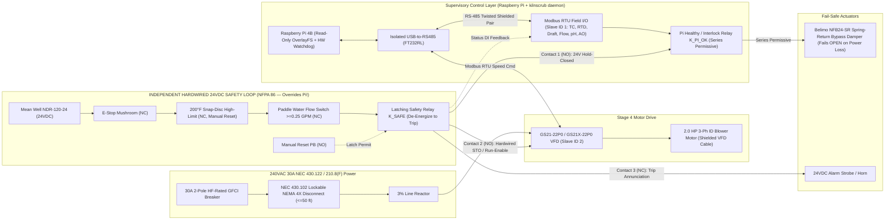

# Control System Alternatives & Complete Raspberry Pi Hardware BOM (`kilnscrub`)

**Purpose:** Practical engineering guide for studio potters, kiln builders, and control engineers comparing **five real-world control architectures** for the 4-stage `kilnscrub` kiln exhaust scrubber — followed by a complete, itemized **Raspberry Pi + Modbus RTU + Hardwired Safety Relay Bill of Materials (BOM)** and fail-safe wiring architecture for the reference 24 cu.ft. wood/salt kiln (`2.0 HP` 240V blower, `2400°F` peak flue, `184°F` quench exit, `200°F` CPVC/PP thermal limit).

---

## Golden Safety Rule (Applies to ALL Control Architectures)

> **NEVER rely on a Raspberry Pi, Linux OS, SD card, Wi-Fi network, microcontroller firmware, or Modbus bus as your primary protection against a `2400°F` kiln melting a CPVC/PP/FRP scrubber!**
>
> Per **NFPA 86** (*Ovens and Furnaces*) and industrial scrubber engineering practice, **primary thermal and water-loss protection MUST be an independent, hardwired 24VDC electromechanical safety loop** (de-energize-to-trip) using dedicated discrete sensors (e.g., `200°F` bimetallic snap-disc thermostat + mechanical water flow switch + E-stop button + manual-reset latching safety relay). The digital controller (Pi, ESP32, PID, or PLC) provides closed-loop kiln draft PID, quench modulation, logging, and alarms *on top of* — never *instead of* — the hardwired safety loop.

---

## 1. Five Control Architectures Compared

### Option (a): Raspberry Pi + `kilnscrub daemon` (Linux + Modbus RTU + Hardwired Safety Relay)
- **How it works:** A Raspberry Pi 4B/5 (or Pi Zero 2 W) runs the compiled Go `kilnscrub daemon --config configs/kilnscrub.example.json` in `"hal_mode": "modbus"`, polling an industrial RS-485 Modbus RTU field I/O module + VFD at 10 Hz (`100 ms` loop), running dual anti-windup PID loops (kiln draft `-0.05 inWC` and quench spray `188°F`), and serving the live browser telemetry dashboard + CSV/JSON firing logs over LAN/Wi-Fi. An **independent 24VDC hardwired safety relay** sits in series with the spring-return bypass damper and VFD Run-Enable/STO.
- **Pros:**
  - Full integration with `kilnscrub`'s web UI, live firing charts, PID tuning, and telemetry logging.
  - Flexible Modbus RTU register mapping (`internal/control/modbus_hal.go`) works with off-the-shelf industrial RS-485 I/O modules and VFDs.
  - Low incremental computer cost (`~$80–$120` for Pi + industrial SD + DIN mount).
- **Cons:**
  - Linux is **not real-time** and microSD cards wear out / corrupt on sudden power loss unless configured with a **read-only root filesystem (`overlayfs` via `raspi-config`)** + industrial high-endurance SLC/pSLC microSD (or NVMe SSD on Pi 5) and Linux hardware watchdog (`bcm2835_wdt`).
  - Requires basic Linux/systemd familiarity to set up and maintain.
  - **Not UL 508A listed as a safety controller** — strictly requires the hardwired safety relay loop below.

### Option (b): ESP32 / RP2040 / Arduino Opta Industrial Microcontroller
- **How it works:** Runs a deterministic bare-metal/FreeRTOS C++ loop (`50–100 ms` tick) with hardware watchdog timer (`WDT`), reading 4–20 mA / thermocouple inputs and commanding the VFD via RS-485 Modbus RTU or `0–10 V` analog output, while streaming telemetry over Wi-Fi/Ethernet/MQTT.
  - *Hobby tier:* **ESP32-S3 / RP2040** (`$10–$25`) + MAX31855/MAX31865 + isolated RS-485 transceiver (requires custom PCB/DIN carrier & 24V→5V isolation — noisy around VFDs unless carefully shielded!).
  - *Industrial tier:* **Arduino Opta RS485 (`AFX00001`, `~$165`)** — UL/CE-listed DIN-rail 24VDC micro-PLC programmed in Arduino C++ *or* IEC 61131-3 Ladder/ST, with built-in RS-485 Modbus RTU, Ethernet/Wi-Fi, 8× 0–10V/DI inputs, and 4× 10A relays.
- **Pros:**
  - **Instant boot (`< 1 s`)**, zero SD card corruption, deterministic loop timing, hardware watchdog built in.
  - Arduino Opta bridges maker friendliness with rugged 24VDC DIN-rail industrial hardware.
- **Cons:**
  - Does not run the Go `kilnscrub` binary directly (requires maintaining separate firmware or acting as a Modbus slave polled by a remote laptop/Pi).
  - Bare hobby ESP32 boards suffer EMI resets near 240V PWM VFDs unless housed in grounded metal enclosures with opto-isolated I/O.

### Option (c): Standalone 1/16-DIN Industrial PID + FM/UL High-Limit Safety Controller
- **How it works:** Zero software and zero coding! Uses two proven kiln-builder panel meters mounted in a NEMA 4X door:
  1. **Draft PID Controller:** e.g., **AutomationDirect SOLO `SL4848-LV` (`~$143`)** accepting `4–20 mA` from the Dwyer `±2 inWC` draft transmitter and outputting `0–10 V` / `4–20 mA` directly to the VFD analog speed input.
  2. **Dedicated FM/UL-Approved High-Limit Safety Controller:** e.g., **Watlow EZ-ZONE PM Limit** or **Omega CN7800 / AutomationDirect SOLO Limit (`~$143–$260`)** wired to a **dedicated quench-exit Type-K TC or Pt100 RTD**, latching a hardwired NC safety relay on `>= 200°F` or open-sensor burnout (NFPA 86 compliant, manual front-panel reset!).
- **Pros:**
  - **Zero coding, zero OS updates, zero SD cards** — any ceramicist who has wired a Bartlett/Watlow kiln controller understands 1/16-DIN PIDs immediately.
  - True **FM/UL-listed independent high-limit** satisfies commercial/university **NFPA 86** inspections cleanly.
  - Most SOLO/Watlow units also expose an optional **RS-485 Modbus RTU** port so a laptop/Pi can still passively log firings!
- **Cons:**
  - No built-in web UI, firing graphs, or automatic multi-sensor logging unless paired with a passive logger.
  - Less flexible for custom filtering (e.g., `0.5 Hz` low-pass draft surge filter on wood stokes, though SOLO includes basic digital input filtering).

### Option (d): Industrial Micro-PLC (AutomationDirect CLICK / Siemens LOGO! / Allen-Bradley Micro810)
- **How it works:** A rugged 24VDC DIN-rail micro-PLC such as **AutomationDirect CLICK `C0-12DD1E-D` (`~$170`) + `C0-04THM` thermocouple / `C0-04AD-1` analog module (`~$120–$180`)**, **Siemens LOGO! 8 (`~$160–$220`)**, or **Allen-Bradley Micro810/820** executes deterministic ladder logic (`< 5 ms` scan) for draft PID, quench modulation, exhaust proving, and fault latching, while acting as a **Modbus RTU/TCP server** for `kilnscrub`'s web dashboard!
- **Pros:**
  - **Gold-standard industrial reliability** (20+ year service life, EMI-hardened for VFD panels, UL 508A panel path for universities/schools/co-ops).
  - Seamless hybrid pairing: the CLICK PLC owns real-time closed-loop I/O (`Modbus Slave ID 1`), and an optional Raspberry Pi running `kilnscrub` connects via RS-485/Ethernet solely for HMI charts and firing logs (if the Pi dies, the PLC keeps scrubbing uninterrupted!).
  - Free ladder programming software (CLICK Programming Software is free, no license fees).
- **Cons:**
  - Slightly steeper initial setup for potters unfamiliar with ladder logic.
  - Higher upfront I/O module cost than a bare Waveshare/ESP32 setup (`~$350–$550` for PLC + analog/TC cards), though still modest compared to the blower/scrubber hardware.

### Option (e): Pure Electromechanical Safety Interlock + Manual VFD Speed Dial
- **How it works:** **Zero microprocessors, zero firmware, zero Modbus.**
  - The potter sets blower suction manually using the **VFD front-panel potentiometer** while glancing at a mechanical **Dwyer Magnehelic (`-1.0 to +0.2 inWC`)** dial gauge (`~$95`) mounted next to the kiln damper.
  - Quench water runs continuously at fixed design pressure (`1.16 GPM` via needle valve + rotameter, or fixed recirculating alkaline spray).
  - Protection is 100% hardwired 24VDC/24VAC electromechanical: **E-Stop (NC) → `200°F` Snap-Disc High-Limit Switch (NC) → Mechanical Paddle Flow Switch `0.25 GPM` (NC) → Latching Safety Relay (manual reset) → Belimo Spring-Return Bypass Damper + VFD Run-Enable**.
- **Pros:**
  - **Lowest cost (`~$350–$500` controls excluding VFD/damper)** and **zero software failure modes**.
  - Trivially inspectable and repairable with a `$20` multimeter by any electrician or studio potter.
  - Completely immune to EMI, OS freezes, firmware bugs, and power-cycle corruption.
- **Cons:**
  - **No automatic draft tracking** during wood-stoking surges (`1.5×–2.0×` flue bursts require manual VFD knob tweaks or running slightly higher steady suction).
  - No digital temperature/pH logging or remote phone/browser monitoring.

---

### Architecture Decision Matrix

| Criterion | (a) Raspberry Pi + `kilnscrub` + Safety Relay | (b) ESP32 / Arduino Opta + Safety Relay | (c) 1/16-DIN PID + FM High-Limit | (d) Micro-PLC (CLICK / LOGO!) + Safety Relay | (e) Pure Electromechanical + Manual VFD |
| :--- | :---: | :---: | :---: | :---: | :---: |
| **Control Electronics Cost** *(excl. VFD, Damper, Disconnect)* | `~$650–$950` *(incl. sensors & Modbus I/O)* | `~$550–$850` *(Opta)* / `~$450` *(ESP32)* | `~$650–$950` *(2× DIN controllers + sensors)* | `~$850–$1,250` *(CLICK + cards + sensors)* | **`~$350–$550`** *(Magnehelic + switches + relay)* |
| **Fail-Safe Independence** *(NFPA 86)* | **High** *(only WITH hardwired safety relay!)* | **High** *(with hardwired safety relay)* | **Very High** *(FM-listed dedicated limit)* | **Very High** *(PLC + hardwired safety relay)* | **Highest** *(100% electromechanical)* |
| **Real-Time Reliability / EMI Immunity** | Moderate *(OS/SD; needs OverlayFS + WDT)* | High *(Opta)* / Low–Mod *(bare ESP32)* | **Very High** *(20-yr industrial)* | **Very High** *(UL 508A industrial)* | **Highest** *(no CPU)* |
| **Auto Draft PID (Wood Stoking Surges)** | **Excellent** *(0.5 Hz LPF + anti-windup)* | **Very Good** *(custom firmware)* | **Good** *(standard PID)* | **Excellent** *(fast scan + optional Pi HMI)* | None *(manual VFD dial)* |
| **Studio-Potter Friendliness** | Good *(great web UI once configured)* | Moderate *(coding required)* | **Excellent** *(familiar kiln panel meters)* | Moderate *(ladder setup)* → **Excellent** daily | **Excellent** *(analog gauge + knob)* |
| **Remote Web UI & Firing Logs** | **Built-in (`kilnscrub`)** | Custom MQTT / Web | Optional *(via Modbus add-on)* | **Excellent** *(paired with `kilnscrub` HMI)* | None |
| **UL 508A / Commercial AHJ Path** | Supervisory only *(safety loop gets approval)* | Good *(Arduino Opta UL-listed)* | **Excellent** *(FM/UL listed)* | **Best** *(standard UL 508A panel)* | **Good** *(simple relay schematic)* |
| **Best Fit For** | Tech-savvy home potters wanting live charts & PID | Embedded makers / Opta builders | Traditional gas/soda/salt studios | Schools, co-ops, universities, pro studios | Budget backyard kilns & bulletproof backup |

> **Recommended Sweet Spot:**
> - **Home / Solo Studio:** **Option (a) Raspberry Pi + `kilnscrub` + Hardwired 24VDC Safety Relay** (detailed in Section 2 below), or **Option (e)** for maximum simplicity on gas/soda kilns.
> - **School / University / Co-op Kiln (48 cu.ft.):** **Option (d) AutomationDirect CLICK PLC** handling real-time I/O + hardwired **NFPA 86 FM High-Limit Safety Relay**, with a Raspberry Pi running `kilnscrub` purely as a non-safety Modbus dashboard/logger.

---

## 2. Complete Raspberry Pi Control & Safety Hardware BOM (Reference 24 cu.ft. Kiln, 2.0 HP 240V)

All prices below reflect realistic 2025–2026 US single-unit distributor estimates (AutomationDirect, McMaster-Carr, DigiKey, Mouser, Global Test Supply, Grainger, Waveshare/Amazon Industrial), excluding freight and tax. Every item is sized for **NEC (NFPA 70)**, **NEC 110.28 (NEMA 4X washdown)**, **NEC 430.102/430.122**, and **NFPA 86** independent hardwired safety compliance.

### 2.1 Itemized Bill of Materials

| # | Subsystem | Component Description | Typical Part Number / Model | Key Technical Spec | Qty | Unit (USD) | Ext. (USD) |
| :-: | :--- | :--- | :--- | :--- | :-: | --: | --: |
| **1** | Compute | **Raspberry Pi 4B (4 GB)** *(or Pi 5 4GB / Pi Zero 2 W)* | `RPI4-MODBP-4GB` *(+ DIN-rail aluminum heatsink case)* | Runs `kilnscrub daemon` + web UI; Ethernet/Wi-Fi | 1 | $75 | $75 |
| **2** | Compute | **Industrial High-Endurance microSD (32 GB)** | SanDisk Max Endurance / Swissbit `S-45u` pSLC | Rated for continuous logging; enable **read-only OverlayFS**! | 1 | $18 | $18 |
| **3** | Enclosure & Power | **NEMA 4X Fiberglass / Polycarbonate Control Enclosure + DIN Rails** | Hammond `1554` / AutomationDirect `N4X` `16"×14"×8"` + backpanel | **NEC 110.28** corrosion-proof washdown enclosure (acid/salt mist) | 1 | $165 | $165 |
| **4** | Enclosure & Power | **UL-Listed 24 VDC DIN-Rail Power Supply (120W, 5A)** | Mean Well `NDR-120-24` (UL 508 listed) | `120/240 VAC` in → `24 VDC 5 A` out (feeds safety loop, damper, transmitters, I/O) | 1 | $32 | $32 |
| **5** | Enclosure & Power | **Isolated 24 VDC → 5 VDC DIN Buck Converter (3A+)** | Mean Well `DDR-15G-5` (or `DDR-30G-5` for Pi 5) | Clean galvanic-isolated `5.1 VDC` power for Raspberry Pi (no wall-wart!) | 1 | $28 | $28 |
| **6** | Enclosure & Power | **24VDC DIN Circuit Breakers / Fuse Blocks & Terminal Strip** | AutomationDirect `DN-F6L24` + `WMZT1C04` (4A/2A) | Separates safety-loop 24V branch from Pi/sensor 24V branch | 1 | $48 | $48 |
| **7** | Modbus RTU Field I/O | **Galvanically Isolated USB-to-RS485 Adapter (FTDI)** | Waveshare `USB TO RS485` (Industrial Isolated, `FT232RL`, TVS/ESD) | `2500 Vrms` isolation protects Pi USB from VFD ground loops; `/dev/ttyUSB0` | 1 | $24 | $24 |
| **8** | Modbus RTU Field I/O | **Modbus RTU 8-Ch Analog Input (`4–20 mA` / `0–10V`) Module** | Waveshare `Modbus RTU Analog Input 8CH` *(or ICP DAS `M-7017`)* | DIN-rail 24VDC, 12/16-bit ADC, reads draft, flow, pH, VFD feedback | 1 | $58 | $58 |
| **9** | Modbus RTU Field I/O | **Modbus RTU Thermocouple / RTD Input Module** | Waveshare `Modbus RTU Thermocouple` / ICP DAS `M-7018Z` *(8-ch TC/RTD)* | Reads Type-K flue TC (`2400°F`) + Pt100 quench exit RTD (`184–210°F`) w/ cold-junction comp | 1 | $65 | $65 |
| **10** | Modbus RTU Field I/O | **Modbus RTU 8-Ch Relay + Analog Output (`0–10V` / `4–20 mA`) Module** | Waveshare `Modbus RTU Relay (D)` + `Modbus RTU Analog Output 8CH` | Drives quench proportional valve (`4–20 mA`), alarm strobe, & Pi-OK series relay | 1 | $75 | $75 |
| **11** | Process Sensors | **Type-K Mineral-Insulated Flue Thermocouple + Ceramic/Inconel Sheath** | AutomationDirect `THMK-H06L06-01` (Inconel 600 / Alumina protection tube) | Rated `>= 2300–2500°F` for Stage 1 quench inlet flue gas | 1 | $72 | $72 |
| **12** | Process Sensors | **Pt100 3-Wire RTD + 316L/PTFE-Coated Thermowell** | AutomationDirect `RTD1-S04-01` + `316L` / PTFE thermowell | Fast-response quench exit temp measurement (`184°F` nom., `188°F` PID SP) | 1 | $68 | $68 |
| **13** | Process Sensors | **`±2 inWC` Differential Pressure Transmitter (`4–20 mA`)** | Dwyer `616KD` / `MSX` Magnesense Bidirectional (`±2 inWC`, `4–20 mA`) | Measures gentle `-0.05 inWC` kiln firebox draft (mount with condensation trap!) | 1 | $155 | $155 |
| **14** | Process Sensors | **Water Flow Sensor / Paddlewheel Flow Switch (`0.25 GPM` Trip)** | Gems `FS-380P` (PP/316SS inline) + Hall flowmeter (`0.1–3 GPM`) | Dual role: discrete NC contact for hardwired safety loop + analog/pulse to Modbus | 1 | $115 | $115 |
| **15** | Process Sensors | **Industrial Submersion pH Electrode + Isolated `4–20 mA` Transmitter** | Atlas Scientific `ENV-40-pH` + Isolated `4–20 mA` Carrier *(or Sensorex `S200C`)* | Monitors sump `pH 6.5–8.5` (galvanic isolation mandatory to avoid sump ground loops!) | 1 | $165 | $165 |
| **16** | **Hardwired Safety Loop** | **Independent `200°F` Snap-Disc High-Limit Thermostat (Manual-Reset NC)** | Honeywell / White-Rodgers `3L05-200` / Klixon (`200°F` open-on-rise, **Manual Reset**) | **Independent NFPA 86 primary thermal limit** mounted in Stage 1→2 transition (CPVC protection!) | 1 | $35 | $35 |
| **17** | **Hardwired Safety Loop** | **24 VDC Force-Guided Safety Relay Module (Dual-Channel / Latching)** | AutomationDirect `SR22-24` / Pilz `PNOZ` / Finder `7S` + Manual Reset PB | De-energize-to-trip latching safety relay; requires deliberate human **Reset** button press | 1 | $125 | $125 |
| **18** | **Hardwired Safety Loop** | **NEMA 4X Twist-to-Release E-Stop Mushroom Button + Reset PB + Piezo Strobe** | AutomationDirect `GCX3226` (NC E-stop) + `GCX3100` (NO Reset) + 24V Strobe/Horn | Immediate manual safe shutdown & visible/audible trip annunciation | 1 | $68 | $68 |
| **19** | **Fail-Safe Damper** | **Spring-Return Fail-Open Bypass Damper Actuator (24 VAC/DC)** | **Belimo `NFB24-SR`** (`90 in-lb`, heavy 8"–12" steel damper) *(or **`TF24`** `18 in-lb` for 6" damper)* | Mechanical spring drives hot-gas bypass **OPEN** in `< 20 s` on ANY power loss or safety trip | 1 | $365 | $365 |
| **20** | **Motor Drive & NEC** | **2 HP 240V 1-Ph Input → 3-Ph Output Modbus VFD (`18.5 A` VT in)** | **AutomationDirect `GS21-22P0`** (IP20, mount inside NEMA 4X panel) *(or washdown **`GS21X-22P0`** `~$540`)* | Built-in RS-485 Modbus RTU (`Slave ID 2`) + hardwired Safe-Torque-Off / DI1 Run-Enable! | 1 | $310 | $310 |
| **21** | **Motor Drive & NEC** | **NEC 430.102 Lockable NEMA 4X Local Disconnect Switch (30A, 240V)** | Square D `DU221RB` / AutomationDirect `H221NRB` (30A 2-Pole NEMA 4X/3R) | Required **in sight (`<= 50 ft`)** of VFD & blower motor; padlockable for LOTO | 1 | $95 | $95 |
| **22** | **Motor Drive & NEC** | **30A 2-Pole HF-Rated GFCI Breaker + 3% Input Line Reactor + Shielded VFD Cable** | Square D `QO230GFI` (HF-compatible) + `LR2-22P0` Reactor + 12/4 Shielded VFD Cable (25 ft) | Satisfies **NEC 430.122 (`125% × 18.5A = 23.1A → 30A`)** & prevents **NEC 210.8(F)** VFD GFCI nuisance trips | 1 | $245 | $245 |
| **23** | Wiring & Misc | **Belden 3105A Shielded RS-485 Cable, Liquid-Tight LFNC Conduit, Cable Glands** | Belden `3105A` (50 ft) + 1/2" & 3/4" LFNC-B + NEMA 4X PG glands + 120Ω terminators | Separates 24VDC/RS-485 low-voltage trays from 240VAC VFD power wiring (EMI hygiene) | 1 | $95 | $95 |

### 2.2 Cost Summary

| BOM Tier | Included Items | Estimated Total (USD) |
| :--- | :--- | --: |
| **Core Raspberry Pi + Sensors + Hardwired Safety Loop** *(Items 1–18 + 23)* | Pi 4B, NEMA 4X panel, 24V/5V PSUs, isolated Modbus RTU I/O, TC/RTD/draft/flow/pH sensors, independent `200°F` snap-disc + safety relay + E-stop | **$1,486** |
| **Complete Turnkey Control + Fail-Safe Damper + 2 HP VFD + NEC Electrical** *(All Items 1–23)* | Adds Belimo `NFB24-SR` spring-return actuator, `GS21-22P0` VFD, NEC 430.102 disconnect, 30A HF-GFCI + line reactor + VFD cable | **$2,501** |
| *Budget Variant (Pi Zero 2 W + Belimo `TF24` on 6" damper + manual pH strips instead of inline pH)* | Replaces Items 1 (`-$57`), 15 (`-$165`), 19 (`-$135`) | **~$2,144** |
| *Washdown Upgrade (`GS21X-22P0` standalone NEMA 4X VFD outside control box)* | Replaces Item 20 (`+$230`), reduces heat inside Pi NEMA 4X panel | **$2,731** |

> **Raspberry Pi Reliability Hardening (Mandatory for Production Firing):**
> 1. Enable **Read-Only Root Filesystem (`OverlayFS`)** (`sudo raspi-config` → Performance Options → Overlay File System) with logs written to a small separate partition or RAM tmpfs synced periodically to LAN/NAS, preventing microSD corruption on sudden power loss.
> 2. Enable the **BCM hardware watchdog** (`dtparam=watchdog=on` in `/boot/firmware/config.txt` + `RuntimeWatchdogSec=10s` in `/etc/systemd/system.conf`) so a kernel hang reboots automatically within 10 s.
> 3. Run `kilnscrub daemon` as a `systemd` service with `Restart=always` and `RestartSec=2`.

---

## 3. Fail-Safe Wiring & Hardwired Safety Override Architecture

### 3.1 Core Fail-Safe Principle (**De-Energize to Trip**)

Every element in the safety chain is wired **Normally-Closed (NC) / Active-High-Healthy**:
- **Normal Healthy Operation:** `24 VDC` passes through **E-Stop (NC)** → **`200°F` Snap-Disc High-Limit (NC)** → **Low-Flow Switch `>= 0.25 GPM` (NC)** → **Safety Relay Latching Coil (`K_SAFE`)**. When the operator presses **Manual Reset (`PB_RST`)**, `K_SAFE` latches **ENERGIZED**:
  - `K_SAFE` Contact 1 (`NO`) supplies `24 VDC` to the **Belimo Spring-Return Bypass Damper**, holding the bypass damper **CLOSED** against its internal mechanical spring.
  - `K_SAFE` Contact 2 (`NO`) closes the **VFD Hardwired Run-Enable / Safe-Torque-Off (`DI1` / `STO`)**, permitting the Raspberry Pi to modulate VFD speed via Modbus RTU.
- **ANY Fault Condition (`>= 200°F`, Water Flow `< 0.25 GPM`, E-Stop Pressed, Wire Break, OR Total 24VDC/240VAC Power Loss):**
  - The series safety string opens → **`K_SAFE` DE-ENERGIZES IMMEDIATELY** (and stays latched OFF even if temperature cools later, until deliberate human press of `PB_RST`!).
  - `K_SAFE` Contact 1 cuts `24 VDC` to the Belimo actuator → **internal mechanical spring drives the hot-gas bypass damper 100% OPEN** (zero power needed!).
  - `K_SAFE` Contact 2 opens **VFD Run-Enable / STO** → **blower halts immediately** regardless of what the Raspberry Pi or Modbus bus commands!
  - `K_SAFE` Contact 3 (`NC` auxiliary) powers the **24 VDC Alarm Horn/Strobe** (or battery-backed buzzer) and signals the Raspberry Pi digital input that a hardware trip occurred.
- **Software Supervision Layer (Secondary Defense-in-Depth):**
  - A **Pi-Supervised Relay (`K_PI_OK`, wired de-energize-to-trip)** can optionally sit in series with `K_SAFE`'s damper/VFD contacts (or trigger the safety relay drop-out): if `kilnscrub daemon` detects `QuenchOutletTemp >= 200–210°F`, `WaterFlow < 0.25 GPM`, `|Draft| > 1.0 inWC`, or `Modbus sensor fault > 5 s`, it drops `K_PI_OK` AND commands VFD = `0%` over RS-485.
  - **Crucially:** Even if the Raspberry Pi crashes completely, freezes, loses its SD card, or has a bug commanding `VFD = 100%` and `Damper = CLOSED`, the **independent hardwired `K_SAFE` loop still opens the bypass damper and kills the VFD** on `>= 200°F`, water loss, E-stop, or power loss!

### 3.2 Mermaid Architecture & Safety Override Diagram



### 3.3 Detailed ASCII Wiring Block Diagram (Panel & Field Connections)

```text
====================================================================================================
  POWER SECTION (NEC 430.122 / 430.102 / 210.8(F) / 110.28)
====================================================================================================
  240VAC 1-Ph Main Panel
   └─[30A 2P HF-GFCI Breaker]──[NEMA 4X Lockable Disconnect (In Sight <=50 ft)]──[3% Line Reactor]
                                        │
                    ┌───────────────────┴──────────────────────┐
                    ▼                                          ▼
         [GS21-22P0 / GS21X-22P0 VFD]                [Mean Well NDR-120-24]
          L1/L2 In -> U/V/W Out (Shielded Cable)      240VAC -> 24VDC (5A)
                    │                                          │
                    ▼                                  ┌───────┴────────┐
            [2.0 HP 3-Ph ID Blower]                    ▼                ▼
                                                [24V Safety Bus]  [DDR-15G-5 Buck]
                                                (2A Breaker F1)   (24V -> 5.1V 3A)
                                                                        │
                                                                        ▼
                                                                [Raspberry Pi 4B]
                                                                (kilnscrub daemon)

====================================================================================================
  HARDWIRED INDEPENDENT 24VDC SAFETY LOOP (NFPA 86 — ZERO SOFTWARE IN THIS PATH!)
====================================================================================================
  +24V (F1) ──[E-Stop NC]──[200°F Snap-Disc NC]──[Flow >=0.25 GPM NC]──┬──[K_SAFE Coil]── 0V
               (Panel)      (Quench Exit Wall)    (Quench Manifold)    │       │
                                                                       ├─[K_SAFE Seal-In NO]
                                                                       └─[PB_RESET Momentary NO]

  SAFETY RELAY K_SAFE OUTPUT CONTACTS (De-Energize to Trip = SAFE):
  ------------------------------------------------------------------
  1) Bypass Damper Power (Fails OPEN on ANY trip OR power loss):
     +24V (F1) ──[K_SAFE NO #1]──[K_PI_OK NO (optional Pi series interlock)]──>(+) Belimo NFB24-SR
                                                                              (-) 0V
     * Energized = Damper Held CLOSED (normal scrub path).
     * K_SAFE drops (OR power fails) = Mechanical Spring drives Bypass Damper 100% OPEN!

  2) VFD Hardwired Run-Enable / Safe-Torque-Off (Overrides Modbus Speed Command!):
     VFD +24V/DCM ──[K_SAFE NO #2]──> VFD DI1 (Run-Enable / External Fault NC) or STO1/STO2
     * K_SAFE drops = VFD coasts/stops immediately even if Raspberry Pi commands 60 Hz!

  3) Alarm Horn/Strobe & Pi Hardware-Trip Status Feedback:
     +24V (F1) ──[K_SAFE NC #3]──> [24VDC Panel Strobe / Piezo Horn] ── 0V
     +24V (F1) ──[K_SAFE NO #4]──> Modbus DI Channel 0 (Pi sees hardware trip in dashboard)

====================================================================================================
  RS-485 MODBUS RTU BUS (9600-8N1, Belden 3105A Shielded Twisted Pair, 120Ω End Terminators)
====================================================================================================
  [Raspberry Pi 4B] ──USB──> [Isolated USB-RS485 (FT232RL)]
                                  │  A(+) / B(-) / GND (Shield grounded at panel end ONLY)
              ┌───────────────────┴───────────────────┐
              ▼                                       ▼
   [Slave ID 1: Field I/O Modules]         [Slave ID 2: GS21 VFD] *(or VFD driven by 0-10V AO)*
    • FC04 Reg 0: DraftPa   (Dwyer ±2 inWC 4-20mA)    • Speed Reference (0–60 Hz)
    • FC04 Reg 1: InletTemp (Type-K Flue TC)          • Speed Feedback  (Actual Hz)
    • FC04 Reg 2: OutTemp   (Pt100 Quench Exit RTD)   • Fault Code Readout
    • FC04 Reg 3: FlowGPM   (Hall Flowmeter)
    • FC04 Reg 4: SumpPH    (Isolated pH 4-20mA)
    • FC04 Reg 5: BlowerFB  (VFD 0-10V / Hz FB)
    • FC16 Reg 100: Blower VFD Cmd (0..10000 -> 0..10V)
    • FC16 Reg 101: Quench Valve   (0..10000 -> 4..20mA)
    • FC05 Coil 0:  Bypass Damper  (wire NC contact for fail-safe de-energize-to-trip!)
    • FC05 Coil 1:  Alarm Latch    (panel indicator / remote alert)
```

### 3.4 Wiring Notes Aligning Hardware with `internal/control/modbus_hal.go` & `configs/kilnscrub.example.json`

1. **Bypass Coil Fail-Safe Polarity (`modbus_hal.go:368, 402`):** Currently `ModbusHAL.ApplyCommands` writes `true` (`0xFF00`) to `BypassDamperCoilAddr` (Coil `0`) when `cmd.BypassDamperOpen == true`. To ensure **de-energize-to-trip** safety on the Modbus relay module, wire the damper permissive through the **Normally-Closed (NC) terminal** of Relay `0` when using the current logic (so `Coil 0 = TRUE` opens the NC contact and releases the Belimo spring), **AND** rely on the **independent hardwired `K_SAFE` relay** (Items 16–18) for total power-loss / Pi-crash / RS-485-disconnect protection! Once `integrator-p6` adds `invert_bypass_coil: true` (active-high healthy) + watchdog timeout on the Waveshare relay module (hardware Modbus timeout register), even a frozen Pi will automatically drop Relay `0` within 5 seconds.
2. **Single-Point Shield Grounding & EMI Hygiene:** Keep `240 VAC` VFD power cables and `U/V/W` motor leads at least **6 inches** away from `4–20 mA`, thermocouple, and RS-485 cables (cross at `90°` only). Terminate shielded VFD motor cable at both VFD PE ground and motor frame; terminate RS-485 and `4–20 mA` cable shields at the **control panel ground bus ONLY** to prevent ground loops.
3. **Draft Transmitter Condensation Trap:** Mount the Dwyer `±2 inWC` transmitter *above* the kiln flue tap with a sloped `1/4"` stainless impulse tube + small vertical condensate/ash drip leg so `2400°F` radiant heat and moisture never reach the silicon pressure diaphragm.
4. **Gravity Emergency Quench Tank (3–5 Min Holdup):** Pair the hardwired safety loop with an elevated `5-gal` gravity water tank + **Normally-Open (NO) 24VDC brass/SS solenoid valve** powered by `K_SAFE`. During a sudden power failure or pump trip, the NO solenoid opens instantly by gravity while the Belimo spring-return bypass damper finishes its `10–20 s` travel to 100% open — preventing any momentary `2400°F` thermal slug from reaching Stage 3 CPVC/PP.
