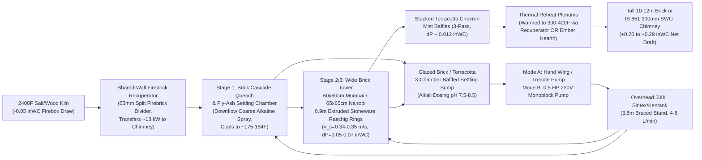

# Local-Materials & Zero-Electricity Kiln Scrubber Engineering Manual (Nairobi, Mumbai & Global Urban Studios)

**Purpose:** A first-principles chemical, thermal, and masonry engineering manual for urban studio potters in **Nairobi, Kenya**, **Mumbai, India**, and similar cities who cannot import industrial CPVC pipe, Alloy C-276 venturis, or `2 HP` VFD pressure blowers — and who frequently face unstable grid power or choose to fire **100% off-grid**.

**Multi-Mode Operating Architecture:** Every mechanical subsystem in this manual is built from **fired ceramics, brick, lime/fireclay mortar, stoneware sewer pipe, and local poly tanks** and operates in three interchangeable modes:
- **Mode A1 — 100% Zero-Electricity Passive Reheat Chimney (`0 psig`, `0 W`):** Natural buoyancy draft via a **wide ceramic-packed masonry tower (`0.04–0.08 inWC`) + tall thermal-reheat chimney (`8–12 m`, `0.20–0.32 inWC`)** paired with a **gravity head tank (`3.5 m` stand)** replenished manually (`8–12 min/hr` on a treadle or semi-rotary hand wing pump). Captures `95–98%` HCl and `~30%` submicron NaCl at **`~$520–$800`**.
- **Mode A2 — 100% Zero-Electricity Certified Steam-Jet Ejector (`20 psig` LP or `60 psig` HP Hydro-Sonic, `0 W`):** Adds a **factory-certified commercial Non-IBR / DOSHS baby steam boiler** (or strictly `<= 20 psig` code-rated `< 0.8 L` monotube coil) driving a `4.6–5.1 mm` supersonic *de Laval* steam nozzle (`514–735 m/s`) into the wide condensing stoneware tower — cutting chimney height to **`4.5–5.5 m`** and lifting submicron NaCl capture to **`~62%` (LP) / `~80%` (HP)** at **`0 W` electricity**! See the dedicated engineering manual [docs/STEAM_EJECTOR_ZERO_ELECTRICITY.md](./STEAM_EJECTOR_ZERO_ELECTRICITY.md) for full compressible-flow, ejector momentum, and pressure-safety design.
- **Mode B — Local-Materials Low-Power (`230V 50Hz` Grid or `12V` Solar):** Identical masonry/ceramic scrubber body, swapping manual pumping for a local **`$40–$60` `0.5 HP` `230V 50Hz` domestic monoblock water pump** (Davis & Shirtliff Dayliff in Nairobi; Kirloskar or Crompton in Mumbai) plus an optional **`12V` solar automotive cooling/cabin fan (`1–2 inWC`)** for zero manual pumping at **`~$510–$910` total build cost**.

**Thermodynamic Reference Baseline:** All mass, energy, pressure-drop, and stoichiometry calculations below are anchored directly to the `kilnscrub` validated reference `24 cu.ft.` Cone 11 (`2400°F` / `1315°C`) wood/salt studio kiln ([pkg/thermo/shomate.go](../pkg/thermo/shomate.go), [pkg/thermo/quench.go](../pkg/thermo/quench.go), [pkg/scrubber/packedbed.go](../pkg/scrubber/packedbed.go), [pkg/scrubber/venturi.go](../pkg/scrubber/venturi.go), [docs/ENGINEERING_VALIDATION.md](./ENGINEERING_VALIDATION.md)):
- **Peak firing load:** `129.6 kW` LHV (`~29.2 kg/hr` seasoned hardwood, `30%` excess air); hot kiln exhaust sensible enthalpy = **`97.54 kW`** (`2.098 mol/s`, `0.0610 kg/s`, `579.5 ACFM` at sea level).
- **Adiabatic quenched gas (sea level, `101.325 kPa`):** `T_sat = 183.86°F` (`84.37°C` / `357.52 K`), `y_H2O = 55.71%`, `MW_sat = 23.65 g/mol`, `n_sat = 4.120 mol/s`, `m_out = 0.0974 kg/s`, `Q_out = 0.1208 m³/s` (`256.0 ACFM`), `ρ_g = 0.806 kg/m³`, `μ_g = 1.605×10⁻⁵ Pa·s`.
- **Nairobi altitude adjustment (`1,660 m` / `83.5 kPa`):** Water boils at `94.7°C` (`202.5°F`), lowering adiabatic `T_sat` by `~9°F` to `~174.5°F` (`79.2°C`), reducing gas density by `~18%` (`ρ_amb ≈ 0.986 kg/m³`), and expanding volumetric flow by `~21%` (`Q_out ≈ 0.146 m³/s`). Every masonry sizing rule below accounts explicitly for both sea-level **Mumbai** (`30°C`, `101.3 kPa`) and high-altitude **Nairobi** (`20–22°C`, `83.5 kPa`).

---

## 1. First-Principles Draft Physics Without Electric Fans

### 1.1 Why a `21 inWC` Venturi and a Cool `184°F` Stack Both Fail on Natural Draft

Natural chimney draft is governed strictly by hydrostatic buoyancy between the cooler ambient air column outside and the lighter gas column inside a chimney of height `H`:

$$\Delta P_{\text{buoy}} = g \, H \, (\rho_{\text{amb}} - \rho_{\text{stack}})$$

where $g = 9.807\text{ m/s}^2$, $\rho = \frac{P \cdot MW}{R \cdot T}$, and $1\text{ inWC} = 249.09\text{ Pa}$.

1. **Why a `21 inWC` Powered Venturi Cannot Run on Natural Draft:**
   From [pkg/scrubber/venturi.go](../pkg/scrubber/venturi.go) and [docs/ENGINEERING_VALIDATION.md](./ENGINEERING_VALIDATION.md), a `70 m/s` submicron wet venturi plus narrow `12"` irrigated packed bed requires **`21.2 inWC` (`5,280 Pa`)** of static suction. Even if an un-quenched stack stayed at a blistering `1,000°F` (`811 K`, `Δρ ≈ 0.77 kg/m³`), producing `5,280 Pa` by buoyancy alone would require a chimney height of:

   $$H_{\text{req}} = \frac{5{,}280\text{ Pa}}{9.807 \times 0.77} \approx \mathbf{700\text{ meters}\ (2{,}300\text{ ft!})}$$

   No passive chimney on Earth can drive a high-energy submicron venturi. Zero-electricity scrubbing **must abandon high-velocity venturi throats altogether**.

2. **Why a Cool Saturated `184°F` Scrubber Exit Stalls a Normal Chimney:**
   When `2400°F` kiln gas is adiabatically quenched to `183.9°F` (`357.5 K`), its density rises to `ρ_stack = 0.806 kg/m³` (despite its lower water-rich molecular weight `23.65 g/mol`). In Mumbai's warm `30°C` (`303 K`) ambient air (`ρ_amb = 1.164 kg/m³`), the density differential collapses to **`Δρ = 0.358 kg/m³`**:
   - At `H = 10 m` (`33 ft`), gross draft is only $9.807 \times 10 \times 0.358 = \mathbf{35.1\text{ Pa}\ (0.141\text{ inWC})}$, and after chimney friction/exit velocity head (`~2.6 Pa`), net usable draft is **`0.131 inWC`** (and only **`0.117 inWC`** in Nairobi at `1,660 m` altitude!).
   - Worse, a cool saturated plume loses sensible heat through brick walls, condenses liquid rain inside the stack, drops to `140–150°F`, and stalls completely during wood stoking surges — pushing HCl and CO back out the kiln stoke ports!

---

### 1.2 The Zero-Electricity Draft Solution: Wide Ceramic Bed + Thermal-Reheat Chimney

Natural draft becomes rock-solid when you solve **both** halves of the hydraulic equation simultaneously: **slash scrubber pressure drop by `10×–20×`** AND **reheat the clean scrubbed gas before it enters a tall `8–12 m` masonry/terracotta chimney**.

#### Step 1 — Replace the Narrow High-Speed Column with a Wide Ceramic-Packed Masonry Tower

In [pkg/scrubber/packedbed.go](../pkg/scrubber/packedbed.go), the Ergun equation scales **quadratically** with superficial gas velocity $v_s$ in the inertial regime:

$$\frac{\Delta P_{\text{dry}}}{Z} = 150 \frac{(1-\varepsilon)^2}{\varepsilon^3} \frac{\mu_g v_s}{d_{p,\text{eq}}^2} + 1.75 \frac{1-\varepsilon}{\varepsilon^3} \frac{\rho_g v_s^2}{d_{p,\text{eq}}}, \qquad d_{p,\text{eq}} = \frac{6(1-\varepsilon)}{a_p}$$

In the powered baseline (`D = 0.30 m`, `v_s = 1.71 m/s`, `Z = 1.05 m`, `55.5%` of flood), irrigated bed pressure drop is **`~360 Pa` (`1.45 inWC`)**. Widening the tower to a simple **`60 × 60 cm` (`24" × 24"`)** brick shaft in Mumbai (or **`65 × 65 cm`** in high-altitude Nairobi) increases cross-sectional area by **`5×–6×`**, dropping superficial velocity to **`v_s = 0.34–0.40 m/s`** (`< 22%` of Eckert flooding velocity!). Because $v_s^2$ falls by **`20×–25×`** and liquid holdup drops to the low-loading regime (irrigated multiplier `~1.35–1.45×` instead of `1.70×`), bed pressure drop plummets into the **`0.04–0.08 inWC` (`10–20 Pa`)** band:

| Masonry Tower Internal Cross-Section | Superficial Gas Vel `v_s` (Mumbai / Nairobi) | Potter-Extruded Ceramic Packing (`Z = 0.85–0.95 m`) | Sauter `d_p,eq` (`mm`) | Dry Ergun `ΔP` (`Pa`) | Irrigated Bed `ΔP` (`1.4×`, `Pa / inWC`) | Reduction vs. Powered `0.30 m` Bed (`360 Pa`) |
| :--- | :---: | :--- | :---: | :---: | :---: | :---: |
| **`55 × 55 cm`** (`0.303 m²`) | `0.40` / `0.48 m/s` | `1.25"` thin-wall stoneware Raschig (`ε = 0.75, a_p = 150 m⁻¹`) | `10.0` | `13.3 Pa` | **`18.6 Pa` (`0.075 inWC`)** | **`19.4×` lower** |
| **`60 × 60 cm`** (`0.360 m²`) *(Mumbai Std)* | **`0.34`** / `0.41 m/s` | `1.0"` stoneware Raschig (`ε = 0.74, a_p = 185 m⁻¹`) | `8.43` | `11.2–13.5 Pa` | **`15.7–18.9 Pa` (`0.063–0.076 inWC`)** | **`19.0×` lower** |
| **`60 × 60 cm`** (`0.360 m²`) *(Low-ΔP)* | **`0.34`** / `0.41 m/s` | `1.25"` thin-wall stoneware Raschig (`ε = 0.75, a_p = 150 m⁻¹`) | `10.0` | `9.6 Pa` | **`13.4 Pa` (`0.054 inWC`)** | **`26.9×` lower** |
| **`65 × 65 cm`** (`0.423 m²`) *(Nairobi Std)* | `0.29` / **`0.35 m/s`** | `1.0"` stoneware Raschig (`ε = 0.73, a_p = 190 m⁻¹`) | `8.53` | `10.0 Pa` | **`14.1 Pa` (`0.056 inWC`)** | **`25.5×` lower** |
| **`70 × 70 cm`** (`0.490 m²`) *(Ultra-Low-ΔP)* | `0.25` / `0.30 m/s` | `1.0"` stoneware Raschig (`ε = 0.73, a_p = 190 m⁻¹`) | `8.53` | `7.7 Pa` | **`10.7 Pa` (`0.043 inWC`)** | **`33.6×` lower** |

Likewise, at `v_s = 0.35–0.40 m/s`, the dynamic pressure drop across a stacked terracotta chevron mist baffle (`K = 55`) collapses from `64.8 Pa` (`0.260 inWC`) down to **`2.7–3.6 Pa` (`0.011–0.014 inWC`)**, and generous `300 mm` ID stoneware/brick flues (`v_duct ≈ 1.7–2.1 m/s`) keep all duct/bend/settling-chamber losses under **`7–10 Pa` (`0.028–0.040 inWC`)**!

#### Step 2 — Reheat Clean Scrubbed Gas to `300–420°F` in a Tall `8–12 m` Brick/Terracotta Chimney

Reheating the clean, demisted `184°F` (`84°C`) scrubber outlet (`n_sat = 4.120 mol/s`, `C_p,mix ≈ 32.2 J/(mol·K)`) by `+120°F` to `+220°F` (up to **`304–404°F` / `151–207°C`**) requires only **`8.8–16.2 kW`** — just **`9%–17%`** of the `97.54 kW` of waste heat already leaving the kiln firebox! Reheating accomplishes **two goals at once**: it superheats the plume `120–240°F` above its `184°F` dew point (completely eliminating wet chimney condensation and low-hanging white steam plumes) AND increases chimney buoyancy draft by **`+45%` to `+65%`**:

| Chimney Height `H` | Reheated Mean Stack Temp | Gross / Net Draft — **Cool Ambient `15°C` Sea Level** (`300 mm` flue) | Gross / Net Draft — **Mumbai `30°C` Sea Level** (`300 mm` flue) | Gross / Net Draft — **Nairobi `20°C`, `1,660 m` (`83.5 kPa`)** (`300 mm` flue) |
| :---: | :---: | :---: | :---: | :---: |
| `8.0 m` (`26 ft`) | `184°F` *(Unheated — FAIL)* | `0.132"` / `0.123"` | `0.113"` / `0.104"` | `0.103"` / `0.092"` |
| `8.0 m` (`26 ft`) | `360–420°F` *(Reheated)* | `0.186–0.200"` / `0.175–0.188"` | `0.167–0.181"` / `0.156–0.168"` | `0.148–0.159"` / `0.134–0.144"` |
| **`10.0 m` (`33 ft`)** | `184°F` *(Unheated — Marginal)* | `0.165"` / `0.155"` | `0.141"` / `0.131"` | `0.129"` / `0.117"` |
| **`10.0 m` (`33 ft`)** | **`300–420°F` *(Target)*** | **`0.213–0.250"` / `0.201–0.236"`** | **`0.190–0.226"` / `0.177–0.212"`** | **`0.169–0.199"` / `0.154–0.182"`** |
| **`12.0 m` (`40 ft`)** | **`300–420°F` *(Target)*** | **`0.256–0.300"` / `0.243–0.285"`** *(up to **`0.32"`** at `450°F` / `10°C`!)* | **`0.227–0.271"` / `0.214–0.256"`** | **`0.203–0.239"` / `0.187–0.220"`** |

*(Note on Nairobi Altitude: Because Nairobi sits at `1,660–1,795 m` elevation (`P ≈ 83.5 kPa`), ambient air density is `18%` lower than sea level. Nairobi studios running 100% zero-electricity should build the full **`11–12 m` (`36–40 ft`)** chimney and **`65 × 65 cm`** bed to secure `>= 0.20 inWC` net draft even on warm afternoons.)*

#### Two Zero-Electricity Ways to Deliver `10–15 kW` of Chimney Reheat (Zero Gas Cross-Contamination!)

1. **Option 1 — Concentric / Shared-Wall Firebrick Flue Recuperator (Zero Extra Fuel!):**
   Route the `2400°F` (`1315°C`) raw kiln exit flue vertically alongside (or concentrically inside) the base of the clean scrubbed chimney, separated by a **gas-tight `65 mm` split firebrick wall** (or a `25 mm` thick slip-cast refractory/stoneware inner liner cemented with sodium-silicate/fireclay mortar).
   - **Heat-transfer proof:** With hot gas cooling from `2400°F → 1600°F` and clean scrubbed gas warming from `184°F → 364°F`, the log-mean temperature difference is **`LMTD ≈ 900 K`**. Across a `65 mm` split firebrick wall (`k ≈ 1.1 W/(m·K)`, `h_hot ≈ 35 W/(m²·K)` radiative+convective, `h_cold ≈ 15 W/(m²·K)`), overall $U = \mathbf{6.5\text{ W/(m}^2\cdot\text{K)}}$ (`8.5 W/(m²·K)` for a `25 mm` refractory tile liner).
   - Required heat-transfer wall area for `13.3 kW` (`+180°F` reheat to `364°F`):
     $$A_{\text{req}} = \frac{13{,}300\text{ W}}{6.5 \times 900} = \mathbf{2.28\text{ m}^2}$$
     That is just a **`1.9 m` tall × `1.2 m` perimeter** shared brick flue-wall (or `1.85 m` of `300 mm` OD concentric refractory inner pipe) — built straight into the kiln-to-quench elbow! Because the clean chimney is at **slightly lower suction** (`-0.16 inWC`) than the hot kiln throat (`-0.05 inWC`), inspect mortar joints before every firing and butter the recuperator divider with refractory mastic/fireclay slip so zero raw HCl leaks across the wall!
2. **Option 2 — Chimney-Base Charcoal / Wood-Ember Draft-Booster Hearth (Simplest Masonry!):**
   Build a small `30 × 30 cm` firebrick grate box (a classic Kenyan *jiko* or Indian *chulha* hearth) directly at the base of the `10–12 m` clean chimney with a tight iron damper door. Burning just **`1.5–2.5 kg/hr`** of dry hardwood charcoal (`LHV ≈ 29 MJ/kg`) or dry split wood embers transfers `9–15 kW` cleanly into the ascending scrubbed flue gas — costing **`< $1.50` per 3-hour salting** and letting the potter pre-warm the chimney *before* lighting the main kiln so cold-start draft is immediate!

#### Complete Zero-Electricity Draft Budget Check (`10–12 m` Reheated Chimney)

| Draft Component | Pressure Requirement / Supply | Margin Check |
| :--- | :---: | :--- |
| Kiln Firebox Target Draw | **`-0.050 inWC`** (`12.5 Pa`) | Keeps kiln negative during stoking |
| Wide Ceramic Packed Bed (`60×60` or `65×65 cm`, irrigated) | **`-0.055 to -0.075 inWC`** (`14–19 Pa`) | `20×` lower than narrow baseline bed |
| Terracotta Chevron Mist Baffles (`v_s = 0.35 m/s`) | **`-0.012 inWC`** (`3 Pa`) | Ultra-low velocity head |
| Brick Settling Chamber, Quench Chamber & `300 mm` Flues | **`-0.030 inWC`** (`7.5 Pa`) | Swept masonry bends, generous area |
| **TOTAL SYSTEM RESISTANCE (Zero-Electricity Mode)** | **`-0.147 to -0.167 inWC` (`37–42 Pa`)** | **Total suction needed at chimney base** |
| **NET AVAILABLE REHEATED CHIMNEY DRAFT (`10–12 m`, `360–420°F`)** | **`+0.200 to +0.285 inWC` (`50–71 Pa`)** *(up to `0.32"` cool night)* | **`+25% to +80%` positive draft reserve** (trimmed via brick sliding damper!) |

---

### 1.3 Gravity Water-Head Trompe / Ejector Audit (`P_hyd = ρ g Q H`)

Many zero-electricity builders wonder whether a rooftop or elevated **Sintex / Kentank gravity tank (`3–6 m` head)** can run a water-jet ejector (*trompe*) to pull kiln draft or atomize fine mist. First-principles hydraulic power settles this cleanly:

$$P_{\text{hyd}} = \rho_L \, g \, Q_L \, H, \qquad \Delta P_{\text{static,nozzle}} = \rho_L \, g \, H$$

| Overhead Tank Elevation `H` | Nozzle Static Pressure (`PSI` / `bar`) | Gravity Flow `Q_L` (`L/min` / `GPM`) | Raw Hydraulic Power `P_hyd` (`W`) | Realistic Downflow Gas Assist (`η_ej = 10%–15%`) across `0.1208 m³/s` | Engineering Verdict |
| :---: | :---: | :---: | :---: | :---: | :--- |
| `3.0 m` (`10 ft`) | **`4.3 PSI`** (`0.29 bar`) | `4–6 L/min` (`1.1–1.6 GPM`) | `2.0–2.9 W` | `0.007–0.015 inWC` (`1.6–3.7 Pa`) | Ideal gentle irrigation over ceramic bed; negligible draft assist |
| `3.5 m` (`11.5 ft`) | **`5.0 PSI`** (`0.34 bar`) | `4–6 L/min` (`1.1–1.6 GPM`) | `2.3–3.4 W` | `0.008–0.017 inWC` (`1.9–4.3 Pa`) | **Sweet spot for manual zero-electricity stand height** |
| `4.0 m` (`13 ft`) | **`5.7 PSI`** (`0.39 bar`) | `10–20 L/min` (`2.6–5.3 GPM`) | `6.5–13.1 W` | **`0.022–0.065 inWC`** (`5.4–16.2 Pa`) | Useful secondary downflow quench assist if rooftop tank exists |
| `5.0–6.0 m` (`16–20 ft`) | **`7.1–8.5 PSI`** (`0.49–0.59 bar`) | `15–20 L/min` (`4.0–5.3 GPM`) | `12.3–19.6 W` | **`0.045–0.098 inWC`** (`11–24 Pa`) | Modest `~0.03–0.08 inWC` downflow assist, **NOT** venturi suction (`21 inWC`)! |

**Three Clear Engineering Conclusions on Gravity Head:**
1. **`4–9 PSI` CANNOT Atomize Fine Quench Fog (`<= 200 µm`):** Hydraulic pressure atomizers require `40–100 PSI` (`28–70 m` head). At `4–9 PSI`, gravity water exits as coarse droplets (`800–2,000 µm`) or cascading sheets. Therefore, **Stage 1 cannot be a short open fog tower** — instead, pour gravity quench water over a **wetted refractory baffle / stacked-brick cascade** so gas contacts large wetted ceramic surfaces and falling curtains over `1.5–2.0 s`!
2. **Co-Current Downflow Quench Gives a Free Bonus (`~0.01–0.08 inWC`):** Spraying the quench water **downward** in the same direction as the flue gas entering the brick quench leg contributes `0.01–0.03 inWC` at `4–6 L/min` (or `0.03–0.08 inWC` during brief `15–20 L/min` stoking-surge boosts from a `5–6 m` rooftop tank). Never rely on a gravity trompe as your *primary* draft engine — treat it strictly as a gentle helper to the `10–12 m` reheated chimney.
3. **Manual Pumping Penalty Bounds `Q_L`:** Dumping `20 L/min` (`1,200 L/hr`) for a trompe requires lifting **60 twenty-liter jerrycans per hour** — humanly unsustainable! Keeping zero-electricity recirculation at **`4–6 L/min` (`240–360 L/hr`)** delivers `95–98%` HCl capture in a hydrophilic ceramic bed while keeping manual pumping effortless (`8–12 min/hr`).

---

### 1.4 Pressurized Steam-Jet Ejector Safety Boundary: DIY Drum Boilers REJECTED vs. Certified Steam-Drive Upgrade

> **DANGER — LETHAL IMPROVISED BOILER EXPLOSION HAZARD (DIY WELDED DRUMS STRICTLY REJECTED):**
> Because `86–155 kW` of `2400°F` kiln exhaust is available, builders occasionally ask about inserting an improvised welded steel drum boiler into the kiln flue to generate **`15–60 psig` (`1–4.1 barg`) live steam** to drive a steam-jet ejector without electricity. **NEVER BUILD AN UNCERTIFIED DIY DRUM BOILER.**

**First-Principles Stored-Energy & Failure Audit (Why Improvised Drum Boilers Are Banned):**
1. **Structural End-Cap Forces:** Even at a deceptively "low" **`15–30 psig`**, internal pressure exerts **`1,696–3,393 lbf` (`7.5–15.1 kN`)** — the weight of a full sedan — pushing outward on every `300 mm` (`12"`) flat end-cap or non-code weld!
2. **Flashing-Water BLEVE Energy:** Superheated liquid water inside a `50 L` (`40 kg` water) DIY drum boiler at `30 psig` (`134.5°C` / `274°F`) stores isentropic flash expansion work of:
   $$e_{\text{flash}} = c_{p,w}\left[T_1 - T_2 - T_2 \ln\!\left(\frac{T_1}{T_2}\right)\right] = 4.21 \left[407.65 - 373.15 - 373.15\ln\!\left(\frac{407.65}{373.15}\right)\right] = \mathbf{6.32\text{ kJ/kg}}$$
   Across `40 kg` of boiling water, rupture instantaneously flashes `6.5%` of the water into steam (`1,600×` volume expansion!), releasing **`253 kJ` of explosive blast energy — equivalent to `60 grams` of TNT** (`95 kJ` / `23 g` TNT at `15 psig`; **`579 kJ` / `138 g` TNT at `60 psig`!**) while showering everyone within `10 meters` in `135–153°C` scalding shrapnel!
3. **Thermal Runaway + Acid Corrosion:** A `2400°F` wood/salt flue surges unpredictably during stoking while coating exterior mild-steel coils in hot corrosive HCl and NaCl slag (`> 100 mpy` wall thinning). Without factory-certified pressure vessels, pop-tested spring-loaded safety relief valves (PRVs), sight glasses, and statutory inspection compliance, a flue-heated drum boiler is a homemade bomb.

**The Safe, Code-Compliant Engineering Path (When You Want `62–80%` Submicron NaCl Capture at `0 W`):**
While DIY-welded drum boilers remain **100% rejected**, pressurized steam **does** solve the zero-electricity velocity problem safely when sourced strictly through **code-compliant hardware** documented in full in **[docs/STEAM_EJECTOR_ZERO_ELECTRICITY.md](./STEAM_EJECTOR_ZERO_ELECTRICITY.md)**:
- **Path A (Recommended — `20 psig` LP or `60 psig` HP Hydro-Sonic):** Procure an off-the-shelf **factory-certified commercial baby steam boiler** — e.g., an Indian **Non-IBR (`< 25 L` capacity exemption)** wood/LPG mini boiler in Mumbai (`₹28k–₹1.35L`) or a **KEBS/DOSHS-compliant commercial laundry/food baby boiler** in Nairobi (`KES 48k–185k`) complete with factory `1.5× MAWP` hydro-test certificate, calibrated ASME/IBR spring-loaded PRV, pressure gauge, fusible plug, and sight glass. Expanding `22–54 kg/hr` of steam through a `4.6–5.1 mm` stainless/brass *de Laval* nozzle delivers **`514–735 m/s` supersonic velocity**, cuts chimney height to **`4.5–5.5 m`**, and lifts submicron NaCl capture to **`~62%` (`20 psig`)** or **`~80%` (`60 psig`)** via hygroscopic NaCl condensation growth + `14–25 µm` Hydro-Sonic droplet atomization at **`0 W` electricity**.
- **Path B (Low-Pressure `<= 15–20 psig` Only):** A **code-rated small-bore seamless once-through monotube flash coil** (`< 0.8 L` liquid inventory = **`53×` lower flash energy, `< 2.8 kJ`**) heated indirectly outside the raw acid flue, strictly equipped with a certified `25 psig` ASME/BS spring-loaded PRV, bronze check valve, `>= 1.5× MAWP` cold hydro-test, open `0 psig` atmospheric feed tank, and scald shielding.
- **Passive Baseline Option:** If you want **zero pressure vessels of any kind**, stay with the atmospheric **`0 psig` Passive Reheat Chimney** in Sections 1.2 and 2 below!

---

## 2. All-Ceramic, Firebrick & Salt-Glazed Stoneware Construction (The Zero-Meltdown Breakthrough)

The single biggest engineering headache in Western plastic-and-stainless kiln scrubbers ([docs/ENGINEERING_VALIDATION.md](./ENGINEERING_VALIDATION.md)) is a **double material trap**:
- **316L Stainless Steel** suffers rapid chloride pitting and stress-corrosion cracking (Cl-SCC) above `140°F` in wet acidic HCl (`184°F`, `1,000–2,000 ppm HCl`).
- **CPVC & Polypropylene** melt or collapse under suction above **`200–210°F`** — requiring `$700–$1,700` of NFPA 86 fail-safe spring-return dampers, `200°F` snap-discs, and emergency quench interlocks just to prevent a plastic fire if a water pump trips!

**The Frugal Ceramic Breakthrough:** Potters already work with the **ultimate industrial acid-and-fire-proof chemical engineering material on Earth — vitrified stoneware and firebrick!**

| Material Property | 316L Stainless Steel | Schedule 80 CPVC / PP | **Vitrified Stoneware / IS 651 SWG Pipe / Firebrick** |
| :--- | :---: | :---: | :---: |
| **Max Service Temp (Dry Accident)** | `~1,500°F` | **`200°F` (MELTS / COLLAPSES!)** | **`1,800–2,500°F` (ZERO MELTDOWN!)** |
| **Hot Wet HCl (`184°F`, `pH 1–8`)** | Pits & cracks (`Cl-SCC > 140°F`) | Immune | **100% IMMUNE** (standard industrial HCl tower lining for 150 years!) |
| **Wetting Behavior (Surface Energy)** | Moderate | Hydrophobic (`σ_c = 33 mN/m` — needs `7+ GPM/ft²`!) | **Strongly Hydrophilic (`σ_c > 72 mN/m` — films smoothly at `0.5–1.5 GPM/ft²`!)** |
| **Needs NFPA 86 `$700` Meltdown Interlock?** | No | **YES (Mandatory)** | **NO** (If water stops, hot gas simply passes safely up the brick chimney!) |
| **Availability in Nairobi & Mumbai** | Expensive import | Expensive import (`> 4"` rare) | **Abundant, locally fired, pennies on the dollar!** |

*(Hydrophilic wetting bonus: Unglazed high-fired stoneware has high surface energy so scrubbing liquor spreads into a thin continuous film even at our low manual zero-electricity flow of `4–6 L/min` across a `0.36 m²` bed — where hydrophobic plastic Pall rings would channel dry!)*

### 2.1 System Architecture Flow Diagram

### 2.2 Kiln-Builder Construction Details (Zero Exotic Parts)

1. **Stage 1 — Brick Wetted-Cascade Quench & Ash Settling Chamber:**
   - Build a `60 × 90 × 120 cm` high-alumina firebrick (hot inlet side) and dense red-brick (wet side) downflow chamber immediately downstream of the recuperator wall.
   - Stack **3 staggered tiers of spaced firebricks** (checkerboard open slots `>= 75 mm` wide so ash never clogs) beneath a simple drilled `25 mm` stoneware or CPVC/brass drip-bar fed at `2–3 L/min` from the gravity tank. Hot gas enters at the top (`1600–2000°F`), hits the flooded ceramic bricks and falling alkali curtain, flashes `~2.2 L/min` (`0.58 GPM`) to steam, drops coarse wood embers and fly ash straight into the water-sealed sump below, and exits horizontally at `175–184°F` into the base of the wide packed tower.
   - **Mumbai shortcut:** Use two **`300 mm` ID IS 651 Salt-Glazed Stoneware (SWG) sewer pipes** (`₹380–₹480` / `$4–$5` per `600 mm` socketed length!) stacked vertically above a brick settling pit as a completely seamless, acid-proof, drop-in cylindrical quench leg!
2. **Stage 2/3 — Wide Masonry Absorber Tower & Potter-Extruded Stoneware Raschig Rings:**
   - Build a **`60 × 60 cm`** (Mumbai) or **`65 × 65 cm`** (Nairobi) internal square brick shaft (`~2.2 m` tall) lined internally with a `10 mm` skim of **acid-resistant lime-pozzolana / fired-clay grog mortar** (or glazed ceramic floor tiles buttered in silicate/cement mortar) to prevent weeping through porous brick mortar joints.
   - Support the packing `40 cm` above the gas inlet on **spaced firebrick arch ribs** (`50 mm` gaps) topped with a heavy terracotta perforated kiln-shelf grate (or glazed clay bars) capable of carrying the **`~350–420 kg` wet ceramic ring load**.
   - **Extruding Your Own Stoneware Raschig Rings (`~0.35 m³` = `~12.5 ft³`):**
     - Blend local stoneware clay with `15%–20%` coarse grog (crushed bisque/firebrick) for thermal-shock resistance.
     - Extrude hollow cylinders **`25–32 mm` (`1"–1.25"`) OD with thin `2.5–3.0 mm` walls**, wire-cut to length `L = OD` (`ε ≈ 0.73–0.75`, `a_p ≈ 150–190 m²/m³`).
     - Fire **unglazed** to **Cone 6–10 vitrification** (`< 3%` water absorption) inside kiln corners and saggars over 2–3 normal studio firings! Unglazed vitrified stoneware stays naturally rough and hydrophilic while remaining impervious to boiling HCl and salt-crystal spalling.
     - **Important Packing Depth:** Fill **`0.90–1.00 m`** deep (`~0.32–0.42 m³` total). At `v_s = 0.34 m/s` and `4–6 L/min`, this delivers `NTU ≈ 3.4–3.8` in the packed bed alone plus `~30–50%` pre-absorption in the alkaline cascade quench — guaranteeing **`95–98%` overall HCl removal**!
   - **Gravity Liquid Distributor (Zero-Clog Trickle Pan):** Never use tiny mist nozzles on a `5 PSI` gravity feed with recirculated ash water! Place a flat **perforated clay or HDPE drip tray** (a shallow box with `25–36` drilled `4 mm` holes on a `10 cm` grid, ringed by `15 mm` standpipe notches so fine ash settles on the tray floor while clean liquor overflows evenly) `15 cm` above the top of the ceramic rings.
3. **Stacked Terracotta Chevron Mist Baffles:**
   - Directly above the drip tray, stack **3 offset rows of angled terracotta roof tiles (Mangalore tiles in Mumbai; clay ridge tiles in Nairobi) or studio-extruded `45°` V-shaped clay slats** spaced `35 mm` apart in a brick rebate frame. Rising mist impinges on the angled wet clay surfaces and drains cleanly back onto the packing with only **`~0.012 inWC`** drag!
4. **Glazed Terracotta / Brick 3-Chamber Baffled Settling Sump:**
   - Build a `120 × 60 × 60 cm` (`~400 L` working volume) sunken or ground-level brick tank plastered waterproof inside and lined with cheap local ceramic wall tiles (or drop in two linked `200 L` reconditioned HDPE drums connected by `50 mm` bulkhead pipes).
   - Divide into **3 under-over weir chambers**: Chamber 1 receives hot quench drain + wood fly ash (heavy sludge settles to the bottom for easy scooping after firing); Chamber 2 is the **alkali dosing & pH check bay**; Chamber 3 holds clarified `pH 7.5–8.5` liquor feeding the hand-pump or `0.5 HP` electric pump suction strainer!
5. **Mortar Joints & Salt-Glazed SWG Chimney (`8–12 m`):**
   - **Hot zone (`> 600°F`, kiln exit & recuperator):** `50%` fireclay + `50%` fine silica sand/grog (or commercial refractory mortar + `5%` sodium silicate waterglass).
   - **Warm wet zone (`175–420°F`, tower & chimney):** Dense **1:1:4 Portland-cement : hydrated-lime : sharp-sand** mortar (or Indian *lime-surkhi* brick-dust pozzolanic mortar), sealed on wet interior joints with potassium/sodium silicate brush coat.
   - **Chimney Stack:** In Mumbai, stacking **`12–16` lengths of `300 mm` ID IS 651 Salt-Glazed Stoneware pipes** (`600 mm` effective length each = `7.2–9.6 m` above a `2.5 m` brick base!) braced inside a simple external MS angle-iron guy-wired cage creates a `10–12 m` acid-proof chimney in two days for under **`₹6,000` (`$65`)**! In Nairobi, build a tapered hollow **red clay brick chimney (`35 × 35 cm` internal)** strapped with `25 × 3 mm` flat iron bands every `1.5 m` and 3 galvanized steel guy wires above `6 m`.

---

## 3. Local Alkali Neutralization Chemistry (Nairobi & Mumbai)

Every kilogram of NaCl thrown into a Cone 10–11 salt kiln hydrolyzes (at conservative `100%` upper-bound conversion: $2\,\text{NaCl} + \text{H}_2\text{O} + \text{SiO}_2 \to \text{Na}_2\text{SiO}_3 + 2\,\text{HCl}$) into **`17.11 mol` (`0.624 kg`) of HCl gas**.
- **Small/moderate salt charge (`1.60 kg` / `3.5 lb` NaCl):** `27.38 mol` HCl upper bound.
- **Reference `24 cu.ft.` heavy salt firing (`2.72 kg` / `6.0 lb` NaCl = `2.0 lb/hr × 3 hr`):** `46.57 mol` HCl upper bound.

Below are exact first-principles stoichiometry, verified **Nairobi (KES)** and **Mumbai (INR)** local pricing (`1 USD ≈ 129.5 KES ≈ 92.5 INR`), and operational trade-offs for all four locally available alkalis:

| Local Alkali Reagent | Neutralization Reaction & Equivalent Weight | Pure Stoich / Practical Dose (+15% buffer) per **`1.6 kg NaCl`** | Pure Stoich / Practical Dose (+15% buffer) per **`2.72 kg NaCl` (Ref. 3-hr)** | Target Sump pH Window | Verified Local Sourcing & Cost (**Nairobi / Mumbai**) | Chemical Cost per `2.72 kg` Firing |
| :--- | :--- | :---: | :---: | :---: | :--- | :---: |
| **1. Soda Ash (`Na₂CO₃`)** *(Magadi Soda / Washing Soda)* | $2\text{HCl} + \text{Na}_2\text{CO}_3 \to 2\text{NaCl} + \text{H}_2\text{O} + \text{CO}_2$ (`53.0 g/eq` — **half** `NaHCO₃` mass!) | **`1.45 kg`** stoich / **`1.70 kg`** (`98%` tech) | **`2.47 kg`** stoich / **`2.90 kg`** (`98%` tech) | `7.5–9.0` *(max `10.5` fresh)* | **Nairobi:** Magadi Soda Ash `KES 3,500–6,000 / 50 kg` (`KES 70–120/kg`) **Mumbai:** Tata/GHCL/Nirma Washing Soda `₹1,200–1,800 / 50 kg` (`₹24–36/kg`) | **Nairobi:** `KES 205–350` (`$1.60–$2.70`) **Mumbai:** `₹70–105` (`$0.75–$1.15`) |
| **2. Slaked Lime (`Ca(OH)₂`)** *(Hydrated Lime / Chuna)* | $2\text{HCl} + \text{Ca(OH)}_2 \to \text{CaCl}_2 + 2\text{H}_2\text{O}$ (`37.0 g/eq` — lightest mass!) | **`1.01 kg`** stoich / **`1.37 kg`** (`85%` comm.) *(+ `CO₂` margin)* | **`1.73 kg`** stoich / **`2.33 kg`** (`85%` comm.) *(+ `1–2 kg` `CO₂` margin)* | **`7.5–9.0`** *(DO NOT hold `> 10.5`!)* | **Nairobi:** Homa/Coast Hydrated Lime `KES 850–1,200 / 25 kg` (`KES 34–48/kg`) **Mumbai:** Commercial *Chuna* `₹400–900 / 50 kg` (`₹8–18/kg`) | **Nairobi:** `KES 120–190` (`$0.95–$1.50`) **Mumbai:** `₹28–70` (`$0.30–$0.75`) |
| **3. Wood-Ash Leachate (`K₂CO₃` / Potash Lye)** *(Studio Wood Kiln Ash!)* | $2\text{HCl} + \text{K}_2\text{CO}_3 \to 2\text{KCl} + \text{H}_2\text{O} + \text{CO}_2$ (`69.1 g/eq`; `5–10%` wt `K₂CO₃` in hardwood ash) | `1.89 kg` `K₂CO₃` → **`22–44 kg` dry hardwood ash** steeped in `200 L` drum | `3.22 kg` `K₂CO₃` → **`32–64 kg` dry hardwood ash** (`~25–50 kg` realistic at `70%` HCl conv.) | `8.0–10.5` *(high raw pH — dilute!)* | **Nairobi & Mumbai:** Literally **`$0` FREE** waste ash from the potter's own wood kiln (eucalyptus/acacia/hardwood)! | **`$0` (`KES 0` / `₹0`)** |
| **4. Bulk Baking Soda (`NaHCO₃`)** | $\text{HCl} + \text{NaHCO}_3 \to \text{NaCl} + \text{H}_2\text{O} + \text{CO}_2$ (`84.0 g/eq`) | **`2.30 kg`** stoich / **`2.67 kg`** (`99%` pure) | **`3.91 kg`** stoich / **`4.54 kg`** (`99%` pure) | **`7.5–8.3`** *(self-buffering!)* | **Nairobi:** Industrial `25 kg` bag `KES 2,800–4,500` (`KES 112–180/kg`) **Mumbai:** Masjid Bunder `25 kg` bag `₹575–850` (`₹23–34/kg`) | **Nairobi:** `KES 510–820` (`$3.95–$6.30`) **Mumbai:** `₹105–155` (`$1.15–$1.70`) |

### 3.1 Practical Chemistry Trade-Offs & Honest `CaCO₃` Scaling Audit

1. **Best Overall Local Alkali — Soda Ash (`Na₂CO₃` / Magadi Soda / Bulk Washing Soda):**
   - **Kenya's Lake Magadi** is one of the world's largest natural trona/soda-ash deposits, making **`Na₂CO₃` cheaper and easier to find in Nairobi than baking soda**, and Gujarat/Mumbai manufacturers (Tata Chemicals, GHCL, Nirma) flood Mumbai markets with `₹24–36/kg` washing soda.
   - Because each mole of `Na₂CO₃` neutralizes **two moles of HCl**, it requires **`37%` less mass** than `NaHCO₃` (`1.45 kg` vs `2.30 kg` per `1.6 kg` NaCl), dissolves readily (`> 215 g/L` at `20°C` — zero slurry settling or pipe plugging!), produces only benign dissolved `NaCl` brine (**zero calcium/gypsum scaling!**), and buffers cleanly at `pH 7.5–9.5` when dosed incrementally (`~1 kg` every hour during salting).
2. **Cheapest Everywhere — Slaked Lime (`Ca(OH)₂`, *Chuna*) & Honest `CO₂` Scaling Quantification:**
   - **Pros:** Half the cost of soda ash in both cities (`~$0.30–$1.50/firing`). Its primary HCl product is **highly soluble calcium chloride (`CaCl₂`, `745 g/L`)**, NOT insoluble gypsum (`CaSO₄`, since wood/gas kilns carry negligible sulfur).
   - **Honest Cons (Slurry + `CO₂` Scaling):** `Ca(OH)₂` has low solubility (`1.6 g/L`), so it must be mixed as a milky **slurry** (`~10–15 g/L`) and stirred every `20–30 min` in Sump Chamber 2. Worse, kiln flue gas contains `~12%` `CO₂` (`~906 mol/hr`!). If sump pH sits high at `11–12.4`, `2%–5%` of flue `CO₂` absorbs into `OH⁻`, precipitating **`1.8–4.5 kg/hr` of insoluble calcium carbonate (`CaCO₃`) chalk scale** right onto the stoneware rings and drip holes!
   - **Mitigation:** Dose *chuna* slowly into Sump Chamber 2 to hold sump pH strictly between **`7.5 and 8.8`** (cutting `CO₂` capture to `< 0.5%` = `~0.45 kg/hr` soft sludge that settles in Chamber 1), use `>= 4 mm` drip tray holes, and wash out settled chalk mud after each firing (acidic rainwater or dilute vinegar cleans light `CaCO₃` crust off stoneware rings effortlessly).
3. **Zero-Cost Circular Economy — Wood-Ash Leachate (`K₂CO₃` Potash Lye):**
   - Dry hardwood ash contains **`~5%–10%` water-extractable potassium carbonate (`K₂CO₃`)** (higher in dense acacia/oak/eucalyptus; lower in pine/softwood).
   - **How to prepare safely:** Steep **`25–50 kg` of cold, sieved dry wood ash** inside a `200 L` HDPE drum filled with `150 L` rainwater/tap water for `24–48 hours`, stir twice, let solids settle completely overnight, and decant ONLY the clear amber supernatant liquor (`pH ~11–12.5`) into Sump Chamber 2, diluting `1:1` with water so initial sump pH starts around `9.5–10.5` (and rapidly drops into `7.5–8.5` once flue `CO₂` and HCl hit the tower). **Wear goggles and rubber gloves** — fresh potash lye is caustic to eyes and skin!
4. **Gentlest Handling — Bulk Sodium Bicarbonate (`NaHCO₃`):**
   - Self-buffers at **`pH 8.3`** (impossible to over-alkalize skin, pipes, or flue `CO₂`), zero scaling, zero caustic splash hazard. Priced nearly identically to washing soda in Mumbai (`₹23–34/kg`), though `~1.5×` pricier per firing in Nairobi than Magadi Soda Ash.

---

### 3.2 Steam-Jet Condensation Water Chemistry & Boiler Feedwater Separation (Mode A2)

When operating the **Certified Steam-Jet Ejector upgrade** ([docs/STEAM_EJECTOR_ZERO_ELECTRICITY.md](./STEAM_EJECTOR_ZERO_ELECTRICITY.md)), strictly separate the two water circuits:
- **Boiler / Monotube Feedwater (`22–54 L/hr`):** Use **only clean rainwater or softened tap water** (zero salt, zero ash, zero *chuna*!) so calcium scale and NaCl never foul the boiler tubes or `4.6–5.1 mm` *de Laval* nozzle.
- **Condensing Stoneware Tower Sump (`pH 7.5–8.5`):** Continues using Magadi Soda Ash (`Na₂CO₃`), *chuna* (`Ca(OH)₂`), wood-ash potash lye (`K₂CO₃`), or bulk `NaHCO₃` exactly as tabled above. When operated at `75–80°C` exit temperature, the cooled stoneware tower re-condenses `67–130 kg/hr` of vapor right back into the baffled settling sump, diluting sump salt concentration slightly while preserving identical stoichiometric alkali demand per kg of kiln salt!

---

## 4. Honest Capture Performance vs. Powered Venturi & Certified Steam-Jet Ejector

Engineering honesty requires stating clearly what each local-ceramic operating mode **can** and **cannot** match against a `$3,450–$7,263` powered `21.2 inWC` electric venturi train (100% aligned with [docs/STEAM_EJECTOR_ZERO_ELECTRICITY.md](./STEAM_EJECTOR_ZERO_ELECTRICITY.md)):

| Pollutant / Metric | Powered Electric Venturi (`kilnscrub` Ref., `21.2"`, `2 HP`) | **Mode A1: Passive Reheat Chimney (`0 psig`, `0 W`)** | **Mode A2-LP: Steam-Jet Ejector (`20 psig`, `0 W`)** | **Mode A2-HP: Hydro-Sonic Steam-Drive (`60 psig`, `0 W`)** | **Mode B: Local `230V`/`12V` Ceramic (`520 W`)** |
| :--- | :---: | :---: | :---: | :---: | :---: |
| **Draft / Velocity Driver** | `2 HP` VFD Blower (`70 m/s` throat) | `9.5–12 m` Reheated Stack (`0.20–0.29"`) | `20 psig` *de Laval* Jet (`514–544 m/s`, `0.7–1.2"`) | `60 psig` *de Laval* Jet (`706–735 m/s`, `3.0–7.0"`) | `12V`/`230V` Low-ΔP Fan (`1.8"`) + `4.5 m` Stack |
| **HCl Acid Gas (`1,000–2,055 ppm`)** | **`95–99%`** | **`95.5–98.0%`** | **`97.8%`** | **`98.5%`** | **`97–99%`** |
| **Coarse Wood Ash & Embers (`> 5 µm`)** | **`96–99%`** | **`88–93%`** *(nom. `90.5%`)* | **`94.0%`** | **`96.5%`** | **`92–96%`** |
| **Submicron NaCl Fume (`0.1–0.5 µm`)** | **`~80–84%`** (`d_50 = 0.21 µm`) | **`~25–35%`** *(nom. `30%`)* | **`~58–65%`** *(nom. **`62%`** — condensation!)* | **`~75–84%`** *(nom. **`80%`** — Hydro-Sonic!)* | **`~30–35%`** *(no high-shear throat)* |
| **Required Chimney Height (`m`)** | `3–4 m` exhaust | `9.5–12.0 m` (`31–40 ft`) | **`5.0 m`** (`4.5–5.5 m`) | **`4.5–5.0 m`** (`15–16.5 ft`) | `4.5 m` (`15 ft`) |
| **Electrical Power Required** | `1,500–2,200 W` (`240V 30A`) | **`0 W` (100% Off-Grid)** | **`0 W` (100% Off-Grid)** | **`0 W` (100% Off-Grid)** | `520 W` (`0.5 HP` pump + fan) |
| **Dry-Run Plastic Meltdown Risk** | High (`$700+` NFPA 86 req.) | **`ZERO`** (All Ceramic) | **`ZERO`** (All Ceramic) | **`ZERO`** (All Ceramic) | **`ZERO`** (All Ceramic) |
| **Est. Local Build Cost (Mumbai / Nairobi)** | `$3,450–$7,263` (US COTS) | **`~$522` / `~$796`** | **`~$830–$1,140` / `~$1,140–$1,505`** | **`~$1,320–$2,030` / `~$1,715–$2,280`** | **`~$509–$631` / `~$781–$908`** |

> **Urban Siting Transparency on Submicron Salt Haze:** Passive Mode A1 (`0 psig`) removes **`95.5–98%` of acrid HCl acid gas** and **`~90%` of coarse wood ash**, but leaves **`~65–70%` of fine `0.1–0.5 µm` benign NaCl table-salt haze** — making the tall **`10–12 m` reheated stack** essential in dense Nairobi/Mumbai neighborhoods. Where dense urban siting demands both **`0 W` off-grid operation** AND **high submicron NaCl capture (`62–80%`) with a compact `4.5–5.5 m` chimney**, upgrade to **Mode A2 (`20 psig` or `60 psig` Certified Steam-Jet Ejector)** documented in [docs/STEAM_EJECTOR_ZERO_ELECTRICITY.md](./STEAM_EJECTOR_ZERO_ELECTRICITY.md)!

---

## 5. Manual Operations Budget (Mode A), Low-Power Option (Mode B) & Local BOMs

### 5.1 Mode A (100% Zero-Electricity) Manual Labor Schedule During the 3-Hour Salting Window

To irrigate the wide ceramic bed and cascade quench reliably without electricity:
- **Closed-Loop Recirculation Rate:** **`4.0–6.0 L/min`** (`1.06–1.59 GPM`) = **`240–360 L/hr`** (total `720–1,080 L` over the 3-hour salting window).
- **Evaporative Makeup Water:** **`~2.2 L/min`** (`0.58 GPM` = **`132 L/hr`**, or `~400 L` total across 3 hours) evaporated inside Stage 1 quench — topped up into Sump Chamber 3 from a garden hose or rainwater barrel!
- **Gravity Head Tank:** A **`500 L` Sintex / Kentank** (or `200 L` HDPE drum) mounted on a braced **`3.5 m` stand** holds **`80–125 minutes`** of continuous unattended gravity flow (`500 L`) or **`33–50 minutes`** (`200 L`) between refills!

| Manual Lifting Method | Real Sustainable Flow Rate | Work Effort per Hour (`240–360 L/hr`) | Total Labor Over 3-Hr Salting | Local Cost & Availability |
| :--- | :---: | :---: | :---: | :--- |
| **Bucket / `20 L` Jerrycan Carry** *(Emergency Backup Only)* | `~15–20 L/min` (ladder climb!) | **`12–18` twenty-liter jerrycans/hr** (`240–360 kg` lifted `3.5 m`!) | `36–54` jerrycans — **EXHAUSTING & FALL HAZARD ON LADDERS!** | `$5` jerrycans *(Not recommended as primary method!)* |
| **Cast-Iron Semi-Rotary Hand Wing Pump (`1"` K2 / No. 2)** *(Recommended Budget)* | **`25–35 L/min`** at `3.5 m` lift | **`8–12 minutes/hour`** of easy standing arm-cranking (3–4 min every 20 min!) | `24–36 min` total standing work at ground level | **Nairobi:** `KES 4,000–8,000` (`$31–$62`) **Mumbai:** `₹3,500–5,000` (`$38–$54`) |
| **KickStart MoneyMaker Treadle / Hip Pump** *(Recommended Kenya Leg-Powered)* | **`35–50 L/min`** at `3.5–7 m` lift | **`6–10 minutes/hour`** of effortless stair-stepping with legs! | `18–30 min` total standing work | **Nairobi:** `KES 20,000–25,000` (`$154–$193`, built by KickStart Nairobi!) |

**Exact 3-Hour Salting Shift Rhythm (2 Potters or 1 Potter + Helper):**
- **T − 30 min (Pre-Salt Prep):** Fill overhead `500 L` tank to brim with `pH 8.5` alkali liquor (`~1.0 kg` Magadi Soda / washing soda dissolved in Sump Chamber 2); ignite chimney-base charcoal hearth (if not using brick recuperator) to establish `-0.20 inWC` warm draft.
- **T = 0:00, 0:45, 1:30, 2:15 (Every 45 Minutes):**
  1. Dip a `pH` test strip in Sump Chamber 3 (`target 7.5–8.5`); stir in `0.7–1.0 kg` `Na₂CO₃` (or `0.6–0.8 kg` *chuna* slurry / `40 L` wood-ash leachate) into Chamber 2 whenever pH dips below `7.5`.
  2. Top up `~100 L` fresh makeup water into Sump Chamber 3 to replace quench evaporation.
  3. Crank the ground-level wing pump (or step the MoneyMaker treadle) for **`6–9 minutes`** to restore the overhead `500 L` tank to full (verified by an overflow telltale pipe spilling back into the sump!).

---

### 5.2 Mode B (Low-Power Local-Grid `230V 50Hz` or `12V` Solar) — Zero Manual Pumping!

When standard single-phase **`230V 50Hz`** city power is available (or a simple **`100 W` `12V` solar kit** during blackouts), upgrading Mode A into Mode B is trivial and actually **keeps total cost equal or slightly lower** (because the heavy `3.5 m` elevated tank stand can be shortened to a `1.5 m` gravity-backup shelf!):
1. **Replace Hand Pump with Local `0.5 HP` (`370 W`) `230V 50Hz` Domestic Monoblock Pump:**
   - **Nairobi:** **Davis & Shirtliff Dayliff DDP 60 / DDP 60E (`0.5 HP`)** — `KES 6,300–7,500` (`$49–$58`).
   - **Mumbai:** **Kirloskar Chhotu / Pearl (`0.5 HP`)** or **Crompton Mini (`0.5 HP`)** — `₹3,500–5,500` (`$38–$60`).
   - *Corrosion Protection Rule:* Domestic monoblock pumps use cast-iron volutes and brass impellers — **NEVER pump acidic (`pH < 6`) un-neutralized brine through them!** Keep Sump Chamber 3 strictly **`pH 7.5–8.8`**, install a `40-mesh` foot-valve strainer, and flush the pump for `3 minutes` with clean fresh tap water at the end of every firing so salt crystals never seize the mechanical shaft seal!
   - *Power cost:* `0.37 kW × 3 hr = 1.11 kWh` = **`~$0.12` in Mumbai (`₹11`)** or **`~$0.25` in Nairobi (`KES 33`)** per salt firing!
2. **Optional `12V` Solar Draft-Booster Fan (`~1–2 inWC` Assist — Eliminates Chimney Reheat Hearth or Cuts Chimney to `6 m`):**
   - **Why `12V` DC?** Moving `256 ACFM` against `1.0–1.5 inWC` requires only `30–45 W` of aerodynamic power (`~67–100 W` electrical at `45%` fan efficiency = **`5.6–8.3 A` at `12V`**!).
   - **Hardware:** Pair a salvaged/new **`12V` automotive radiator fan or dual `12V` HVAC/bilge centrifugal blower** (`KES 3,500–7,500` in Nairobi; `₹800–2,500` in Mumbai) mounted on the **cool, demisted dry-side chimney discharge** (or blowing clean ambient air into a `30°` upward co-current ejector nozzle inside the chimney base so wet gas never touches the motor!) with a standard **`100 W` rigid solar panel** (`KES 4,300–6,500` / `₹3,500–5,500`) + `40–60 Ah` `12V` car battery (`~25 Ah` consumed per 3-hr firing).

---

### 5.3 Verified Local-Materials Bills of Materials (Nairobi & Mumbai, `24 cu.ft.` Kiln)

Exchange rates verified at `1 USD ≈ 129.5 KES ≈ 92.5 INR` (baseline local distributor pricing, excluding site masonry labor if self-built by studio potters):

#### A. Nairobi, Kenya BOM (KES & USD)

| Line Item (Local Nairobi Sourcing) | Mode A: 100% Zero-Electricity (`KES`) | Mode B: `230V 50Hz` Pump + `12V` Solar Fan (`KES`) | Local Sourcing Notes |
| :--- | :---: | :---: | :--- |
| **40% Alumina Firebricks (`70 pcs @ KES 320`)** | `22,400` | `22,400` | Enterprise Rd (Industrial Area): hot flue throat & `65 mm` recuperator divider |
| **Red Clay Building Bricks (`650 pcs @ KES 40`)** | `26,000` | `26,000` | Kenya Clay Products / local kilns: `65×65 cm` tower, sump, `11–12 m` brick chimney |
| **Lime, Fireclay & River Sand Mortar + Silicate Seal** | `11,000` | `11,000` | 4 bags Homa Lime + 3 bags fireclay + sharp river sand |
| **Studio-Extruded Stoneware Raschig Rings & Terracotta Baffles** | `7,500` | `7,500` | Local stoneware clay + grog (~350 kg), extruded & fired in studio kiln |
| **Kentank `500 L` Gravity Tank (`5,500`) + Recond. `200 L` Drum (`3,000`)** | `8,500` | `8,500` | Kentank CCV 50 distributor + Kamukunji/Gikomba reconditioned HDPE drum |
| **Braced Timber / Steel Gravity Stand (`3.5 m` Mode A / `1.5 m` Mode B)** | `10,500` | `4,500` | Must carry `>= 500 kg` water load + wind bracing (`3.5 m` stand in Mode A) |
| **Pump: K2 Cast-Iron Hand Wing Pump (Mode A) vs. Dayliff DDP 60 `0.5 HP` + RCD (Mode B)** | `6,500` *(or `22,000` MoneyMaker)* | `10,500` (`7,000` pump + `3,500` RCD/switch) | CBD/Industrial Area hardware (wing pump); Davis & Shirtliff (Dayliff `0.5 HP`) |
| **Optional `12V` Solar Fan Assist (`12V` Fan + `100 W` Panel + Battery/Reg)** | `0` | `16,500` *(omit for Mode B1 Grid-Only!)* | Jiji/Industrial Area auto fan (`4,500`) + SolarMax `100 W` (`5,500`) + battery/ctrl (`6,500`) |
| **HDPE/PPR Piping, Ball Valves, Foot Strainer & Drip-Tray Material** | `5,500` | `5,500` | Standard `25 mm`/`32 mm` Kenyan plumbing hardware |
| **Magadi Soda Ash (`50 kg` bag = `~17` firings!) + pH Strips** | `5,200` | `5,200` | `KES 4,000` Magadi `Na₂CO₃` + `KES 1,200` pH 1–14 test strips |
| **NAIROBI TOTAL ESTIMATED BUILD COST** | **`KES 103,100` (`~$796 USD`)** *(w/ MoneyMaker: `KES 118,600` / `$916`)* | **Mode B1 (Grid Pump Only): `KES 101,100` (`~$781`)** **Mode B2 (+12V Solar Fan): `KES 117,600` (`~$908`)** | **`88%–89%` cheaper** than `$7,263` imported US baseline! |

#### B. Mumbai, India BOM (INR & USD)

| Line Item (Local Mumbai / MMR Sourcing) | Mode A: 100% Zero-Electricity (`INR`) | Mode B: `230V 50Hz` Pump + `12V` Solar Fan (`INR`) | Local Sourcing Notes |
| :--- | :---: | :---: | :--- |
| **IS 8 Firebricks (`120 pcs @ ₹30`)** | `3,600` | `3,600` | Standard `9"×4.5"×3"` 30–40% alumina firebricks (hot throat + recuperator wall) |
| **First-Class Red Clay Bricks (`650 pcs @ ₹9`)** | `5,850` | `5,850` | Thane/Bhiwandi/Panvel yards: `60×60 cm` wide tower, 3-bay sump, chimney base |
| **IS 651 Salt-Glazed Stoneware (SWG) Pipes (`12×300 mm` + `4×200 mm`)** | `5,900` | `5,900` | Grade A SWG drainage pipes (`₹430` for `300 mm`, `₹185` for `200 mm`): quench + `7–9 m` stack! |
| **Fireclay, Lime-*Surkhi*/Cement Mortar & Acid-Proof Joint Mastic** | `5,500` | `5,500` | Local masonry supply + steel guy-wire chimney bracing |
| **Studio-Extruded Stoneware Rings & Mangalore Terracotta Baffle Tiles** | `4,500` | `4,500` | Local potter clay + grog + off-the-shelf terracotta roof tiles for chevron baffles |
| **Sintex `500 L` Overhead Tank (`4,000`) + Recond. `200 L` HDPE Drum (`750`)** | `4,750` | `4,750` | Standard Sintex triple-layer `500 L` + Navi Mumbai/Kurla reconditioned barrel |
| **Fabricated MS Angle-Iron Tank Stand (`3.5 m` Mode A / `1.5 m` Mode B)** | `7,500` | `3,500` | Welded `40×40×5 mm` MS angle-iron frame cross-braced for `500 kg` water load |
| **Pump: K2 Cast-Iron Hand Wing Pump (Mode A) vs. Kirloskar/Crompton `0.5 HP` + ELCB (Mode B)** | `4,200` | `7,000` (`4,500` pump + `2,500` ELCB/switch) | Lohar Chawl hardware: Kirloskar *Chhotu* / Crompton *Mini* `0.5 HP` `230V 50Hz` |
| **Optional `12V` Solar Fan Assist (`12V` Auto Fan + `100 W` Panel + Battery)** | `0` | `11,300` *(omit for Mode B1 Grid-Only!)* | Auto radiator/condenser fan (`₹1,800`) + Luminous/Waaree `100 W` + battery (`₹9,500`) |
| **UPVC/CPVC Gravity Manifold, Valves, Strainer & Drip Tray** | `3,800` | `3,800` | Local plumbing fittings (`25 mm`/`32 mm`) |
| **Bulk Washing Soda (`50 kg` @ `₹1,500`) + *Chuna* (`50 kg` @ `₹650`) + pH Strips (`₹500`)** | `2,650` | `2,650` | Masjid Bunder / IndiaMART wholesale — covers `30+` salt firings! |
| **MUMBAI TOTAL ESTIMATED BUILD COST** | **`₹48,250` (`~$522 USD`)** | **Mode B1 (Grid Pump Only): `₹47,050` (`~$509`)** **Mode B2 (+12V Solar Fan): `₹58,350` (`~$631`)** | **`91%–93%` cheaper** than `$7,263` imported US baseline! |

*(Optional Zero-Electricity Certified Steam-Jet Upgrade BOM Summary — full line-item breakdown in [docs/STEAM_EJECTOR_ZERO_ELECTRICITY.md](./STEAM_EJECTOR_ZERO_ELECTRICITY.md#8-verified-nairobi--mumbai-local-steam-ejector-boms-24-cuft-kiln)):*
- **Mumbai:** Tier 1 LP (`20 psig`, `0 W`, `~62%` NaCl): **`₹76,500–₹1,05,000` (`~$830–$1,140`)** *(Path B `< 0.8 L` coil: `₹70,500` / `$762`)* · Tier 2 HP (`60 psig` Non-IBR baby boiler, `0 W`, `~80%` NaCl): **`₹1,22,000–₹1,88,000` (`~$1,320–$2,030`)**.
- **Nairobi:** Tier 1 LP (`20 psig`, `0 W`, `~62%` NaCl): **`KES 148,000–195,000` (`~$1,140–$1,505`)** *(Path B `< 0.8 L` coil: `KES 136,000` / `$1,050`)* · Tier 2 HP (`60 psig` DOSHS commercial baby boiler, `0 W`, `~80%` NaCl): **`KES 222,000–295,000` (`~$1,715–$2,280`)**.

---

## 6. Mandatory Safety, Structural & Urban Siting Rules

Frugal local construction **never** means compromising human life safety. Every studio build must enforce six non-negotiable rules:

1. **Outdoor-Only Siting & Chimney Clearance (CO & HCl Asphyxiation Prevention):**
   - **NEVER** install a natural-draft wood/salt kiln or brick scrubber inside an enclosed living room, basement, or unventilated shop. Wood reduction firing generates lethal **Carbon Monoxide (`CO`, `1%–4%`)** alongside corrosive **HCl**. Site the entire kiln and scrubber in an **open-air courtyard or open-sided roofed shed**.
   - Terminate the `10–12 m` chimney at least **`3.0 m` (`10 ft`) above any neighboring roof ridge, terrace, or openable window within `10 m`**, and brace any stack taller than `4 m` with **`3 ×` galvanized steel guy wires** anchored at `120°` intervals (critical during Mumbai monsoon gusts and Nairobi highland storms!).
2. **Gravity Tank Stand Structural Bracing (`200–500 kg` Overhead Crush Hazard!):**
   - A full `500 L` Sintex/Kentank weighs **`~525 kg` (`1,155 lbs`)** perched `3.5 m` in the air — a collapsing stand will kill anyone standing beside the kiln or hand pump!
   - Build the stand from **welded `40×40×5 mm` MS angle-iron** or bolted **`100×100 mm` hardwood posts** set on concrete footings, with **full X-bracing on all four sides** (never unbraced vertical legs!) and a flat plywood/planked full-bottom deck supporting the entire plastic tank base.
3. **Neutralized & Cooled Sump Disposal (`<= 140°F` / `60°C`, `pH 6.5–8.5`):**
   - After firing, let the baffled settling sump cool overnight to **`<= 40°C` (`104°F`)** (never dump scalding `84°C` water into municipal drains or PVC sewer pipes!).
   - Verify **`pH 6.5–8.5`** with a strip (add a handful of soda ash or baking soda if acidic; dilute if `> 9.0` from *chuna*/wood ash). Decant the clear dilute `NaCl`/`CaCl₂`/`KCl` brine slowly into sanitary/greywater drainage (avoid pouring concentrated salt brine directly onto garden soil or drinking-water wells!) and shovel settled wood-ash / `CaCO₃` mud into solid waste (or recycle clean wood-ash sludge into studio stoneware glazes!).
4. **Electrical Wet-Location Protection (Mode B `230V 50Hz`):**
   - Wet salt water is highly conductive! Power the `0.5 HP` Kirloskar/Crompton/Dayliff pump strictly through a dedicated **`30 mA` RCD / ELCB earth-leakage breaker**, proper earth grounding rod, waterproof IP55 switch box, and elevated pump plinth (`>= 15 cm` above splash puddles).
5. **Chemical & Thermal PPE:**
   - Wear **splash-proof chemical goggles, nitrile/rubber gloves, and closed leather shoes** when mixing *chuna* (`Ca(OH)₂`), Magadi Soda (`Na₂CO₃`), or decanting caustic wood-ash potash lye (`K₂CO₃`, `pH 12+`). Keep a `20 L` bucket of clean fresh rinse water immediately next to Sump Chamber 2 at all times.
6. **Strict Pressure-Vessel Safety Rule (Zero DIY Drum Boilers; Certified Steam Equipment Only):**
   - For **Mode A1 / Mode B (`0 psig`)**, keep every tank, sump, quench leg, and recuperator strictly **open to atmospheric pressure (`0 psig`)** — never seal a drum or water-heating coil inside the `2400°F` kiln flue.
   - For **Mode A2 (`20 psig` / `60 psig` Steam-Jet Ejector)**, **improvised DIY-welded drum boilers remain 100% prohibited (`253–579 kJ` BLEVE explosion hazard)**. Use **only** a factory-certified `< 25 L` Non-IBR / DOSHS commercial baby steam boiler (Path A) — or, strictly at `<= 20 psig`, a code-rated `< 0.8 L` once-through seamless monotube coil (Path B) protected by a certified ASME/BS spring-loaded PRV (`25 psig`), bronze check valve, `>= 1.5× MAWP` cold hydro-test, open `0 psig` feed tank, and scald shielding per [docs/STEAM_EJECTOR_ZERO_ELECTRICITY.md](./STEAM_EJECTOR_ZERO_ELECTRICITY.md).
