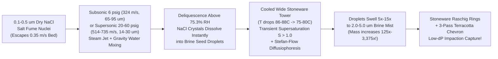
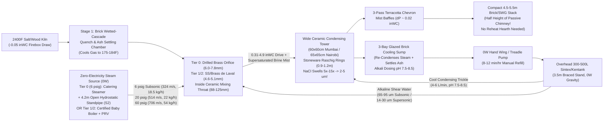

# Zero-Electricity Pressurized Steam-Jet Ejector & Hygroscopic Condensation Scrubbing Manual

**Engineering Questions Addressed:**
> 1. *"Can pressurized steam solve the submicron velocity problem at `0 W` electricity? Studios have water, they can get pipes, steam expands as a reliable power source, and it has plenty of velocity when pressurized."*
> 2. *"Would a sub-sonic steam source also work? That seems like it would be quieter and easier to source."*

**Short Engineering Answer: YES on both counts — and Subsonic `6 psig` (`0.414 barg`, Tier 0) is the Recommended Entry Steam Tier for urban studios!**
- **Tier 0 — Subsonic Quiet Steam-Jet Ejector (`6 psig` / `0.414 barg`, Unchoked `M = 0.68–0.74 < 1.0`, Recommended Entry Tier):** Expanding saturated steam below the sonic choking threshold (`12.2 psig` sea level / `10.1 psig` Nairobi) through a **simple drilled brass pipe-cap orifice (`Ø6.0–7.7 mm`, ZERO CNC *de Laval* bell needed!)** accelerates steam to **`324–349 m/s`** — still **`4.6×–5.0×` faster** than a `70 m/s` electric venturi throat! At `18.5 kg/hr` (`13.3 kW`), it generates **`0.31–0.40 inWC`** of active zero-electricity draft (`~2.5×–3.0×` total draft margin with a compact `5.2–5.5 m` brick/SWG stack), eliminates supersonic shock-cell screech completely (**`~52 dBA @ 3 ft` / `~29.5 dBA @ 40 ft`**, quieter than a fridge!), lifts submicron NaCl capture from **`30% → ~55%`** via hygroscopic condensation growth, runs off an off-the-shelf **`$95–$220` commercial hotel/catering stainless pressure steamer** backed by a fail-safe **`4.2 m` open vertical water-column hydrostatic relief standpipe (`6.0 psig` physical ceiling, zero moving parts)**, and builds for **`~$785` (Mumbai) / `~$955` (Nairobi)** at **`0 W` electricity**!
- **Tier 1 (`20 psig` LP) & Tier 2 (`60 psig` HP Hydro-Sonic) Supersonic Steam-Jet Ejectors (`M = 1.09–1.56`):** Expanding saturated steam from **`20–60 psig` (`1.38–4.14 barg`)** through a `4.6–5.1 mm` stainless or brass converging-diverging (*de Laval*) nozzle accelerates steam to **`514–735 m/s`** — **`7× to 10.5×` faster** than an industrial `2 HP` electric venturi — at **`0 W` of electricity**. Paired with a wide ceramic-packed condensing tower (expired public-domain **Lone Star Steel Hydro-Sonic** and **Aronetics** patents), these higher-pressure tiers generate **`0.70–4.86 inWC`** of active draft (`4.5–5.0 m` stack), shear gravity water into **`14–30 µm` micro-droplets**, and push zero-electricity submicron NaCl capture to **`~62%` (Tier 1 LP)** and **`~80%` (Tier 2 HP, matching an electric venturi at `0 W`!)** at `~62–68 dBA`.

> **CRITICAL SAFETY BOUNDARY (READ FIRST):**
> **Improvised unvented DIY-welded large-volume drum boilers remain 100% REJECTED at EVERY pressure.** A `40 kg` welded drum at `30 psig` stores **`253 kJ` (`60 g` TNT equivalent)** of flashing-water BLEVE blast energy (`579 kJ` / `138 g` TNT at `60 psig`). **Never** build an uncertified drum boiler or seal a steel drum inside a `2400°F` kiln flue. Every steam system in this manual uses strictly **code-compliant, locally procurable hardware**:
> - **Tier 0 Subsonic Path (`6 psig` / `0.414 barg`, Easiest Sourcing & Passive Hydrostatic Safety):** An off-the-shelf **factory-rated commercial hotel/catering stainless pressure steamer or institutional idli/rice boiler (`12–15 psig` factory MAWP, `$95–$220`)** with factory dead-weight + spring safety valve and fusible plug, **backed up by a `4.2 m` (`13.8 ft`) open vertical water-seal standpipe (`P_max = ρ·g·h = 41.1 kPa = 5.96 psig`)** with zero shutoff valves — making overpressurization above `6 psig` physically impossible with zero moving parts (`0.54 kJ/kg` specific flash energy = **`26.7×` lower per kg** and **`~71×` lower total stored energy** than a `40 kg` `60 psig` drum)!
> - **Path A (Recommended for Supersonic `20 psig` and `60 psig`):** A **factory-certified commercial baby steam boiler** — e.g., an Indian **Non-IBR (`< 25 L` volumetric capacity)** packaged mini boiler in Mumbai or a **KEBS/DOSHS-compliant commercial garment/laundry/food baby boiler** in Nairobi with factory hydro-test certificate, calibrated spring-loaded ASME/IBR safety relief valve (PRV), sight glass, fusible plug, and pressure gauge.
> - **Path B (Low-Pressure `<= 15–20 psig` Only):** A **code-rated small-bore seamless once-through monotube flash coil** holding **`< 0.8 L`** liquid water inventory (`~53×` lower stored flash energy — **`1.8–2.7 kJ`** — than a `40 kg` drum), protected by a certified `20–25 psig` ASME/BS spring-loaded PRV, swing check valve, `1.5× MAWP` cold hydrostatic proof test, and open `0 psig` atmospheric feed tank.

---

## Thermodynamic Baseline (Anchored to `kilnscrub` Reference `24 cu.ft.` Cone 11 Kiln)

All calculations below match the validated `24 cu.ft.` Cone 11 (`2400°F` / `1315.6°C`) wood/salt kiln baseline in [docs/ENGINEERING_VALIDATION.md](./ENGINEERING_VALIDATION.md), [docs/LOCAL_ZERO_ELECTRICITY_ENGINEERING.md](./LOCAL_ZERO_ELECTRICITY_ENGINEERING.md), and [pkg/studio/frugal.go](../pkg/studio/frugal.go):

| Baseline Parameter | Sea Level / **Mumbai** (`101.325 kPa`, `30°C`) | Highland / **Nairobi** (`1,660 m`, `83.5 kPa`, `22°C`) |
| :--- | :---: | :---: |
| **Peak Firing Load / Raw Hot Flue** | `129.6 kW` LHV (`29.2 kg/hr` wood); `m_hot = 0.0610 kg/s`, `97.54 kW` sensible | Identical kiln fuel & molar rate (`m_hot = 0.0610 kg/s`) |
| **Quenched Exhaust Temperature (`T_sat`)** | **`183.86°F`** (`84.37°C` / `357.52 K`) | **`174.5°F`** (`79.2°C` / `352.3 K`) |
| **Quenched Mass Flow (`m_gas`)** | **`0.0974 kg/s`** (`4.120 mol/s`, `y_H2O = 55.71%`, `MW = 23.65 g/mol`) | **`0.0974 kg/s`** (`4.120 mol/s`) |
| **Quenched Volumetric Flow (`Q_gas`)** | **`0.1208 m³/s`** (`256.0 ACFM`) | **`0.1460 m³/s`** (`309.4 ACFM`, `+21%` volume!) |
| **Quenched Gas Density (`ρ_gas`)** | **`0.806 kg/m³`** | **`0.667 kg/m³`** (`-17%` density) |
| **Ambient Air Density (`ρ_amb`)** | `1.164 kg/m³` (`30°C`) | `0.986 kg/m³` (`22°C`) |
| **Water Boiling Point (`T_boil`)** | `99.97°C` (`212.0°F`) | `94.68°C` (`202.4°F`) |

---

## 1. Compressible Steam-Nozzle Physics: Solving the Velocity Problem

### 1.1 Exact Isentropic Steam Expansion Velocity (`v_e`)

When dry saturated steam at stagnation pressure $P_0$ and enthalpy $h_{g,0}$ expands through a smooth converging-diverging (*de Laval*) nozzle to local ambient exhaust pressure $P_a$ (`101.325 kPa` at sea level; `83.5 kPa` in Nairobi), the isentropic exit quality $x_{2s}$ and isentropic enthalpy drop $\Delta h_s$ follow directly from the real IAPWS-IF97 steam tables (constant entropy $s_{g,0} = s_{f,2} + x_{2s}\,s_{fg,2}$):

$$x_{2s} = \frac{s_{g,0} - s_{f,2}}{s_{fg,2}}, \qquad \Delta h_s = h_{g,0} - \left(h_{f,2} + x_{2s}\,h_{fg,2}\right)$$

Accounting for nozzle boundary-layer friction and condensation lag with a realistic machined-brass/stainless nozzle efficiency $\eta_n = 0.90$ (`0.88–0.92` for small `4–7 mm` nozzles), the actual steam jet exit velocity $v_e$ and vapor Mach number $M_e$ are:

$$v_e = \sqrt{2 \, \eta_n \, \Delta h_s}, \qquad M_e = \frac{v_e}{c_2}, \qquad c_2 = \sqrt{k \, R_v \, T_2}$$

where $k \approx 1.30$ for saturated steam, $R_v = 461.52\text{ J/(kg}\cdot\text{K)}$, and $c_2 \approx 473\text{ m/s}$ at `100°C` sea level (`470 m/s` at `94.7°C` in Nairobi).

*(Critical Pressure Ratio Check: For $k = 1.30$, the choking pressure ratio is $P_0 / P^* = \left(\frac{k+1}{2}\right)^{k/(k-1)} = \mathbf{1.832}$. At sea level, any boiler pressure above **`12.2 psig`** (`185.6 kPa` abs) — and in Nairobi above **`10.1 psig`** (`153.0 kPa` abs) — **chokes the nozzle throat at Mach 1.0**, making mass flow completely insensitive to downstream kiln pressure fluctuations!)*

### 1.2 Exact Choked Nozzle Throat Sizing (`d_throat`)

Once choked ($P_0 / P_a > 1.832$), the mass flux $G^*$ [$\text{kg/(m}^2\cdot\text{s)}$] through the minimum nozzle throat area $A^*$ is fixed solely by upstream stagnation conditions:

$$G^* = C_d \, P_0 \sqrt{\frac{k}{R_v T_0}} \left(\frac{2}{k+1}\right)^{\frac{k+1}{2(k-1)}} \quad \text{(ideal-steam form)}, \qquad G^*_{\text{real}} = C_d \sqrt{k \, P_0 \, \rho_0} \left(\frac{2}{k+1}\right)^{\frac{k+1}{2(k-1)}}$$

with discharge coefficient $C_d = 0.96$ for a rounded-entry conical *de Laval* nozzle (`10°–12°` included diffuser cone angle), where $\left(\frac{2}{k+1}\right)^{\frac{k+1}{2(k-1)}} = 0.5852$ and $\sqrt{k}\left(\frac{2}{k+1}\right)^{\frac{k+1}{2(k-1)}} = 0.6673$ for $k = 1.30$. The required throat diameter is:

$$d^* = \sqrt{\frac{4 \, \dot{m}_{\text{steam}}}{\pi \, G^*_{\text{real}}}}$$

### 1.3 Master Saturated Steam Expansion Table (`15–100 psig`, IAPWS-IF97 Real Steam)

| Boiler Gauge Pressure `P_gauge` | Abs. Pressure `P_0` (`kPa`) | Sat. Temp `T_0` (`°C` / `°F`) | Isentropic Drop `Δh_s` (`kJ/kg`) | Actual Exit Vel `v_e` (`η_n=0.90`, `m/s`) | Exit Mach `M_e` | Choked Mass Flux `G*` (`kg/m²·s`) | Throat `d*` for `22 kg/hr` (`mm`) | Throat `d*` for `54 kg/hr` (`mm`) |
| :--- | :---: | :---: | :---: | :---: | :---: | :---: | :---: | :---: |
| **`15 psig`** (`1.03 barg`, SL) | `204.7` | `120.9°C` / `249.7°F` | `119.5` | **`464 m/s`** | `0.98` *(sonic)* | `311.4` | `5.00 mm` | `7.83 mm` |
| **`20 psig`** (`1.38 barg`, **SL — Tier 1**) | `239.2` | `126.0°C` / `258.7°F` | **`146.6`** | **`514 m/s`** | **`1.09`** | **`362.0`** | **`4.64 mm`** | `7.26 mm` |
| **`20 psig`** (`1.38 barg`, **Nairobi `83.5 kPa`**) | `221.4` | `123.5°C` / `254.3°F` | **`164.3`** | **`544 m/s`** | **`1.16`** | **`335.9`** | **`4.81 mm`** | `7.54 mm` |
| **`30 psig`** (`2.07 barg`, SL) | `308.2` | `134.5°C` / `274.0°F` | `189.0` | **`583 m/s`** | `1.23` | `462.7` | `4.10 mm` | `6.42 mm` |
| **`60 psig`** (`4.14 barg`, **SL — Tier 2**) | `515.0` | `153.0°C` / `307.3°F` | **`276.5`** | **`706 m/s`** | **`1.49`** | **`761.4`** | `3.20 mm` | **`5.01 mm`** |
| **`60 psig`** (`4.14 barg`, **Nairobi `83.5 kPa`**) | `497.2` | `151.6°C` / `304.9°F` | **`300.4`** | **`735 m/s`** | **`1.56`** | **`735.8`** | `3.25 mm` | **`5.09 mm`** |
| **`100 psig`** (`6.89 barg`, SL) | `790.8` | `169.9°C` / `337.9°F` | `349.4` | **`793 m/s`** | `1.68` | `1,155.6` | `2.59 mm` | `4.07 mm` |

**Two Huge Insights from the Table:**
1. **High Altitude *Helps* Steam Velocity in Nairobi!** At `1,660 m` (`83.5 kPa`), the same `20 psig` or `60 psig` gauge pressure expands across a higher absolute pressure ratio (`P_0 / P_a = 2.65` vs `2.36` at `20 psig`; `5.95` vs `5.08` at `60 psig`), boosting nozzle exit velocity by **`+29–30 m/s`** (`544 m/s` LP; `735 m/s` HP) — neatly compensating for Nairobi's thinner ambient air!
2. **Shop-Machinable Nozzle Size (`4.6–5.1 mm`):** Both Tier 1 (`4.6–4.8 mm` throat) and Tier 2 (`5.0–5.1 mm` throat) sit right on standard `4.5 mm`–`5.0 mm` drill bits (`3/16"`–`13/64"`) — easily turned on any small manual lathe in Mumbai's Kumbharwada/Lohar Chawl or Nairobi's Kariobangi/Industrial Area out of solid **316 stainless steel or C36000 brass hex bar** for **`~$12–$25`**, and large enough to resist scale plugging!

### 1.4 Subsonic Unchoked Steam Regime (`3–8 psig`, Tier 0 Design Point `6 psig` / `0.414 barg`)

#### Exact Sonic Choking Threshold (`M = 1.0`)

For saturated steam ($k = 1.30$, $R_v = 461.52\text{ J/(kg}\cdot\text{K)}$), sonic choking at the nozzle exit ($M = 1.0$) occurs when the stagnation-to-ambient pressure ratio reaches the exact isentropic critical ratio:

$$\frac{P_{0,\text{crit}}}{P_{\text{atm}}} = \left(\frac{k+1}{2}\right)^{\frac{k}{k-1}} = \left(\frac{2.30}{2}\right)^{\frac{1.30}{0.30}} = 1.15^{4.3333} = \mathbf{1.8324}$$

- **Sea Level / Mumbai (`P_atm = 101.325 kPa`):** $P_{0,\text{crit}} = 185.67\text{ kPa}$ $\implies$ choking begins at **$P_{g,\text{crit}} = 84.34\text{ kPa} = \mathbf{0.843\text{ barg}} = \mathbf{12.23\text{ psig}}$** (`12.2 psig`).
- **Highland / Nairobi (`1,660 m`, `P_atm = 83.50 kPa`):** $P_{0,\text{crit}} = 153.01\text{ kPa}$ $\implies$ choking begins at **$P_{g,\text{crit}} = 69.51\text{ kPa} = \mathbf{0.695\text{ barg}} = \mathbf{10.08\text{ psig}}$** (`10.1 psig`).

Therefore, operating across **`3–8 psig` (`0.21–0.55 barg`)** — centered on our **`6 psig` (`0.414 barg`) Tier 0 design point** — is **100% unchoked subsonic ($M < 1.0$)** at every elevation from sea-level Mumbai to highland Nairobi!

#### Exact Unchoked Subsonic Mass Flux & Simple Drilled Brass Pipe-Cap Orifice (NO CNC *de Laval* Bell Needed!)

Because the jet never reaches Mach `1.0`, a supersonic diverging *de Laval* diffuser bell would actually *slow the flow down* and add friction. All that is needed is a **simple converging orifice** — either a smooth chamfered/radiused brass nozzle (`C_d ≈ 0.92–0.95`, nominal `0.93`) OR a **zero-lathe flat drilled `1/2"` brass hex pipe cap (`C_d ≈ 0.62–0.65`, sharp-edged vena contracta)** drilled with a standard hand drill bit in 2 minutes!

In the unchoked subsonic regime ($P_0 / P_a < 1.8324$), the exit static pressure equals local ambient pressure ($P_2 = P_a$), and the mass flux $G_{\text{sub}}$ [$\text{kg/(m}^2\cdot\text{s)}$] and required orifice diameter $d_{\text{orifice}}$ are:

$$G_{\text{sub}} = C_d \, \rho_{2,a} \, v_e \approx C_d \sqrt{\frac{2k}{k-1}\,P_0\,\rho_0 \left[\left(\frac{P_a}{P_0}\right)^{\frac{2}{k}} - \left(\frac{P_a}{P_0}\right)^{\frac{k+1}{k}}\right]}, \qquad d_{\text{orifice}} = \sqrt{\frac{4 \, \dot{m}_{\text{steam}}}{\pi \, G_{\text{sub}}}}$$

where $\rho_{2,a} = 1 / [v_{f,2} + x_{2a}(v_{g,2} - v_{f,2})]$ is the actual exit steam density at $P_a$ after expansion efficiency $\eta_n = 0.90$ (`~0.608 kg/m³` at Mumbai SL; `~0.506 kg/m³` in Nairobi).

#### Master IAPWS-IF97 Unchoked Subsonic Expansion Table (`3–8 psig`, `η_n = 0.90`, `ṁ_steam = 18.5 kg/hr`)

| Gauge Pressure `P_gauge` & Location | Abs. Pressure `P_0` (`kPa`) & Ratio `P_0/P_a` | Sat. Temp `T_0` (`°C`) | Isentropic Drop `Δh_s` (`kJ/kg`) | Actual Exit Vel `v_e` (`η_n=0.90`, `m/s`) | Exit Mach `M_e` (`c_2 = 473.1 / 469.8 m/s`) | Smooth Converging Brass Nozzle `d` (`C_d=0.93`, `18.5 kg/h`) | Flat Drilled Brass Pipe Cap `d` (`C_d=0.63`, `18.5 kg/h`, No Lathe!) |
| :--- | :---: | :---: | :---: | :---: | :---: | :---: | :---: |
| **`3 psig`** (`0.207 barg`, Mumbai SL) | `122.0` (`1.204`) | `105.3°C` | `31.5` | `238 m/s` | `0.50` *(subsonic)* | `7.0 mm` | `8.5 mm` (`11/32"`) |
| **`3 psig`** (`0.207 barg`, Nairobi `1,660 m`) | `104.2` (`1.248`) | `100.8°C` | `37.1` | `259 m/s` | `0.55` *(subsonic)* | `7.4 mm` | `8.9 mm` (`23/64"`) |
| **`5 psig`** (`0.345 barg`, Mumbai SL) | `135.8` (`1.340`) | `108.4°C` | `49.7` | `299 m/s` | `0.63` *(subsonic)* | `6.2 mm` | `7.6 mm` (`19/64"`) |
| **`5 psig`** (`0.345 barg`, Nairobi `1,660 m`) | `118.0` (`1.413`) | `104.3°C` | `58.0` | `323 m/s` | `0.69` *(subsonic)* | `6.6 mm` | `8.0 mm` (`5/16"`) |
| **`6 psig`** (`0.414 barg`, **Mumbai SL — Tier 0**) | **`142.7`** (`1.408`) | **`109.9°C`** | **`58.1`** *(58.4 IF95)* | **`324 m/s`** *(324–327)* | **`0.68`** *(0.68–0.69)* | **`6.0 mm`** (`15/64"`) | **`7.3 mm`** (`9/32"`–`5/16"`) |
| **`6 psig`** (`0.414 barg`, **Nairobi — Tier 0**) | **`124.9`** (`1.495`) | **`105.9°C`** | **`67.5`** *(67.8 IF95)* | **`349 m/s`** *(349–352)* | **`0.74`** *(0.74–0.75)* | **`6.3 mm`** (`1/4"`) | **`7.7 mm`** (`5/16"` = `7.9 mm`) |
| **`8 psig`** (`0.552 barg`, Mumbai SL) | `156.5` (`1.544`) | `112.6°C` | `73.8` | `365 m/s` | `0.77` *(subsonic)* | `5.6 mm` | `6.8 mm` (`17/64"`) |
| **`8 psig`** (`0.552 barg`, Nairobi `1,660 m`) | `138.7` (`1.661`) | `109.0°C` | `85.1` | `392 m/s` | `0.83` *(subsonic)* | `5.9 mm` | `7.2 mm` (`9/32"`) |

*(Note: For a slightly higher `20–22 kg/hr` steam rate or gentle `5 psig` firing, a flat drilled brass pipe cap uses a standard **`Ø7.8–8.5 mm`** (`5/16"`–`11/32"`) drill bit; a smooth chamfered converging brass insert (`C_d = 0.93`) uses **`Ø6.0–6.6 mm`** (`1/4"`). Both are large, clog-proof bores made in minutes at any neighborhood hardware or lathe shop with **zero CNC diverging bell**!)*

---

## 2. 1D Steam-Jet Ejector Momentum Balance & Expired Industrial Patents

### 2.1 Real Public-Domain Industrial Lineage (Expired US Patents)

Using a supersonic steam jet to **simultaneously pump flue gas, atomize scrubbing water, and nucleate submicron fume with zero electric blower** is not experimental folklore — it is proven 1970s steel-mill pollution-control technology whose foundational patents are all **long expired and 100% public domain**:

1. **Lone Star Steel Hydro-Sonic / Steam-Hydro Air Cleaning System** (Thomas K. Ewan et al., Lone Star Steel Co., EPA-evaluated on open-hearth & electric-arc furnace submicron fume):
   - **US 3,852,408** (1974), **US 3,912,469** (1975 — *Apparatus and process for separating materials from gas streams*), **US 4,141,701** (1979), and **US 4,272,499** (Cason, Ewan et al., 1981).
   - *Core physics:* Injects low-pressure gravity water straight into the shear boundary of a supersonic steam jet (`Mach 1.1–1.8`) inside a short mixing tube. Aerodynamic shear shatters water into **`10–30 µm` micro-droplets** while momentum transfer pulls gas through the entire scrubber with **zero mechanical blower** — achieving `> 90–99%` submicron particulate removal on industrial metallurgical fumes!
2. **Aronetics Two-Phase Hot-Water / Steam Jet Scrubber** (Hugh E. Gardenier, Aronetics, Inc., EPA-tested on ferro-alloy furnace submicron fume):
   - **US 3,613,333** (1971), **US 3,704,570** (1972), and **US 3,782,074** (1974 — variable-geometry flashing nozzle).
   - *Core physics:* Uses waste-heat-driven pressurized water/steam flashing through a supersonic throat to combine fanless gas induction with **flux-force / condensation nucleation** onto submicron fume particles.
3. **DuPont Reverse-Jet Gas-Liquid Contactor** (David N. Low, E.I. du Pont de Nemours):
   - **US 3,803,805** (1974 — *Process for contacting a gas with a liquid*) — high-velocity jet turbulence for intensive gas-liquid mass transfer and fine droplet collision.

### 2.2 Keenan-Neumann-Lustwerk (1950) 1D Constant-Area Momentum Balance

Consider a constant-area ceramic-lined mixing throat of cross-sectional area $A_m = \frac{\pi}{4} D_m^2$ (length $L_m \approx 6\,D_m$ to $8\,D_m$) followed by a `7°–10°` included-angle subsonic diffuser expanding to $4\,A_m$ (`2×` diameter) directly into the base of the wide stoneware condensing tower.

Let primary steam enter with mass flow $\dot{m}_p$ at velocity $v_p = v_e$, and secondary quenched kiln exhaust enter with mass flow $\dot{m}_s = 0.0974\text{ kg/s}$ at throat entry velocity $v_s = \frac{\dot{m}_s}{\rho_s A_m}$. Defining mixed mass flow $\dot{m}_m = \dot{m}_p + \dot{m}_s$ and mixed velocity $v_m = \frac{\dot{m}_m}{\rho_m A_m}$, the 1D momentum balance across the mixing tube plus diffuser static pressure recovery ($C_{pr} \approx 0.70$) minus inlet acceleration loss ($\eta_{\text{in}} \approx 0.92$) yields the **net static pressure rise $\Delta P_{\text{ejector}}$**:

$$\Delta P_{\text{ejector}} = \underbrace{\frac{\eta_m \left(\dot{m}_p v_p + \dot{m}_s v_s\right) - \dot{m}_m v_m}{A_m}}_{\text{Constant-Area Mixing Momentum Rise}} + \underbrace{C_{pr}\,\frac{1}{2}\rho_m \left(v_m^2 - v_2^2\right)}_{\text{Subsonic Diffuser Recovery}} - \underbrace{\frac{1}{2\eta_{\text{in}}}\rho_s v_s^2}_{\text{Secondary Inlet Acceleration}}$$

where $\eta_m \approx 0.82$ accounts for wall friction and jet-mixing profile losses inside a practical studio-built ceramic/stainless mixing tube, and the **entrainment ratio** is $\text{ER} = \dot{m}_s / \dot{m}_p = \dot{m}_{\text{gas}} / \dot{m}_{\text{steam}}$.

### 2.3 Three Practical Zero-Electricity Steam-Ejector Tiers (`24 cu.ft.` Kiln)

| Design & Performance Parameter | **Tier 0 (Recommended Entry): Subsonic Quiet Steam-Jet (`steam_ejector_subsonic`)** | **Tier 1: LP Supersonic Steam-Jet (`steam_ejector_lp`)** | **Tier 2: HP Hydro-Sonic Steam-Drive (`steam_ejector_hp`)** |
| :--- | :---: | :---: | :---: |
| **Operating Steam Pressure (`P_gauge`)** | **`6 psig`** (`0.414 barg`, range `5–8 psig`, **Unchoked!**) | **`20 psig`** (`1.38 barg`, Choked) | **`60 psig`** (`4.14 barg`, Choked) |
| **Nozzle Exit Velocity (`v_e`, Mumbai / Nairobi)** | **`324` / `349 m/s`** (**`Mach 0.68–0.74 < 1.0`**) | **`514` / `544 m/s`** (`Mach 1.09–1.16`) | **`706` / `735 m/s`** (`Mach 1.49–1.56`) |
| **Nozzle / Orifice Geometry & Bore** | **Simple Drilled Brass Converging Orifice** (`Ø6.0–6.3 mm` chamfered / **`Ø7.3–7.8 mm` flat cap**, NO *de Laval* bell!) | Machined *de Laval* (`d* = 4.6–4.8 mm`, `3/16"`) | Machined *de Laval* (`d* = 5.0–5.1 mm`, `13/64"`) |
| **Steam Mass Flow (`ṁ_steam`)** | **`18.5 kg/hr`** *(range `16–22 kg/hr` = `18.5 L/hr` water)* | **`22 kg/hr`** *(range `18–26 kg/hr`)* | **`54 kg/hr`** *(range `45–65 kg/hr`)* |
| **Entrainment Ratio (`ER = ṁ_gas / ṁ_steam`)** | **`19.0:1`** *(`18.95:1` at `18.5 kg/hr`)* | **`15.9:1`** *(range `13.5–19.5`)* | **`6.5:1`** *(range `5.4–7.8`)* |
| **Mixing Throat Dia (`D_m`, SL / Nairobi) & Vel (`v_m`)** | **`115–125 mm`** (`v_m ≈ 11.5–13.8 m/s`; `135 mm` low-vel alt.) | **`115` / `125 mm`** (`4.5"–5"`); `v_m ≈ 13 m/s` | **`88` / `95 mm`** (`3.5"–3.75"`); `v_m ≈ 25 m/s` |
| **Net Static Ejector Draft (`ΔP_ejector`)** | **`0.31–0.40 inWC`** (`77–100 Pa`; up to `0.44"` @ `20 kg/h`) | **`0.60–1.20 inWC`** *(nom. **`0.77"` SL / `0.70"` NB**)* | **`3.0–7.0 inWC`** *(nom. **`4.86"` SL / `4.36"` NB**)* |
| **Steam Jet Kinetic Power (`½ ṁ_p v_e²`)** | **`270–313 W`** | **`807–904 W`** | **`3,738–4,052 W`** |
| **Steam Thermal Input (`Q_steam`, `25°C` feed)** | **`13.3 kW`** *(only `15.4%` of `86.1 kW` kiln waste heat!)* | **`15.9 kW`** *(range `13–19 kW`)* | **`39.7 kW`** *(range `33–48 kW`)* |
| **Droplet Atomization Size (`d_32`, Nukiyama-Tanasawa)** | **`~65–95 µm`** *(gentle subsonic shear — condensation-led!)* | **`~18–35 µm`** *(gravity water sheared into jet)* | **`~14–25 µm`** *(supersonic Hydro-Sonic shear!)* |
| **Compact Masonry Chimney Height (`H`)** | **`5.2 m` (Mumbai) / `5.5 m` (Nairobi)** *(no reheat hearth!)* | **`5.0 m`** (`4.5–5.5 m` — half of passive `9.5–12 m`!) | **`4.5–5.0 m`** *(no reheat hearth needed!)* |
| **Expected HCl Acid Gas Removal** | **`97.5%`** (`97.0–98.0%`) | **`97.8%`** (`97.5–98.2%`) | **`98.5%`** (`98.2–99.0%`) |
| **Expected Coarse Ash / Soot Removal (`> 5 µm`)** | **`92.5%`** (`91.5–93.5%`) | **`94.0%`** (`93–95%`) | **`96.5%`** (`96–98%`) |
| **Expected Submicron NaCl Fume (`0.1–0.5 µm`)** | **`~55%`** (`54–56%` — nearly `2×` passive chimney!) | **`~62%`** (`58–65%` condensation + shear) | **`~80%`** (`75–84%` — matches electric venturi!) |
| **Electrical Power Consumption** | **`0 W`** *(100% zero-electricity!)* | **`0 W`** *(100% zero-electricity!)* | **`0 W`** *(100% zero-electricity!)* |
| **Acoustic Noise (`@ 3 ft` / `@ 40 ft` Property Line)** | **`~52 dBA` / `~29.5 dBA`** *(Whisper-quiet subsonic! Zero shock screech!)* | `~62 dBA` / `~39.5 dBA` *(moderate steam hiss)* | `~68 dBA` / `~45.5 dBA` *(industrial hiss; brick-lined)* |
| **Steam Source & Primary Safety Barrier** | **Commercial Catering Steamer (`$95–$220`) + `4.2 m` Open Hydrostatic Standpipe (`6 psig` Physical Limit!) + PRV** | Certified `< 25 L` Baby Boiler (Path A) or `< 0.8 L` Monotube Coil (Path B) + PRV | Certified `< 25 L` Non-IBR / DOSHS Baby Steam Boiler (Path A Only!) + PRV |

#### Draft Margin Proof Across All Three Tiers (Compact `4.5–5.5 m` Chimney, Zero Reheat Hearth Needed!)
Even with an un-reheated `4.5–5.5 m` brick/SWG chimney (`~0.055–0.075 inWC` natural buoyancy) + wide stoneware bed (`-0.065 inWC`) + quench/baffle (`-0.030 inWC`) + terracotta chevron demister (`-0.020 inWC`) + kiln firebox target draw (`-0.050 inWC`), total passive resistance is only **`0.150–0.165 inWC`**:
- **Tier 0 Subsonic (`6 psig`, `18.5 kg/hr`, `D_m = 115–125 mm`):** Full Keenan-Neumann-Lustwerk (Sec 2.2) gives **`0.31–0.32 inWC` (`77–79 Pa`)** while the mixing-tube model (`pkg/studio/frugal.go`, `v_m = 12–14 m/s`) gives **`0.36–0.40 inWC` (`89–100 Pa`)** (and a wider `135 mm` throat delivers `0.27–0.31 inWC` at `18.5 kg/hr` or `0.34–0.38 inWC` at `22 kg/hr`). Adding the compact **`5.2 m` Mumbai / `5.5 m` Nairobi stack** (`+0.060–0.075 inWC`) + `+0.025 inWC` gravity downflow assist yields **`0.40–0.50 inWC` total available draft vs `0.150–0.165 inWC` resistance = `2.4×–3.1×` positive draft margin at `0 W` electricity!**
- **Tier 1 (`20 psig`)** supplies **`0.77 + 0.065 + 0.025 = 0.86 inWC`** (`0.78 inWC` in Nairobi) — **`> 4.5×` total system resistance**, easily trimmed to `-0.05 inWC` firebox draw via a simple brick slide damper!
- **Tier 2 (`60 psig`)** supplies **`4.36–4.86 inWC`** of supersonic mixing energy + static lift — easily driving both the high-shear Hydro-Sonic mixing zone AND the wide condensing stoneware bed with massive surge stability during heavy wood stoking!

### 2.4 Honest Audit: Why NOT Push a `21.2 inWC` Conventional Narrow-Throat Venturi with Steam?

A natural follow-up question is: *"Why not keep the conventional `21.2 inWC` (`5,280 Pa`) narrow `70 m/s` wet venturi from `pkg/scrubber/venturi.go` and simply replace the `2 HP` electric blower with a steam ejector?"*

Running the exact Keenan-Neumann-Lustwerk momentum equation above for $\Delta P_{\text{ejector}} = 5{,}280\text{ Pa}$ (`21.2 inWC`) exposes why that is an engineering dead end:
- Because a gas-gas steam ejector has a low overall thermodynamic-to-static-head efficiency ($\eta_{\text{therm}} = \frac{\Delta P \cdot Q}{\dot{Q}_{\text{steam}}} \approx \mathbf{0.60\%–0.72\%}$), generating `5,280 Pa` of *pure static suction* across `0.1208 m³/s` requires **`142 kg/hr` of `60 psig` steam (`104.3 kW` thermal!)** — or **`119 kg/hr` at `100 psig` (`88.0 kW` thermal!)**.
- That would require a boiler **larger than the kiln itself**, consuming `~25–30 kg/hr` of extra firewood and injecting `142 L/hr` of steam into the stack!

**The Hydro-Sonic Shortcut:** You do **NOT** need `21 inWC` of static gas pressure drop to create high relative velocity! In a conventional venturi, you spend `21 inWC` of electric fan work just to accelerate the *entire flue gas stream* to `70 m/s` so it can shear water droplets to `~90 µm`. In a **Direct Steam-Drive Hydro-Sonic Ejector**, the `5.0 mm` steam jet is *already* traveling at **`706–735 m/s`**! Dropping gravity water straight into that supersonic shear layer creates **`14–25 µm` droplets** directly via Nukiyama-Tanasawa aerodynamic breakup:

$$d_{32} = \frac{585}{v_{\text{rel}}}\sqrt{\frac{\sigma}{\rho_L}} + 597\left(\frac{\mu_L}{\sqrt{\sigma \rho_L}}\right)^{0.45}\left(\frac{1000\,Q_L}{Q_g}\right)^{1.5}$$

At `v_rel ≈ 600 m/s` effective shear velocity (water at `60°C`, `σ = 66.2 dyn/cm`, `4 L/min` gravity injection into `0.145 m³/s`), $d_{32} = 8.0 + 6.5 = \mathbf{14.5\ \mu\text{m}}$ (versus **`90.9 µm`** in a `70 m/s` electric venturi!). Using **`54 kg/hr`** of `60 psig` steam directly as the Hydro-Sonic atomizer + condensing stoneware tower uses **`62%` less steam** than pushing a separate `21 inWC` venturi while delivering finer droplets and matching `~80%` submicron NaCl capture!

### 2.5 Water Consumption, Re-Condensation & Visible Plume Trade-Off

Honest engineering must account for every kilogram of injected steam (`18.5 kg/hr` Tier 0 subsonic; `22 kg/hr` Tier 1 LP; `54 kg/hr` Tier 2 HP) added on top of the `148.9 kg/hr` of quench water vapor already inside the `184°F` (`84.4°C`) kiln exhaust (`y_H2O = 55.7%`, raising mixture vapor fraction to `0.586` in Tier 0 / `0.591` in Tier 1 / `0.632` in Tier 2, with uncooled adiabatic saturation dew points of **`85.7°C`**, **`85.9°C`**, and **`87.7°C`** respectively):

| Wide Stoneware Tower Exit Temp (`T_exit`, Sea Level) | Saturation Mole Fraction `y_H2O,sat` | Total Water Condensed — **Tier 0 (`+18.5 kg/hr`)** | Total Water Condensed — **Tier 1 (`+22 kg/hr`)** | Total Water Condensed — **Tier 2 (`+54 kg/hr`)** | Net Sump Water Gain (`Condensed − Motive Steam`, T0 / T1 / T2) | Latent Heat Rejected (`kW`, T0 / T1 / T2) |
| :--- | :---: | :---: | :---: | :---: | :---: | :---: |
| **`85.7°C` (T0) / `85.9°C` (T1) / `87.7°C` (T2)** *(Uncooled Mix)* | `0.586` / `0.591` / `0.632` | **`0.0 kg/hr`** | **`0.0 kg/hr`** | **`0.0 kg/hr`** | `-18.5` / `-22.0` / `-54.0 kg/hr` | `0.0` / `0.0` / `0.0 kW` |
| **`84.4°C` (`184°F`, Held at Inlet Dew Point)** | `0.557` | **`18.5 kg/hr`** | **`22.0 kg/hr`** | **`54.0 kg/hr`** | **`0.0 kg/hr`** *(recovers `100%` of steam!)* | `11.9` / `14.2` / `34.8 kW` |
| **`80.0°C` (`176°F`, Light Cooling)** | `0.468` | **`63.3 kg/hr`** | **`66.9 kg/hr`** | **`98.9 kg/hr`** | **`+44.8` / `+44.9` / `+44.9 kg/hr`** | `40.8` / `43.1` / `63.7 kW` |
| **`75.0°C` (`167°F`, Optimal Condensing)** | `0.381` | **`94.5 kg/hr`** | **`98.1 kg/hr`** | **`130.1 kg/hr`** | **`+76.0` / `+76.1` / `+76.1 kg/hr`** | `60.9` / `63.2` / `83.8 kW` |
| **`70.0°C` (`158°F`, Deep Condensing)** | `0.308` | **`114.7 kg/hr`** | **`118.2 kg/hr`** | **`150.2 kg/hr`** | **`+96.2 kg/hr`** | `73.9` / `76.2` / `96.8 kW` |

**Practical Operational Takeaway:**
- **If the stoneware tower runs uncooled (`~85.7–87.7°C` adiabatic exit):** Steam-jet injection adds **`18.5–54 L/hr`** (`56–162 L` over a 3-hour salt firing) of boiler feedwater demand and produces a noticeably thicker **harmless white water-vapor plume** at the `5.0–5.5 m` stack exit (important to anticipate with urban neighbors!).
- **If the stoneware tower is operated as a *condensing tower* (`T_exit ≈ 75–84°C`):** Feeding cool fresh makeup water (`20–30°C`) into the top drip tray of the wide stoneware bed or rejecting **`~61–84 kW`** of latent heat via a dedicated shaded cooling pond / finned masonry overflow radiator cools the saturated exhaust by **`2–11°C`**, which **re-condenses `100%` of the injected motive steam (and up to `94.5–130.1 kg/hr` total vapor at `75°C`) right back into liquid inside the tower**! *(Engineering Honesty Note: a stagnant `1,000 L` closed sump alone cannot reject `61–84 kW` continuously — it warms at `~1.0–1.2°C/min` unless cooled with `15–22 L/min` once-through cool makeup/overflow or a dedicated heat exchanger; if the sump runs uncooled near saturation, submicron NaCl capture drops by `~15–20` percentage points.)*

### 2.6 Lighthill `v⁸` Jet Aeroacoustics & Complete Supersonic Shock-Noise Elimination

Why is the user's intuition — *"a sub-sonic steam source seems like it would be quieter"* — **dramatically confirmed by aeroacoustics?** Two independent acoustic mechanisms collapse simultaneously the moment jet velocity drops below Mach `1.0`:

1. **Lighthill's 8th-Power Turbulent Jet Mixing Law ($W_{\text{ac}} \propto v_e^8$):**
   In Sir James Lighthill's classic quadrupole aeroacoustic theory for turbulent mixing jets, radiated acoustic power scales with the **eighth power of jet exit velocity**:
   $$W_{\text{ac}} \propto \frac{\rho_0 \, D_j^2 \, v_e^8}{c_0^5} \quad \implies \quad \Delta L_{w,\text{vel}} = 80 \log_{10}\!\left(\frac{v_{\text{sub}}}{v_{\text{sup}}}\right)$$
   - **`6 psig` Subsonic vs. `60 psig` HP Supersonic:**
     - Sea Level (`324 m/s` vs `706 m/s`): $\Delta L_{w,\text{vel}} = 80\log_{10}(324 / 706) = \mathbf{-27.1\text{ dB}}$ (Nairobi `349` vs `735 m/s`: **`-25.9 dB`**). Even after the slight orifice-area term $+20\log_{10}(6.0 / 5.0) = +1.6\text{ dB}$, turbulent jet acoustic power drops by **`-25.5 dB`** (`~350×` less acoustic watts!).
   - **`6 psig` Subsonic vs. `20 psig` LP Supersonic:**
     - Sea Level (`324 m/s` vs `514 m/s`): $\Delta L_{w,\text{vel}} = 80\log_{10}(324 / 514) = \mathbf{-16.0\text{ dB}}$ (Nairobi `349` vs `544 m/s`: **`-15.4 dB`**; **`-13.8 dB`** net after $+2.2\text{ dB}$ nozzle-area correction — `~24×` less turbulent acoustic power!).
2. **Complete Elimination of Supersonic Shock-Cell Noise & Screech (`+8 to +15 dB` Eliminated!):**
   - Above choking ($M > 1.0$, i.e. `20 psig` and `60 psig`), under-expanded supersonic steam jets form periodic shock diamonds that generate intense **Broadband Shock-Associated Noise (BBSAN)** and piercing discrete **screech tones** across `2–12 kHz` — sitting squarely in the peak A-weighted sensitivity band of the human ear and adding **`+8 to +15 dB`** of harsh high-frequency hiss/whistle!
   - At **`6 psig` (`M = 0.68–0.74 < 1.0`)**, **zero shock cells can form** — BBSAN and supersonic screech drop identically to **`0 dB`!**

| Draft & Acoustic Mode (Inside `115 mm` Brick Mixing Casing) | Jet Exit Mach `M_e` | Shock / Screech Noise | Bare Jet Power vs `60 psig` (Lighthill `v⁸`) | Practical Studio Level **`@ 3 ft` (`~1 m`)** | Property-Line Level **`@ 40 ft` (`12.2 m`, `-22.5 dB`)** | Everyday Urban Comparison |
| :--- | :---: | :---: | :---: | :---: | :---: | :--- |
| **Passive Reheat Chimney (`0 psig`, `0 W`)** | `0` | None | N/A | **`~45 dBA`** | **`~22.5 dBA`** | Whisper / quiet studio kiln draw |
| **Tier 0: Subsonic Steam-Jet (`6 psig`, `0 W`)** | **`0.68–0.74`** | **`0 dB` (Eliminated!)** | **`-25.5 dB`** + shock gone! | **`~52 dBA`** | **`~29.5 dBA`** | **Quieter than a fridge (`40 dBA`) or quiet street!** |
| **Tier 1: LP Supersonic (`20 psig`, `0 W`)** | `1.09–1.16` | Moderate BBSAN | `-11.7 dB` | `~62 dBA` | `~39.5 dBA` | Normal conversation / insulated steam hiss |
| **Tier 2: HP Hydro-Sonic (`60 psig`, `0 W`)** | `1.49–1.56` | Strong BBSAN + screech | `0 dB` (ref.) | `~68 dBA` | `~45.5 dBA` | Busy street / brick-muffled industrial hiss |
| **Industrial Electric Venturi (`21.2"`, `2 HP`)** | `0` *(blower)* | Fan blade-pass tone | N/A | `~78–85 dBA` | `~55.5–62.5 dBA` | Shop vacuum / loud commercial HVAC |

*(Note: Enclosing the subsonic jet inside the `115 mm` brick mixing chamber + stoneware tower provides `~15–20 dB` of high-frequency masonry transmission loss, so the `~52 dBA @ 3 ft` studio floor is mostly soft muffled airflow over the kiln's `45 dBA` burner/draft rumble — attenuating via spherical spreading `-20·log10(40/3) = -22.5 dB` to a virtually inaudible **`~29.5 dBA`** at a `40 ft` urban neighbor's window!)*

---

## 3. The Hidden Superpower: Hygroscopic Condensation Growth on NaCl Nuclei (Works at Subsonic Speed Too!)

Why does even a **`6 psig` subsonic steam-jet ejector** (`324–349 m/s`, `M = 0.68–0.74`) jump submicron NaCl capture from **`~30%`** (passive chimney) straight up to **`~54–56%` (nominal `55%`)** — and why does `20 psig` reach `~62%` — even without `21 inWC` inertial velocity? Because **salt kiln fume is pure sodium chloride (`NaCl`) — one of the most hygroscopic cloud condensation nuclei (CCN) in atmospheric physics — and condensation nucleation depends on steam mass flow and cooling supersaturation, NOT supersonic shocks!**

### Three Coupled Aerosol-Capture Mechanisms Working Together

1. **Deliquescence & Köhler Solute Vapor-Pressure Lowering (`RH_deliq = 75.3%`) — Active in Tier 0 Subsonic (`6 psig`)!**
   - Unlike hydrophobic carbon soot (which resists wetting until high supersaturation), solid crystalline **NaCl spontaneously deliquesces into saturated brine droplets at `75.3%` relative humidity** (nearly temperature-independent across `20–90°C`).
   - Because dissolved `Na⁺` and `Cl⁻` ions lower equilibrium water vapor pressure over the droplet surface (Raoult's Law — the solute term in Köhler theory), a `0.2 µm` NaCl nucleus begins absorbing water vapor *even below `100%` RH* and grows explosively the instant the steam-enriched gas (`y_H2O = 0.586` in Tier 0 subsonic; `0.591–0.632` in Tiers 1–2) encounters the cooler irrigated stoneware rings (`T_water ≈ 55–70°C`), creating a boundary-layer supersaturation ratio **`S = p_v / p_sat(T) ≈ 1.02–1.15`**.
   - Within **`0.5–1.5 seconds`** of residence time inside our wide `60 × 60 cm` (`2.6 s` residence!) stoneware tower, a `0.2–0.4 µm` NaCl crystal swells **`5× to 15×` in diameter** to **`2.0–5.0 µm`**! Since inertial impaction scales with the Stokes number $\text{Stk} \propto d_p^2$, a `10×` diameter jump multiplies capture inertia by **`100×`** — turning an "uncapturable" submicron fume into a heavy mist trapped effortlessly by wet stoneware Raschig rings and 3-pass terracotta chevron baffles!
2. **Stefan-Flow Diffusiophoresis (Condensation Sweeping) — Nearly Full Strength at `6 psig`!**
   - Whenever water vapor condenses onto a cooler wetted stoneware surface or cool falling droplet (**`63–95 kg/hr`** condensing flux in Tier 0 `6 psig` — nearly identical to Tier 1's `67–98 kg/hr`!), a bulk inward convective drift — **Stefan flow** — moves toward the condensing surface with velocity $v_{\text{diff}} \approx \frac{D_v}{1 - y_v}\frac{dy_v}{dx}$.
   - Critically, **diffusiophoresis is independent of particle size** across `0.05–1.0 µm` and **does not require supersonic shock waves!** Every `0.1–0.5 µm` NaCl particle that refuses to impact inertially is physically swept straight onto the wet ceramic film along with the condensing steam molecules (typically capturing an extra `15%–30%` of submicron mass per `10°C` of condensing temperature drop — the classic Calvert / Sparks flux-force condensation scrubber effect).
3. **Honest Comparison of Droplet Shear: Subsonic `6 psig` (`~55%`) vs. Supersonic `60 psig` Hydro-Sonic (`~80%`):**
   - At **`6 psig` subsonic (`324–349 m/s` jet exit)**, by the time the subsonic steam jet mixes with the gravity-fed water curtain (`v_rel ≈ 55–85 m/s` effective shear velocity across the water sheet), Nukiyama-Tanasawa atomization produces **`d_32 ≈ 65–95 µm`** droplets (`d_32 = 585/65 × 8.21 + 6.5 = 80 µm`). Those droplets are great for HCl scrubbing (**`97.5%`**) and coarse ash (**`92.5%`**), and condensation growth + Stefan flow still drives submicron NaCl capture to **`~54–56%` (nominal `55%`)** — nearly double the `30%` passive chimney!
   - However, because `65–95 µm` droplets have much gentler inertial impaction than the **`14.5 µm` micro-droplets** blasted by **`60 psig` supersonic Hydro-Sonic shear (`706–735 m/s`)**, Tier 0 honestly stops at **`~55%`** submicron NaCl rather than Tier 2's **`~80%`** (`75–84%`)! That is an exceptionally clean engineering trade-off: **`+25` percentage points of extra submicron NaCl capture over passive**, **`~52 dBA` quiet operation**, and **`$95–$220` off-the-shelf catering steamer sourcing** with zero supersonic hardware!

---

## 4. Kiln Waste-Heat Recovery Balance (`2400°F` Flue) vs. Dedicated Baby Boiler

Does the `24 cu.ft.` Cone 11 wood/salt kiln actually reject enough waste heat to raise `22–54 kg/hr` of steam? Let's compute the exact heat balance from `2400°F` (`1315.6°C`) down to `400°F` (`204.4°C` — kept strictly above the `~280°F` HCl/water acid dew point):

$$\dot{Q}_{\text{waste}} = \dot{m}_{\text{hot}} \, \bar{c}_{p,\text{flue}} \, \left(T_{\text{flue,in}} - T_{\text{flue,out}}\right)$$

- **Validated Steady-State Baseline (`m_hot = 0.0610 kg/s`, `c_p = 1.25–1.30 kJ/(kg·K)`, `ΔT = 1,111 K`):**
  $$\dot{Q}_{\text{waste,steady}} = 0.0610 \times 1.27 \times 1{,}111 = \mathbf{86.1\text{ kW}} \quad (\text{range }\mathbf{85–88\text{ kW}} \text{ out of } 97.54\text{ kW total sensible})$$
- **Peak Wood-Stoking Surge (`1.4–1.8×` firing rate during active Cone 11 reduction stokes, `0.085–0.110 kg/s`):**
  $$\dot{Q}_{\text{waste,peak}} = \mathbf{120–155\text{ kW}}$$

| Steam Operating Mode | Steam Thermal Load `Q_steam` (`25°C` feedwater) | Share of Steady `86 kW` Kiln Waste Heat (`120–155 kW` Peak) | Alternative: Dedicated Wood/LPG Steamer or Baby Boiler Fuel Rate | Engineering Recommendation |
| :--- | :---: | :---: | :---: | :--- |
| **Tier 0 — Subsonic `6 psig` (`18.5 kg/hr`)** | **`13.3 kW`** *(13.2–13.4 kW)* | **`15.4%`** steady (`9–11%` peak) | **`4.0 kg/hr` dry wood** (`70%` eff.) or `1.2 kg/hr` LPG (`~$1.25/hr`) | **Recommended Entry Steam Tier!** Commercial `12–15 psig` catering steamer + `4.2 m` open hydrostatic standpipe (`$95–$220`) — OR indirect ceramic-jacketed low-pressure coil! |
| **Tier 1 — LP `20 psig` (`22 kg/hr`)** | **`16.0 kW`** *(range `13–19 kW`)* | **`18.6%`** steady (`10–13%` peak) | **`4.8 kg/hr` dry wood** (`70%` eff.) or `1.4 kg/hr` LPG (`~$1.50/hr`) | Easily within kiln waste heat (Path B indirect coil) **OR** compact certified baby boiler (Path A — simplest!) |
| **Tier 2 — HP `60 psig` (`54 kg/hr`)** | **`39.7 kW`** *(range `33–48 kW`)* | **`46.1%`** steady (`26–33%` peak) | **`12.0 kg/hr` dry wood** (`70%` eff.) or `3.5 kg/hr` LPG (`~$3.80/hr`) | **Strongly prefer Path A (Dedicated Certified Baby Boiler)** — decoupled from corrosive salt flue & stoking dips! |

**Why Decoupling the `60 psig` Boiler from the Kiln Flue Is Smarter Engineering:**
Even though the kiln flue physically contains `86–155 kW` of waste heat, extracting **`40 kW` at `60 psig` (`153°C`) directly inside a `2400°F` salt-laden wood flue** exposes metal tubes to: (a) rapid hot HCl/NaCl molten-salt corrosion (`> 100 mpy` on mild steel), (b) violent thermal cycling (`1400°F → 2400°F`) every time a potter stokes wood, and (c) **loss of scrubber draft whenever the kiln cools between stokes!** Firing a standalone **certified commercial wood/LPG baby boiler** next to the kiln eliminates corrosive flue exposure completely, holds rock-steady `60 psig` pressure throughout the entire 3-hour salting window, and burns only `~30–36 kg` of studio scrap wood (or `~10 kg` LPG) per firing!

---

## 5. CRITICAL SAFETY & CODE ENGINEERING (Nairobi & Mumbai — Zero Compromises)

Steam is an extraordinary, reliable power source **only when engineered strictly within pressure-vessel physics and local boiler law**. Every studio must respect three non-negotiable engineering boundaries:

### 5.1 Explicit Rejection of Improvised DIY-Welded Drum Boilers (Unchanged!)

> **DANGER — NEVER BUILD AN UNCERTIFIED WELDED DRUM BOILER:**
> Superheated liquid water stored in a large vessel violently flashes into `1,600×`-volume steam the instant a non-code weld or flat end-cap tears (a **Boiling Liquid Expanding Vapor Explosion — BLEVE**). The isentropic flash work per kilogram of saturated water expanding from $T_1$ to atmospheric boiling $T_2 = 373.15\text{ K}$ is:
> $$e_{\text{flash}} = c_{p,w}\left[T_1 - T_2 - T_2 \ln\!\left(\frac{T_1}{T_2}\right)\right]$$

| Operating Gauge Pressure | Sat. Water Temp `T_1` (SL) | Specific Flash Energy `e_flash` (`kJ/kg`) | **BANNED: `40 kg` Unvented DIY Welded Drum** (`E_BLEVE` / TNT equiv.) | **Safe Code Hardware (`15 kg` Catering Steamer w/ `4.2 m` Open Standpipe OR `0.75 L` Monotube Coil)** | Stored-Energy Reduction vs `60 psig` `40 kg` Drum (`579 kJ`) |
| :--- | :---: | :---: | :---: | :---: | :---: |
| **`3 psig`** (`0.207 barg`) | `105.3°C` | **`0.16 kJ/kg`** *(92× lower vs 60 psig)* | `6.3 kJ` *(unvented DIY drum still banned!)* | `2.4 kJ` (`0.57 g` TNT) — open `2.1 m` standpipe | **`~240×` lower** |
| **`5 psig`** (`0.345 barg`) | `108.4°C` | **`0.40 kJ/kg`** *(36.5× lower vs 60 psig)* | `15.8 kJ` *(unvented DIY drum still banned!)* | `6.0 kJ` (`1.4 g` TNT) — open `3.5 m` standpipe | **`~96×` lower** |
| **`6 psig`** (`0.414 barg`, **Tier 0**) | **`109.9°C`** | **`0.54 kJ/kg`** *(0.61 IF97; **`26.7×` lower per kg** vs 60 psig!)* | `21.7 kJ` *(unvented DIY drum still banned!)* | **`8.1 kJ`** (`1.9 g` TNT) in `15 kg` factory steamer + **`4.2 m` Open Standpipe** | **`~71×` lower total!** |
| **`15 psig`** (`1.03 barg`) | `120.9°C` | `2.38 kJ/kg` | **`95.2 kJ`** (`22.8 g` TNT — **LETHAL!**) | **`1.79 kJ`** (`0.43 g` TNT, Path B `0.75 L` coil) | **`53×` lower** *(vs `15 psig` drum)* |
| **`20 psig`** (`1.38 barg`, **Tier 1**) | `126.0°C` | `3.63 kJ/kg` | **`145.3 kJ`** (`34.7 g` TNT — **LETHAL!**) | **`2.72 kJ`** (`0.65 g` TNT, Path B `0.75 L` coil) | **`53×` lower** *(vs `20 psig` drum)* |
| **`30 psig`** (`2.07 barg`) | `134.5°C` | `6.32 kJ/kg` | **`252.7 kJ`** (`60.4 g` TNT — **LETHAL!**) | `4.74 kJ` *(not rec. for Path B)* | `53×` lower *(vs `30 psig` drum)* |
| **`60 psig`** (`4.14 barg`, **Tier 2**) | `153.0°C` | `14.47 kJ/kg` | **`578.9 kJ`** (`138.4 g` TNT — **CATASTROPHIC!**) | **Use Certified Path A Boiler Only!** | `1×` *(ref.)* |

A `40 kg` homemade welded steel drum at `30 psig` (`253 kJ` / `60 g` TNT) or `60 psig` (`579 kJ` / `138 g` TNT) is literally a fragmentation bomb — and even at `6 psig`, **no amateur unvented weldment, repurposed LPG cylinder, or scrap-pipe drum may EVER be fired as a steam boiler.**

### 5.2 Tier 0 Subsonic Path (`6 psig` / `0.414 barg`, Easiest Sourcing & Zero-Moving-Parts Hydrostatic Safety)

The biggest practical advantage of **subsonic `6 psig` steam** is that studios do **NOT** need to hunt for an industrial `60 psig` boiler fabricator or statutory high-pressure boiler registration! Commercial food-service equipment sold on every major market street in Nairobi and Mumbai already operates safely at `12–15 psig` factory MAWP:

1. **Off-the-Shelf Commercial Catering Stainless Pressure Steamers & Institutional Idli/Rice Boilers (`$95–$220`):**
   - **Nairobi (Biashara Street, River Road & Kamukunji):** Heavy-gauge 304 stainless steel commercial hotel/catering pressure steamers, institutional soup/ugali steam kettles, and `25–50 L` commercial pressure cookers (`12–15 psig` factory-rated with calibrated dead-weight + spring safety valve + fusible metal plug) are stocked off the shelf at **`KES 13,000–26,000` (`~$100–$200`, nominal `KES 18,500`)** — fired over a standard LPG ring burner or clay/brick wood-ember *jiko* stove!
   - **Mumbai (Lohar Chawl, Crawford Market & Nagdevi):** Institutional stainless steel hotel **idli/rice steam boilers** and `30–50 L` commercial catering pressure steamers (`12–15 psig` factory-rated, complete with ISI/factory dead-weight valve, spring backup safety valve, and fusible alloy plug) are ubiquitous across Mumbai catering suppliers at **`₹9,000–₹20,000` (`~$97–$216`, nominal `₹18,500`)**.
   - **Simple Steam Take-Off:** Replace the factory whistle weight nipple (or tap a dedicated `1/2"` BSP brass bulkhead fitting in the dome lid) with a `1/2"` insulated brass steam line feeding the simple drilled brass pipe-cap orifice (`Ø6.0–7.7 mm`), leaving the factory spring safety valve and fusible plug 100% untouched!
2. **Passive Zero-Moving-Parts Safety: The Classic `4.2 m` (`13.8 ft`) Open Vertical Hydrostatic Water-Column Standpipe (`S2`):**
   - Inspired by classic 19th-century low-pressure district heating boilers (Hartford loop / open water-seal safety column), tee a dedicated **`25–32 mm` (`1"–1.25"`) vertical copper, galvanized-iron, or high-temp metal standpipe (`S2`)** directly off the boiler steam/water space with **ZERO shutoff valves** anywhere in the line. Drop down `0.3 m` into a U-trap water seal filled with clean water, then rise vertically **`h = 4.20 m` (`13.8 ft`)** to a completely **open atmospheric top** piped into a safe overhead vent funnel/drain!
   - **Exact Hydrostatic Pressure Ceiling:**
     $$P_{\max} = \rho_w \, g \, h = 998\text{ kg/m}^3 \times 9.807\text{ m/s}^2 \times 4.20\text{ m} = \mathbf{41.1\text{ kPa} = 5.96\text{ psig}} \approx \mathbf{6.0\text{ psig}}$$
     *(Using `h = 3.50 m` / `11.5 ft` sets an even gentler physical limit of **`34.3 kPa = 5.0 psig`**; if standpipe water warms to `80°C` / `972 kg/m³`, `4.20 m` caps at `5.81 psig`.)*
   - **Why This Changes Safety Completely:** If the burner surges or the brass orifice ever fouls, steam pressure pushes water up the `4.2 m` pipe and simply **burps harmlessly out the open atmospheric top at `6.0 psig`** — with **zero springs to rust, zero valve seats to stick, zero moving parts!** Overpressurization above `6.0 psig` is **physically impossible**, while a factory-stamped **`10–15 psig` brass spring PRV** + **fusible plug** remain installed as independent backup layers (alongside a `0–15 psig` pressure gauge, bronze feedwater check valve, open `0 psig` atmospheric feed tank, `1.5× MAWP` cold hydro-test, and insulated steam scald guards).

### 5.3 Path A (Recommended for Supersonic `20 psig` / `60 psig`): Factory-Certified Commercial Baby Steam Boilers (Mumbai & Nairobi)

Both **Mumbai** and **Nairobi** have deep, mature commercial markets for small certified steam generators used daily in garment pressing shops, dry cleaners, small dairies, ayurvedic/food kitchens, and pilot labs:

1. **Mumbai / Western India — Certified Non-IBR Baby Steam Boilers (`< 25 L` Capacity Exemption):**
   - **Legal Basis:** Under the **Indian Boilers Act, 1923** and **Indian Boiler Regulations (IBR 1950)**, a steam generator whose internal volumetric capacity (from feed check valve to main steam stop valve) is **strictly `< 25 liters`** is legally classified as **Non-IBR** — exempt from statutory IBR boiler-house registration and licensed shift-attendant mandates while still manufactured by established Mumbai/Thane/Vasai/Pune boiler fabricators to industrial shell/coil standards!
   - **What to Specify When Buying:** Wood-fired or LPG-fired **Non-IBR coil-type or vertical baby steam boiler** rated **`30–60 kg/hr`** at **`4–7 kg/cm²` (`57–100 psig` MAWP)**, supplied with:
     - Factory **`1.5× MAWP` cold hydrostatic test certificate** (`>= 9–10.5 bar`),
     - **Calibrated brass spring-loaded Safety Relief Valve (PRV)** set at `<= MAWP` (never a deadweight or blocked valve!),
     - **Dial pressure gauge** (`0–10 bar` with red MAWP line), **fusible safety plug**, **armored sight glass / water-level gauge**, and **bottom blowdown valve**.
   - **Real Mumbai Market Cost:** Compact `20–30 kg/hr` commercial laundry/food/lab Non-IBR baby boilers run **`₹28,000–₹60,000` (`~$330–$700`)** (Tier 1 LP / compact commercial units); heavy-duty skid-mounted `50–100 kg/hr` wood- or LPG-fired Non-IBR coil baby boilers from Thane/Navi Mumbai/Vasai industrial fabricators run **`₹75,000–₹1,45,000` (`~$890–$1,725`)** (Tier 2 HP).
2. **Nairobi / East Africa — KEBS/DOSHS-Compliant Commercial Baby Boilers:**
   - **Legal Basis:** Under Kenya's **Occupational Safety and Health Act (OSHA) 2007**, commercial steam boilers are statutory pressure vessels requiring registration with the **Directorate of Occupational Safety and Health Services (DOSHS)** (`Form DOSHS 20`, statutory fee `KES 1,000`) and annual thorough examination + PRV check by a **DOSHS-approved third-party plant examiner** (`KES 10,000–30,000/yr`).
   - **Sourcing & Cost:** Commercial garment/laundry/food baby boilers (wood/charcoal/LPG-fired or reconditioned dry-cleaner vertical boilers) are sold along **Industrial Area / Kirinyaga Road** and commercial laundry/kitchen equipment dealers at **`KES 48,000–95,000` (`~$370–$730`)** for compact `20–30 kg/hr` units and **`KES 115,000–185,000` (`~$885–$1,425`)** for heavier `50–60 kg/hr` commercial wood/LPG steam generators. Always demand a current hydro-test certificate, calibrated spring-loaded PRV, and DOSHS-approved examiner sign-off before firing!

### 5.4 Path B (Low-Pressure `<= 15–20 psig` Only): Code-Rated Small-Bore Once-Through Monotube Flash Coil

Where a factory baby boiler is unavailable and the studio targets **Tier 1 Low-Pressure (`15–20 psig` / `1.0–1.4 barg`)** only, physics permits a fundamentally safer **zero-drum, once-through monotube flash coil** — the exact principle behind industrial Benson/Clayton coil steam generators:

- **Why Small-Bore Monotube Eliminates Catastrophic BLEVE:**
  - `8.0 m` of **`1/2"` Schedule 80 seamless carbon/stainless steel pipe (`ID = 13.87 mm`, burst rating `> 12,000 psi`, MAWP `> 1,500 psi`)** or heavy-wall **Type K/L seamless drawn copper tube (`15 mm OD / 13.8 mm ID`, MAWP `> 400 psi` at `150°C` with silver-brazed fittings)** has a total internal volume of only **`1.21 L`**, of which **`<= 0.75 L`** (`< 0.8 L`) contains liquid water at any instant (the rest is vapor!).
  - At `20 psig`, total stored flash energy is only **`2.72 kJ` (`0.65 g` TNT)** — **`53×` smaller** than a `40 kg` drum — and seamless `1/2"` Sch 80 pipe cannot fail by flat-head tearing! If a pinhole ever opened, it releases a localized hiss rather than a structural blast.
- **Eight Non-Negotiable Path B Safety Mandates:**
  1. **Strict Pressure Ceiling (`<= 20 psig` / `1.38 barg`):** Never push a studio monotube coil to `60 psig` — use a certified Path A baby boiler for Tier 2.
  2. **Indirect Ceramic Heating Jacket (No Direct `2400°F` Salt-Flue Contact):** Mount the coil inside a separate `65 mm` firebrick radiative cavity beside the hot flue (or over a dedicated small wood/charcoal firebox) so raw corrosive HCl/NaCl slag never contacts the metal tubing and heat flux stays bounded (`<= 20 kW`).
  3. **Certified Spring-Loaded PRV (`25 psig` / `1.7 barg` Set Pressure):** Install a factory-stamped **ASME Section I/IV or BS 6759 brass spring-loaded safety relief valve** directly on the steam outlet header with **zero shutoff valve between the coil and the PRV**, piped to discharge safely downward/away from all walkways!
  4. **Open Atmospheric Feed Tank (`0 psig`) + Gravity/Manual Plunger Feed + Swing Check Valve:** Feed softened/rainwater from an **open atmospheric `0 psig` header tank** (via a brass hand-piston boiler feed pump or `2.5 bar` manual pressure-tested hydraulic feed accumulator, or a small elevated gravity head for `<= 15 psig` operation) strictly through a **bronze swing/spring check valve** so live steam can never blow back into the water tank!
  5. **Mandatory `1.5× MAWP` Cold Hydrostatic Proof Test:** Before the coil ever touches fire, fill completely with **cold water (zero air pockets!)** and hydro-test to **`>= 45 psig` (`3.1 barg`, `> 2×` working pressure)** for `30 minutes` using a hand test pump — verifying zero weeping or deformation.
  6. **Full Scald Shielding & Insulated Steam Header:** Wrap the entire `1/2"` steam line from coil/boiler to the ejector nozzle in `25 mm` mineral-wool/ceramic-fiber insulation + sheet-metal jacket so accidental skin contact cannot cause `126°C` third-degree burns, and route PRV discharge into a baffled quench bucket or outdoor safe zone.
  7. **Water Softening / Rainwater Feed:** Use clean rainwater or softened tap water (never muddy sump brine!) inside any boiler or monotube coil so hardness scale never chokes the `13.8 mm` tube or `4.6 mm` nozzle.
  8. **Local Statutory Compliance:** Verify compliance with **India IBR (`< 25 L` exemption)**, **Kenya OSHA 2007 / DOSHS**, or **ASME Section I/IV** before commissioning in any commercial or community studio.

---

## 6. Complete Steam-Ejector System Architecture & Flowsheet

---

## 7. Side-by-Side Architecture Comparison (`24 cu.ft.` Cone 11 Baseline — 4 Zero-Electricity Modes + Powered References)

| Engineering Metric | **1. Passive Reheat Chimney** (`natural_chimney`, `0 psig`, `0 W`) | **2. Subsonic Quiet Steam-Jet (Tier 0)** (`steam_ejector_subsonic`, `6 psig`, `0 W`) | **3. LP Supersonic Steam-Jet (Tier 1)** (`steam_ejector_lp`, `20 psig`, `0 W`) | **4. HP Hydro-Sonic Steam-Drive (Tier 2)** (`steam_ejector_hp`, `60 psig`, `0 W`) | **5. Local `230V`/`12V` Ceramic** (`0 psig`, `520 W`) | **6. Industrial Electric Venturi** (`kilnscrub` Ref., `21.2"`, `2 HP`) |
| :--- | :---: | :---: | :---: | :---: | :---: | :---: |
| **Electrical Power (`W`)** | **`0 W`** *(Off-Grid)* | **`0 W`** *(Off-Grid)* | **`0 W`** *(Off-Grid)* | **`0 W`** *(Off-Grid)* | `520 W` (`370 W` pump + `150 W` fan) | `1,500–2,200 W` (`240V 30A`) |
| **Velocity / Draft Driver** | `9.5–12 m` Reheated Stack | **`6 psig` Subsonic Jet (`324–349 m/s`, `M 0.68–0.74`)** | `20 psig` *de Laval* (`514–544 m/s`, `M 1.09–1.16`) | `60 psig` *de Laval* (`706–735 m/s`, `M 1.49–1.56`) | `12V`/`230V` Low-ΔP Fan (`1.8"`) | `2 HP` VFD Blower (`21.2"`) |
| **Nozzle Fabrication** | None | **Drilled Brass Pipe Cap (`Ø6.0–7.8 mm`, No CNC!)** | Turned *de Laval* (`4.6–4.8 mm`) | Turned *de Laval* (`5.0–5.1 mm`) | None | Machined Alloy Venturi |
| **Available Static Drive (`inWC`)** | `0.20–0.29"` | **`0.40–0.50"` total** (`0.31–0.40"` ejector) | **`0.78–0.86"` total** (`0.70–0.77"` ejector) | **`4.4–4.9"`** *(range `3.0–7.0"`)* | `1.86"` | `21.2"` |
| **Required Chimney Height (`m`)** | `9.5–12.0 m` (`31–40 ft`) | **`5.2–5.5 m`** (`17–18 ft`) | **`5.0 m`** (`4.5–5.5 m`) | **`4.5–5.0 m`** (`15–16.5 ft`) | `4.5 m` (`15 ft`) | `3–4 m` exhaust |
| **Motive Steam / Thermal Load** | `0 kg/hr` (`0 kW`) | **`18.5 kg/hr` (`13.3 kW`, `15.4%` kiln heat)** | `22 kg/hr` (`16.0 kW`) | `54 kg/hr` (`39.7 kW`) | `0 kg/hr` (`0 kW`) | `0 kg/hr` (`0 kW`) |
| **HCl Acid Gas Removal** | `95.5–98.0%` | **`97.5%`** | **`97.8%`** | **`98.5%`** | `97–99%` | `95–99%` |
| **Coarse Wood Ash (`> 5 µm`)** | `90.5%` | **`92.5%`** | **`94.0%`** | **`96.5%`** | `92–96%` | `96–99%` |
| **Submicron NaCl (`0.1–0.5 µm`)** | **`~30%`** *(passive limit)* | **`~55%`** (`54–56%` condensation!) | **`~62%`** (`58–65%`) | **`~80%`** (`75–84%` Hydro-Sonic!) | `~34%` | **`~80–84%`** |
| **Dry-Run Plastic Meltdown Risk** | **`ZERO`** (All Ceramic) | **`ZERO`** (All Ceramic) | **`ZERO`** (All Ceramic) | **`ZERO`** (All Ceramic) | **`ZERO`** (All Ceramic) | High (`$700+` NFPA 86 req.) |
| **Acoustic Noise (`@ 3 ft` / `@ 40 ft`)** | `~45` / `22.5 dBA` | **`~52` / `29.5 dBA` (Zero Shock Screech!)** | `~62` / `39.5 dBA` | `~68` / `45.5 dBA` | `~64` / `41.5 dBA` | `~78–85` / `56–63 dBA` |
| **Est. Mumbai Local Build Cost** | **`₹48,250`** (`~$522`) | **`₹72,600`** (`~$785`, range `₹63k–₹76.5k`) | **`₹76,500–₹1,05,000`** (`~$830–$1,140`) | **`₹1,22,000–₹1,88,000`** (`~$1,320–$2,030`) | `₹47,050–₹58,350` (`~$509–$631`) | `~$3,450–$7,263` (US COTS) |
| **Est. Nairobi Local Build Cost** | **`KES 103,100`** (`~$796`) | **`KES 123,700`** (`~$955`, range `KES 118k–131k`) | **`KES 148,000–195,000`** (`~$1,140–$1,505`) | **`KES 222,000–295,000`** (`~$1,715–$2,280`) | `KES 101,100–117,600` (`~$781–$908`) | `~$3,450–$7,263` (US COTS) |

---

## 8. Verified Nairobi & Mumbai Local Steam-Ejector BOMs (`24 cu.ft.` Kiln)

Baseline all-ceramic tower, stoneware rings, baffled cooling sump, `500 L` overhead Kentank/Sintex, hand wing pump, and local alkali are inherited from [docs/LOCAL_ZERO_ELECTRICITY_ENGINEERING.md](./LOCAL_ZERO_ELECTRICITY_ENGINEERING.md) (with chimney brick/SWG cost reduced by **`~40%–45%`** thanks to cutting the stack from `10–12 m` down to `4.5–5.5 m`, and zero chimney-base reheat hearth needed!):

### A. Mumbai, India Steam-Ejector Incremental & Total BOM (`INR` & `USD`, `1 USD ≈ 92.5 INR`)

| Line Item (Mumbai / Thane / Lohar Chawl Sourcing) | **Tier 0: Subsonic `6 psig` (`0 W`, Recommended Entry)** (`INR`) | **Tier 1: LP `20 psig` (`0 W`)** (`INR`) | **Tier 2: HP `60 psig` Hydro-Sonic (`0 W`)** (`INR`) | Local Sourcing & Compliance Notes |
| :--- | :---: | :---: | :---: | :--- |
| **All-Ceramic Scrubber Core + Short `5.0–5.5 m` SWG Stack + `500 L` Sintex + Hand Pump** | `₹44,600` (`5.2 m` stack) | `₹44,200` (`5.0 m` stack) | `₹44,200` (`4.5–5.0 m` stack) | Saves `₹3,650–₹4,050` on shorter IS 651 SWG chimney vs `10–12 m` passive stack |
| **Steam Source (Tier 0 Catering Steamer vs. Path A Non-IBR `< 25 L` Baby Boiler)** | **`₹18,500`** *(range `₹9k–₹20k`)* | `₹28,000–₹55,000` *(Path B coil: `₹18,500`)* | `₹72,000–₹1,35,000` | **Tier 0:** Lohar Chawl / Crawford Market `12–15 psig` commercial hotel idli/rice steamer (`$95–$220`)! **Tier 1/2:** Thane/Vasai Non-IBR `< 25 L` baby boiler w/ hydro-test cert |
| **Steam Nozzle (`Ø6.0–7.8 mm` Drilled Brass Cap vs. *de Laval*) + Ceramic Mixing Throat** | **`₹1,800`** *(No CNC bell!)* | `₹2,200` | `₹2,600` | **Tier 0:** Drilled `1/2"` brass hex cap + SWG/castable `120 mm` throat; **Tier 1/2:** lathe-turned *de Laval* |
| **Safety Relief (`4.2 m` Open Hydrostatic Standpipe `S2` + Certified Brass PRV + Gauge)** | **`₹5,500`** *(`S2` `1"` GI/Cu + `15 psig` PRV + gauge)* | `₹3,200` | `₹3,500` | **Tier 0:** `4.2 m` open water-column standpipe physically caps pressure at **`6.0 psig`** + backup PRV! |
| **Insulated `1/2"` Steam Line + Mineral Wool Cladding + Bronze Check + Feedwater Drum** | **`₹2,200`** | `₹2,400` | `₹3,200` | `25 mm` thermal scald jacket + bronze check valve + clean rainwater/softener drum |
| **MUMBAI TOTAL ESTIMATED STEAM-EJECTOR BUILD COST** | **`₹72,600` (`~$785`)** *(range `₹63k–₹76.5k` / `$680–$827`)* | **`₹80,000–₹1,07,000`** (`~$865–$1,155`) *(Path B: `₹70,500` / `$762`)* | **`₹1,25,500–₹1,88,500`** (`~$1,357–$2,038`) | **Tier 0 delivers `~55%` NaCl at `~52 dBA` & `0 W` for `~$785` (`89%` cheaper than US COTS!)** |

### B. Nairobi, Kenya Steam-Ejector Incremental & Total BOM (`KES` & `USD`, `1 USD ≈ 129.5 KES`)

| Line Item (Nairobi Biashara St / River Rd / Industrial Area Sourcing) | **Tier 0: Subsonic `6 psig` (`0 W`, Recommended Entry)** (`KES`) | **Tier 1: LP `20 psig` (`0 W`)** (`KES`) | **Tier 2: HP `60 psig` Hydro-Sonic (`0 W`)** (`KES`) | Local Sourcing & Compliance Notes |
| :--- | :---: | :---: | :---: | :--- |
| **All-Ceramic Scrubber Core + Short `5.0–5.5 m` Brick Stack + `500 L` Kentank + Hand Pump** | `KES 92,800` (`5.5 m` stack) | `KES 91,500` (`5.0 m` stack) | `KES 91,500` (`4.8–5.0 m` stack) | Saves `KES 10,300–11,600` on shorter brick chimney vs `11–12 m` Nairobi highland stack |
| **Steam Source (Tier 0 Catering Steamer vs. KEBS/DOSHS Commercial Baby Boiler)** | **`KES 18,500`** *(range `KES 13k–26k`)* | `KES 48,000–92,000` *(Path B coil: `KES 29,000`)* | `KES 115,000–185,000` | **Tier 0:** Biashara St / River Rd / Kamukunji `12–15 psig` commercial catering pressure steamer (`$100–$200`)! **Tier 1/2:** Industrial Area / Kirinyaga Rd baby boiler + hydro-test cert |
| **Steam Nozzle (`Ø6.3–7.8 mm` Drilled Brass Cap vs. *de Laval*) + Refractory Mixing Throat** | **`KES 2,600`** *(No CNC bell!)* | `KES 3,500` | `KES 4,000` | **Tier 0:** Drilled `1/2"` brass pipe cap + castable `125 mm` throat; **Tier 1/2:** Kariobangi lathe *de Laval* |
| **Safety Relief (`4.2 m` Open Hydrostatic Standpipe `S2` + Certified Brass PRV + Gauge)** | **`KES 6,200`** *(`S2` `1"` GI/Cu + `15 psig` PRV + gauge)* | `KES 6,500` | `KES 7,500` | **Tier 0:** `4.2 m` open water-column standpipe physically caps pressure at **`6.0 psig`** + backup PRV! |
| **Insulated `1/2"` Steam Header + Scald Jacket + Bronze Check (+ DOSHS Reg. for Tier 1/2)** | **`KES 3,600`** | `KES 5,500` *(+ annual DOSHS exam)* | `KES 7,000` *(+ annual DOSHS exam)* | `KES 1,000` DOSHS registration (`Form DOSHS 20`) + `KES 10k–30k` approved examiner for commercial boilers |
| **NAIROBI TOTAL ESTIMATED STEAM-EJECTOR BUILD COST** | **`KES 123,700` (`~$955`)** *(range `KES 118k–131k` / `$910–$1,010`)* | **`KES 155,000–199,000`** (`~$1,197–$1,537`) *(Path B: `KES 136,000` / `$1,050`)* | **`KES 225,000–295,000`** (`~$1,737–$2,278`) | **Highland `1,660 m` altitude bonus (`+25 m/s` faster subsonic jet `349 m/s`, `M=0.74`) + `~52 dBA` quiet!** |

---

## 9. Bottom-Line Engineering Verdict

1. **Yes — A Subsonic `6 psig` Steam Source Works, and It Is Dramatically Quieter, Safer, and Easier to Source!** Below the exact sonic choking limit (`12.2 psig` Mumbai SL / `10.1 psig` Nairobi `1,660 m`), **`6 psig` (`0.414 barg`)** saturated steam through a simple drilled brass pipe-cap orifice (`Ø6.0–7.8 mm`, **no CNC *de Laval* bell needed!**) still hits **`324–349 m/s` (`Mach 0.68–0.74 < 1.0`)**, delivers **`0.31–0.40 inWC`** of active zero-electricity draft (`0.40–0.50 inWC` total with a compact `5.2–5.5 m` stack = **`~2.5×–3.0×` margin**), slashes noise to **`~52 dBA @ 3 ft` (`~29.5 dBA @ 40 ft`)** via Lighthill's `v⁸` law + complete elimination of supersonic shock screech, and lifts submicron NaCl capture from **`30% → ~55%`** via hygroscopic condensation growth — all powered by a **`$95–$220` commercial catering steamer** backed by a zero-moving-parts **`4.2 m` open hydrostatic relief standpipe (`6.0 psig` physical ceiling)** for **`~$785` (Mumbai) / `~$955` (Nairobi)**!
2. **Supersonic Tiers (`20–60 psig`) Unlock Higher Submicron Capture When Needed:** When dense urban siting demands maximum zero-electricity submicron salt capture (`~62%` LP / `~80%` HP — matching a `$7,263` electric venturi at `0 W`), stepping up to a factory-certified `< 25 L` Non-IBR / DOSHS baby boiler (`20–60 psig`, `514–735 m/s`) adds high-shear `14–30 µm` Hydro-Sonic droplet atomization at `~62–68 dBA`.
3. **Safety Never Compromises:** **Never** weld an unvented DIY drum boiler at any pressure (`253–579 kJ` BLEVE hazard at `30–60 psig`). Always use a **factory-rated catering steamer + `4.2 m` open hydrostatic standpipe + backup PRV** (Tier 0 `6 psig`), a **factory-certified `< 25 L` Non-IBR / DOSHS commercial baby boiler** (Path A, `20–60 psig`), or a **code-rated `< 0.8 L` once-through seamless monotube coil** (Path B, strictly `<= 20 psig`).
4. **Choose the Right Zero-Electricity Tier for Your Site:**
   - **Open rural/suburban studio with tall-stack clearance & tightest budget (`~$522–$796`):** **Passive Reheat Chimney (`0 psig`, `0 W`)** — zero steam vessels, `95.5–98%` HCl, `~30%` NaCl, `~45 dBA`.
   - **Quiet urban studio wanting easy local sourcing, compact `5.2–5.5 m` stack & `~55%` NaCl (`~$785–$955`):** **Tier 0 Subsonic Quiet Steam-Jet (`6 psig`, `0 W`, Recommended Entry Steam Tier!)** — `~52 dBA`, commercial catering steamer + `4.2 m` hydrostatic standpipe, drilled brass orifice.
   - **Dense urban courtyard needing `62–80%` submicron NaCl capture at `0 W` electricity (`~$830–$2,280`):** **Tier 1 (`20 psig`)** or **Tier 2 (`60 psig`) Certified Supersonic Steam-Jet Ejector + Condensing Stoneware Tower**!
