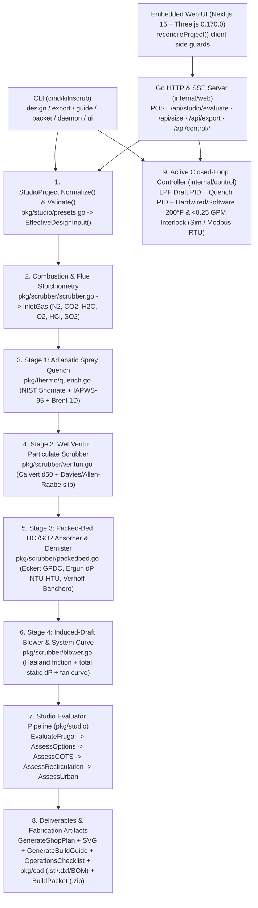
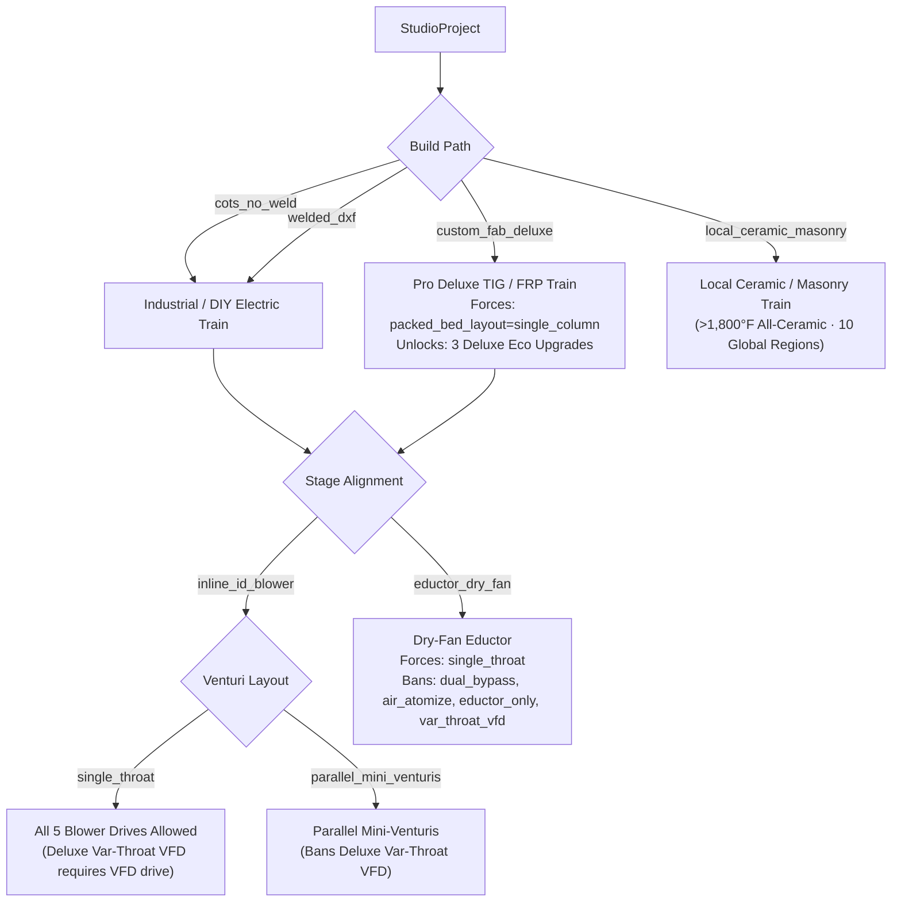
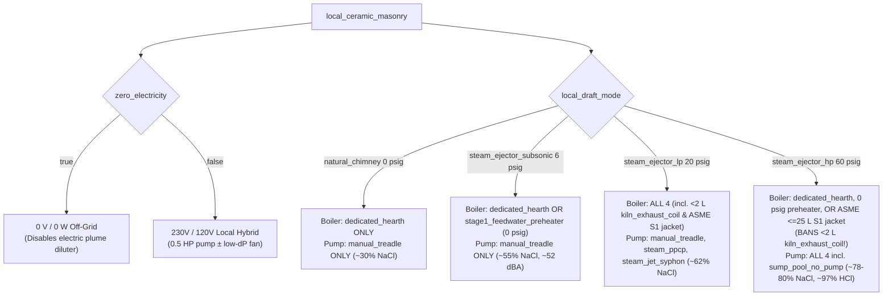

# System Architecture, Unit Consistency Audit & Decision Tree Reference

> **Phase 18 Reference Manual:** Complete end-to-end blueprint of how `kilnscrub` connects its physics solvers, studio configurator, CAD/BOM exporters, active PID controller, and embedded web UI — together with the verified **Unit-Consistency Contract** and full **User Option Decision Trees** tested by our automated E2E suites.

---

## 1. End-to-End System Assembly Process

Every request in `kilnscrub` — whether triggered from the CLI (`kilnscrub design | guide | packet | ui | daemon`) or from the browser (`POST /api/studio/evaluate`) — flows through a strict, single-source-of-truth pipeline with zero duplicated physics:

### Stage-by-Stage Data Handoff
1. **Input Normalization (`pkg/studio/presets.go`):**
   - `StudioProject.Validate()` enforces finite bounds and all mutual-exclusivity rules (build path, voltage, steam pressure tiers, Deluxe VFD constraints).
   - `StudioProject.EffectiveDesignInput()` reconciles `VaporGlazeMode` (`none`/`soda`/`salt`) with `FuelType` (`*_salt` vs clean fuel) and propagates Phase 8 air-atomization (`25 µm`, `48 m/s`) and DIY ceramic/bio-ball packing hydraulics into `model.DesignInput`.
2. **Core 4-Stage Thermochemistry Solver (`pkg/scrubber` + `pkg/thermo`):**
   - **Inlet Flue Gas:** Derives 6-species mole fractions (`N2`, `CO2`, `H2O`, `O2`, `HCl`, `SO2`) summing strictly to `1.0 ± 1e-12`, plus Shomate `Cp`/`H` and Lucas/Wilke dynamic viscosity at kiln peak temperature.
   - **Stage 1 Quench:** Solves `H_gas(T_in) + m_w · h_liq(T_spray) = H_gas_sat(T_sat)` via Brent root-finding (`1e-8` tol) using IAPWS-95 `WaterPsat`.
   - **Stage 2 Venturi:** Sizes throat geometry, pressure drop (`Pa` & `inWC`), and Calvert `d50` fractional capture curves for both `NaCl` fume (`2160 kg/m³`) and wood fly ash (`2400 kg/m³`).
   - **Stage 3 Packed Bed:** Iteratively solves column diameter (`<= 75%` of Eckert flooding velocity), NTU-HTU `HCl` and `SO2` absorption, combined `NaHCO3` demand (`1 mol/mol HCl + 2 mol/mol SO2`), Verhoff–Banchero `H2SO4` dew point, irrigated Ergun ΔP, and 3-pass chevron demister ΔP.
   - **Stage 4 ID Blower:** Sums `duct + quench + venturi + bed + demister + |target_draft|` strictly without double-counting the demister, and sizes shaft HP, NEMA motor HP, wheel diameter, RPM, and operating/fan/system curves.
3. **Studio Assembly & Local/Off-Grid Layer (`pkg/studio`):**
   - `EvaluateFrugal`: Computes local barometric density scaling (`66.8–101.3 kPa`), wide stoneware bed irrigated Ergun ΔP, natural chimney buoyancy vs. IAPWS-95 steam-jet ejector momentum (`6/20/60 psig`), Stage 0 passive masonry tar afterburner (`+0.015 inWC`, `0 W`), boiler heat recovery, steam pumps / zero-pump sump-pool hydraulics, and exact regional alkali stoichiometry (`soda_ash`, `slaked_lime`, `trona_kanwa`, `wood_ash_lye`, `baking_soda`).
   - `AssessOptions` & `AssessCOTS`: Snaps vessels to real stock pipe sizes, recomputes `ActualPercentOfFlood`, and enforces exact cost parity (`Frugal.EstimatedLocalCostUSD == COTS.EstimatedTotalUSD` in local ceramic mode).
   - `AssessUrban`, `AssessRecirculation`, `GenerateShopPlan`, `GenerateBuildGuide`, `BuildPacketZip`: Produce NEC/IMC/IPC/NFPA-aligned site readiness checks, 2D elevation/plan SVG, electrical/plumbing/bracing/acoustic schedules, CAD exports (`.stl`, `.dxf`), and 8–12 file `.zip` build packets.

---

## 2. End-to-End Unit-Consistency Contract & Audit

All internal physics calculations use **strict named SI types** defined in [`pkg/model/units.go`](../pkg/model/units.go) so dimensional mismatches fail at compile time. Display conversions happen strictly at the API/UI boundary using identical exact international constants:

| Physical Quantity | Canonical Internal Unit (`pkg/model`) | Exact Conversion Constant | Display / API Units | Verified Across |
| :--- | :--- | :--- | :--- | :--- |
| **Temperature** | `Kelvin` (`K`) | `°F = (K - 273.15) × 9/5 + 32` `°C = K - 273.15` | `°F`, `°C`, `K` | `pkg/model`, `pkg/thermo`, `pkg/studio`, `web/src/lib/api.ts` |
| **Pressure / Draft** | `Pascal` (`Pa`) | `1 inWC = 249.08891 Pa` (NIST 4°C) `1 psi = 6894.757 Pa` `1 bar = 100,000 Pa` | `Pa`, `inWC`, `kPa`, `psig`, `barg` | `pkg/model`, `pkg/scrubber`, `pkg/studio`, `internal/control`, `web/` |
| **Linear Length / Diameter** | `Meters` (`m`) | `1 in = 0.0254 m` (exact) `1 ft = 0.3048 m` (exact) `1 mm = 1e-3 m`, `1 µm = 1e-6 m` | `m`, `mm`, `µm`, `in`, `ft` | `pkg/model`, `pkg/cad` (mm), `pkg/studio`, `web/src/components/scene3d/`, `schematic2d/` |
| **Volumetric Gas Flow** | `CubicMetersPerSec` (`m³/s`) | `1 CFM = 0.3048³ / 60 = 4.719474432e-4 m³/s` | `m³/s`, `ACFM`, `SCFM` | `pkg/thermo`, `pkg/scrubber`, `pkg/studio` |
| **Volumetric Liquid Flow** | `CubicMetersPerSec` (`m³/s`) | `1 US gal = 0.003785411784 m³ = 3.785411784 L` `1 GPM = 6.30901964e-5 m³/s` | `m³/s`, `GPM`, `L/min`, `L/hr`, `gal` | `pkg/thermo`, `pkg/scrubber`, `pkg/studio`, `internal/control` |
| **Mass & Mass Flow** | `KgPerSec` (`kg/s`), `kg` | `1 lb = 0.45359237 kg` (exact) `1 lb/hr = 1.2599788e-4 kg/s` | `kg/s`, `kg/hr`, `kg`, `lbs/hr`, `lbs` | `pkg/scrubber`, `pkg/cad`, `pkg/studio` |
| **Power & Heat Rate** | `Watts` (`W`) | `1 HP = 745.6998715822702 W` | `W`, `kW`, `HP` | `pkg/scrubber`, `pkg/studio` |
| **Gas Concentration** | Mole fraction `y_i` (`[0, 1]`) | `ppm = y_i × 1e6`; `Σ y_i = 1.0 ± 1e-9` | `mol/mol`, `ppm` | `pkg/model`, `pkg/thermo`, `pkg/scrubber` |

### Phase 18 Audit Fixes Applied
1. **Standardized US-Gallon & Meter-to-Foot Constants in `pkg/studio/frugal.go`:** Replaced truncated inline factors (`3.78541`, `3.28084`) with exact `model.CubicMetersPerUSGallon * 1000.0` (`3.785411784`) and `model.Meters(chimneyM).Feet()`.
2. **2D P&ID Metric Unit Consistency (`web/src/components/schematic2d/IndustrialDetail2D.tsx`):** Updated the top `ENVELOPE` title stamp to switch cleanly between `ft` (`in / ft` mode) and `m` (`mm / m` mode).
3. **Frontend Zero-Electricity Toggle Recovery (`web/src/lib/api.ts`):** Fixed a decision-tree edge case where unchecking `zero_electricity` while staying in `local_ceramic_masonry` left `available_voltage = 0` (which backend `Validate()` rightly rejected); `reconcileProject` now restores `230V` automatically and clears `local_afterburner` when switching back to non-local build paths.

---

## 3. Complete Application Decision Trees

### Tree A — Top-Level Build Path & Mutual-Exclusivity Rules

### Tree B — Fuel Stoichiometry × Vapor Glaze Reconciliation

| Base Fuel | `vapor_glaze_mode = none / soda` | `vapor_glaze_mode = salt` | `SO₂` & `H₂SO₄` Dew Pt | Auto-Recommended Tar Afterburner |
| :--- | :--- | :--- | :--- | :--- |
| **Wood** | `wood` (`0 lb/hr` salt) | `wood_salt` (`>0 lb/hr` salt) | `0 ppm SO₂` | Optional |
| **Gas / Electric** | `gas` (`0 lb/hr` salt) | `gas_salt` (`>0 lb/hr` salt) | `0 ppm SO₂` | Optional |
| **Bituminous Coal** | `coal` (`~2.0% S`, `0` salt) | `coal_salt` (`~2.0% S` + salt) | `~750–1,400 ppm SO₂`, `~290–315°F` | **Yes (`local_afterburner = true`)** |
| **Peat / Turf / *Turba*** | `peat` (`~0.8% S`, `30%` H₂O) | `peat_salt` (`~0.8% S` + salt) | `~350–650 ppm SO₂`, `~275–298°F` | **Yes (`local_afterburner = true`)** |
| **Ag-Biomass (PKS/Pomace/Husk)** | `biomass_ag` (`~0.25% S`) | `biomass_ag_salt` (`~0.25% S` + salt) | `~100–210 ppm SO₂`, `~255–280°F` | **Yes (`local_afterburner = true`)** |

### Tree C — Local Ceramic / Off-Grid Draft, Boiler & Water-Drive Compatibility

### Complete Compatibility Matrix (Verified by Both Go `Validate()` & Frontend `reconcileProject()`)

| Rule ID | Constraint | Backend (`pkg/studio/presets.go`) | Frontend (`web/src/lib/api.ts`) |
| :--- | :--- | :--- | :--- |
| **R1** | `zero_electricity=true` or steam draft requires `local_ceramic_masonry` | Returns `400` error if mismatch | Resets `zero_electricity` & steam modes when leaving local path |
| **R2** | `available_voltage=0` only allowed when `zero_electricity=true` | Returns `400` error | Sets `0V` when ON; restores `230V` (local) / `240V` (industrial) when OFF |
| **R3** | `custom_fab_deluxe` forbids `packed_bed_layout=parallel_manifold` | Returns `400` error | Forces `single_column` & disables Uniseal button |
| **R4** | Deluxe eco upgrades (`condensing`, `var_throat_vfd`, `s1_heat`) require `custom_fab_deluxe` | Returns `400` error | Clears all 3 flags when leaving Deluxe |
| **R5** | `deluxe_variable_throat_vfd` requires `inline_id_blower` + `single_throat` + VFD blower drive | Returns `400` error | Auto-clears & disables checkbox if incompatible |
| **R6** | `eductor_dry_fan` forbids `parallel_mini_venturis` & `dual_bypass`/`air_atomize`/`eductor_only` | Returns `400` error | Forces `single_throat` + `industrial_radial_vfd` & disables options |
| **R7** | `kiln_exhaust_coil` (`<2 L` monotube) strictly restricted to `20 psig` LP (`steam_ejector_lp`) | Returns `400` error | Switches to `stage1_water_jacket` (60 psig) or `stage1_feedwater_preheater` (6 psig) |
| **R8** | `stage1_water_jacket` (`≤25 L` ASME/IBR) requires `>=20 psig` (`lp` or `hp`) | Returns `400` error | Downgrades to `stage1_feedwater_preheater` on 6 psig |
| **R9** | `steam_ppcp` & `steam_jet_syphon` require `>=20 psig` (`lp` or `hp`) | Returns `400` error | Resets to `manual_treadle` on 0/6 psig |
| **R10** | `sump_pool_no_pump` (high-capture 0-pump/0-tower) requires `60 psig` HP (`steam_ejector_hp`) | Returns `400` error | Resets to `manual_treadle` on 0/6/20 psig |

---

## 4. Automated End-to-End (E2E) Verification Architecture

To prevent regressions from UI or physics churn, Phase 18 introduces a **3-tier E2E testing stack**:

1. **Cypress Browser E2E Suite (`web/cypress/e2e/decision_trees.cy.ts` + `web/cypress.config.ts`):**
   - Industry-standard **Cypress** TypeScript E2E framework (a strong complementary resume credential alongside Playwright) wired into GitHub Actions CI (`.github/workflows/ci.yml`) and `make e2e`.
   - Clicks through the live `kilnscrub ui` browser app across **all 4 decision trees**, intercepts real `POST /api/studio/evaluate` HTTP calls asserting `200 OK`, verifies 3D/2D viewport switching, stage focus explainers, all 4 Build Guide chapters, Shop Plans layers, and Live Control SSE fault injection/reset.
2. **Client-Reconciler-to-Live-Server E2E Harness (`web/scripts/e2e-trees.mjs`):**
   - Zero-dependency Node.js `node:test` harness that boots the real compiled `bin/kilnscrub ui` binary on a random ephemeral port, executes every client-side UI transition sequence (including toggling `zero_electricity` ON→OFF, switching all build paths, all 10 fuels × 3 glaze modes, all 10 global hubs, and all steam boiler/pump transitions), and asserts every resulting payload returns **`HTTP 200`** with consistent units.
3. **Pure-Go Full-Stack Live HTTP & Unit-Consistency E2E Suite (`internal/web/e2e_decision_trees_test.go`):**
   - Runs inside `go test -race ./...` against a real `httptest.Server` wired to the real `scrubber.NewDesigner()`, `cad.NewExporter()`, `studio.NewEvaluator()`, and live simulated `control.Controller`.
   - Exhaustively validates **80+ valid & invalid decision-tree combinations**, verifies strict SI↔Imperial unit invariants on every response, checks `.zip` build packets (8, 11, and 12 files), and tests live SSE telemetry + fault injection/reset end-to-end.
